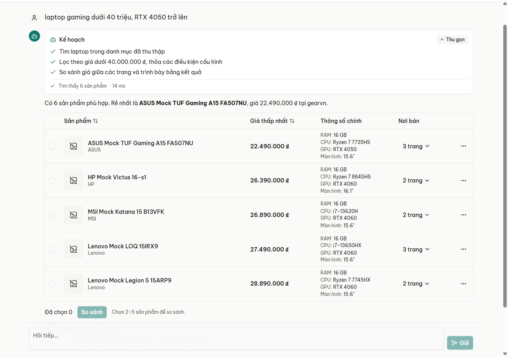
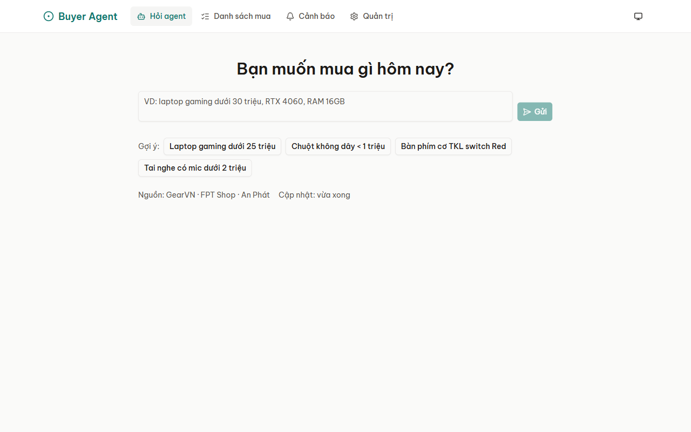
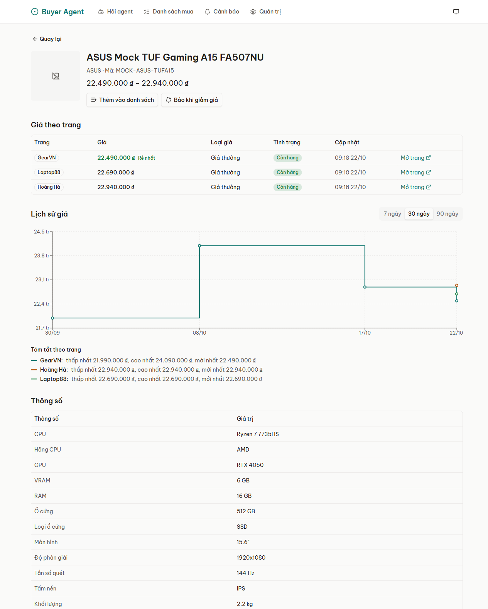
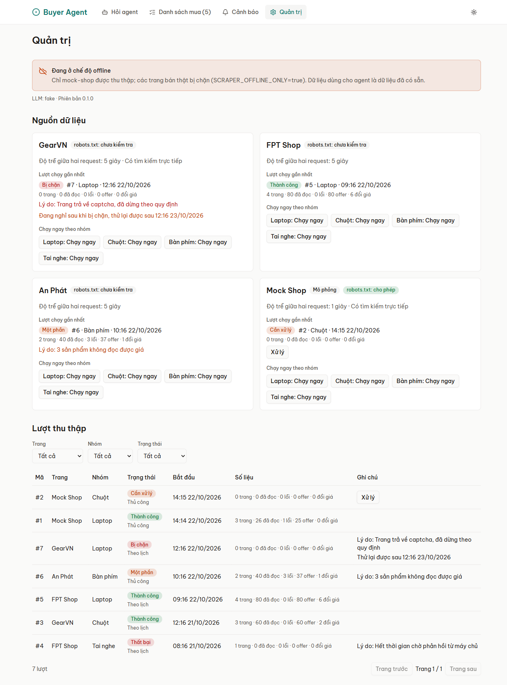
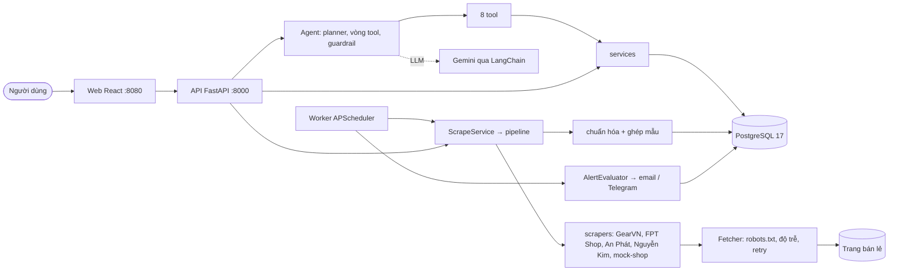

# Product Scraper & Buyer Agent

**Đồ án: Ứng dụng Agentic AI trong Thương mại điện tử.**

Trợ lý mua sắm đồ công nghệ bằng tiếng Việt. Người dùng gõ một yêu cầu như *"laptop gaming dưới 30 triệu, RTX 4060 trở lên"*; agent tự lập kế hoạch, tra cứu dữ liệu đã thu thập từ các trang bán lẻ Việt Nam (GearVN, FPT Shop, An Phát, Nguyễn Kim), rồi trả về bảng so sánh có nguồn. Người dùng có thể lưu sản phẩm vào danh sách mua và đặt cảnh báo khi giá giảm.



## Mục lục
1. [Tóm tắt](#1-tóm-tắt)
2. [Mục tiêu và kết quả](#2-mục-tiêu-và-kết-quả)
3. [Chức năng](#3-chức-năng)
4. [Công nghệ](#4-công-nghệ)
5. [Kiến trúc](#5-kiến-trúc)
6. [Dữ liệu và nguồn](#6-dữ-liệu-và-nguồn)
7. [Quyết định thiết kế chính](#7-quyết-định-thiết-kế-chính)
8. [Kiểm thử và chất lượng](#8-kiểm-thử-và-chất-lượng)
9. [Tuân thủ khi thu thập dữ liệu](#9-tuân-thủ-khi-thu-thập-dữ-liệu)
10. [Cài đặt và chạy](#10-cài-đặt-và-chạy)
11. [Kịch bản demo](#11-kịch-bản-demo)
12. [Cấu trúc thư mục](#12-cấu-trúc-thư-mục)
13. [Hạn chế và hướng phát triển](#13-hạn-chế-và-hướng-phát-triển)

## 1. Tóm tắt
**Bài toán.** Người mua đồ công nghệ ở Việt Nam thường phải mở nhiều trang bán lẻ, tự đọc thông số và tự so giá giữa các trang. Mỗi trang ghi thông số một kiểu, cùng một mẫu máy lại có tên khác nhau.

**Giải pháp.** Hệ thống thu thập trước dữ liệu sản phẩm công khai, chuẩn hóa thông số theo từng nhóm, ghép các tin bán của cùng một mẫu giữa các trang rồi lưu vào PostgreSQL. Agent chỉ trả lời **từ dữ liệu đó** (mô hình "thu thập trước, trả lời sau"): mọi sản phẩm, giá và link trong câu trả lời đều phải có trong kết quả của tool, bảng so sánh dựng từ cơ sở dữ liệu chứ không từ con số do LLM viết ra.

**Kết quả.** Hệ thống chạy trọn vòng *hỏi → kế hoạch → bảng so sánh → danh sách mua → cảnh báo giảm giá*, trên môi trường phát triển lẫn Docker. Trên bộ 34 câu đánh giá với LLM thật: hiểu đúng ý định 100%, kết quả thỏa ràng buộc 100%, **không bịa sản phẩm nào**. Mục tiêu chưa đạt duy nhất là thời gian trả lời (p50 khoảng 18 s so với mục tiêu 15 s).

**Quy mô.**

| Hạng mục | Số lượng |
| --- | --- |
| Trang bán lẻ thật | 4 (cùng một mock-shop nội bộ) |
| Nhóm sản phẩm đầy đủ (tầng 1) | 5: laptop, chuột, bàn phím, tai nghe, điện thoại |
| Tool của agent | 8 |
| Endpoint API | 32 |
| Màn hình web | 6 |
| Bảng dữ liệu / migration | 13 / 6 |
| Test tự động | hơn 10 400 backend, gần 1 200 frontend, 12 E2E |

## 2. Mục tiêu và kết quả
Đo ngày 2026-11-12 với `gemini-3.5-flash-lite` trên 34 câu hỏi mẫu (`docs/eval/queries.yaml`).

| Mã | Mục tiêu | Ngưỡng | Kết quả | Đạt |
| --- | --- | --- | --- | --- |
| G1 | Hiểu đúng yêu cầu (nhóm, khoảng giá, thông số bắt buộc) | ≥ 90% | 100% | ✅ |
| G2 | Sản phẩm trả về thỏa mọi ràng buộc | ≥ 95% | 100% | ✅ |
| G3 | Không bịa sản phẩm, giá, link | 0 | 0 | ✅ |
| G4 | Thời gian trả lời tầng 1 (p50) | ≤ 15 s | ~18 s | ⚠️ ngoại lệ được chấp nhận |
| G5 | Request vi phạm robots.txt hoặc độ trễ tối thiểu | 0 | 0 | ✅ |

G4 chưa đạt vì mỗi câu hỏi cần ít nhất ba lần gọi Gemini (lập kế hoạch, gọi tool, viết câu trả lời), mỗi lần 4–10 s, và gói miễn phí giới hạn số request mỗi phút. Ba câu từng chập chờn (P01, L10, A04) được chạy lặp 10 lần mỗi câu: đạt 30/30.

## 3. Chức năng
- **Hỏi bằng tiếng Việt** (có dấu hoặc không dấu): agent lập kế hoạch, hiện tiến trình theo thời gian thực (SSE) và trả bảng so sánh dựng từ cơ sở dữ liệu; hỏi lại khi yêu cầu quá mơ hồ.
- **Tầng 1** (đầy đủ: lọc theo thông số, so sánh giữa các trang, lịch sử giá): laptop, chuột, bàn phím, tai nghe, điện thoại (ghép theo biến thể dung lượng).
- **Tầng 2** (cơ bản: tên, giá, link, nhãn "chưa chuẩn hóa"): các nhóm khác, tìm trực tiếp trên GearVN và FPT Shop, có cache 6 giờ. Ở chế độ offline chỉ tìm trên mock-shop.
- **Danh sách mua**: thêm từ bảng kết quả, theo dõi giá thay đổi, xuất CSV, chia sẻ bằng link.
- **Cảnh báo giảm giá** qua email hoặc Telegram; worker làm mới giá theo lịch và kiểm tra cảnh báo.
- **Trang quản trị** `/admin`: trạng thái nguồn dữ liệu, chạy thu thập thủ công, xử lý captcha giả lập (human-in-the-loop).
- **Mock-shop** nội bộ mô phỏng phân trang và captcha, dùng cho test và demo an toàn.
- Giao diện sáng/tối, dùng được trên điện thoại.

| Hỏi agent | Chi tiết sản phẩm | Quản trị |
| --- | --- | --- |
|  |  |  |

Toàn bộ 34 ảnh chụp (6 màn hình, sáng/tối, máy tính/điện thoại) ở [docs/ui/screens/](docs/ui/screens/).

## 4. Công nghệ
| Phần | Công nghệ |
| --- | --- |
| Backend | Python 3.11+, uv, FastAPI, SQLModel + Alembic, PostgreSQL 17 (psycopg 3), APScheduler |
| Agent | LangChain + Google Gemini (đổi được provider), LLM giả cho test |
| Thu thập | httpx + selectolax, `Fetcher` riêng (robots.txt, độ trễ, retry) |
| Frontend | React + Vite + TypeScript strict, Tailwind CSS + shadcn/ui, TanStack Query, React Router, Recharts |
| Kiểm thử | pytest, Vitest + MSW, Playwright |
| Triển khai | Docker Compose, GitHub Actions |

## 5. Kiến trúc


**Phụ thuộc một chiều.** Luồng hỏi: `api` → `agent` → `agent/tools` → `services` → `db/repositories`. Luồng thu thập: `services/scrape_service` → `scrapers/pipeline` → `scrapers/sites` + `normalize` → `db/repositories`. Agent không truy cập cơ sở dữ liệu hay web trực tiếp, chỉ gọi tool. Ranh giới giữa các lớp được kiểm bằng test tự động (`test_layer_boundaries.py`).

**Một lượt hỏi.** Planner phân tích câu hỏi thành ý định có cấu trúc (nhóm, khoảng giá, hãng, thông số) → vòng tool gọi `search_catalog` và các tool khác khi cần → guardrail đối chiếu từng sản phẩm, giá, link trong câu trả lời với kết quả tool → bảng kết quả dựng lại từ cơ sở dữ liệu.

## 6. Dữ liệu và nguồn
| Trang | Dùng cho | Cách lấy | Kết quả chạy thật (1 trang/lượt) |
| --- | --- | --- | --- |
| GearVN | Tầng 1 + tầng 2 | Thẻ sản phẩm + JSON-LD trang chi tiết | 4 nhóm, 80/80 mục parse đúng |
| FPT Shop | Tầng 1 + tầng 2, điện thoại | Duyệt qua sitemap, JSON-LD `Product` | Cùng An Phát: 194 offer, 100% parse; điện thoại 20/20 |
| An Phát Computer | Tầng 1 | Danh mục + trang chi tiết | (như trên) |
| Nguyễn Kim | Điện thoại | Dữ liệu `__NEXT_DATA__` | 25/25, không bị chặn |
| Mock-shop | Test, demo, tầng 2 khi offline | Trang giả lập trong repo | – |

Một số trang dự kiến ban đầu đã bị thay: Hoàng Hà Mobile và Laptop88 thay bằng FPT Shop và An Phát; Viettel Store bị bỏ vì có thử thách captcha; tìm trực tiếp trên Viettel Store và Nguyễn Kim cần JavaScript nên tầng 2 chỉ dùng GearVN và FPT Shop.

**Mô hình dữ liệu** (13 bảng): `product` (mẫu chuẩn hóa) ← `offer` (một tin bán ở một trang) ← `price_history`; `scrape_run`; `shopping_list` + `shopping_list_item`; `price_alert`; `conversation`, `message`, `agent_run`; `llm_extraction_cache`, `live_search_cache`; `domain_throttle`. Tiền luôn là số nguyên VND, thời gian lưu theo UTC.

**Chuẩn hóa và ghép mẫu.** Bộ trích xuất theo luật (không đoán) chuyển thông số thô thành khung thông số có kiểu cho từng nhóm. `matcher` ghép các tin bán cùng mẫu giữa các trang bằng mã model và độ tương đồng tên có chốt chặn (màu không phải khác biệt sản phẩm, dung lượng điện thoại thì có). Trường bắt buộc còn thiếu có thể được LLM bổ sung (có cache). Khi đổi luật, `make rematch` ghép lại các offer cũ.

## 7. Quyết định thiết kế chính
| Quyết định | Lý do |
| --- | --- |
| **Thu thập trước, agent trả lời từ cơ sở dữ liệu** | Trả lời nhanh và có nguồn, không gọi trang bán lẻ theo từng câu hỏi; guardrail kiểm được từng sản phẩm, giá, link |
| **Guardrail sau agent** | Chỉ hiển thị thứ có trong kết quả tool; nội dung lấy từ web là dữ liệu, không phải lệnh (chống prompt injection) |
| **Phân tầng nhóm sản phẩm** | Làm sâu vài nhóm thay vì làm nông nhiều nhóm; nhóm khác vẫn tìm được ở mức cơ bản |
| **LangChain + Gemini, đổi được provider** | Không khóa nhà cung cấp; test dùng LLM giả (`ScriptedChatModel`) nên ổn định và không tốn chi phí |
| **PostgreSQL trên Docker, test trên Postgres thật** | JSONB cho thông số, `unaccent` cho tìm không dấu, khóa dòng `SKIP LOCKED` cho cảnh báo |
| **Mock-shop + human-in-the-loop** | Minh họa xử lý captcha mà không bao giờ phải giải captcha thật |
| **Độ trễ domain dùng chung qua PostgreSQL** | API, worker và script cùng tuân thủ ≥ 5 s/domain; không giữ được lượt thì không gửi request (fail-closed) |

## 8. Kiểm thử và chất lượng
| Chỉ số | Giá trị (2026-11-12) |
| --- | --- |
| Backend | 10 455 test pass, 0 `xfail`, coverage 99,23% (ngưỡng bắt buộc 80%) |
| Frontend | 1 193 test Vitest, 12 test E2E Playwright (LLM giả) |
| Eval agent (34 câu, LLM thật) | Ý định 100%, ràng buộc 100%, chọn đúng tool 100%, 0 hallucination; latency p50 ~18 s |

Cách đảm bảo chất lượng:
- **Cổng chất lượng** `make check` (ruff, mypy strict, pytest, eslint, tsc, vitest) phải xanh trước mỗi lần hoàn tất; CI chạy lại trên GitHub Actions, không dùng bí mật.
- **Mỗi bug có test tái hiện** trước khi sửa; bug chưa sửa được giữ bằng `xfail(strict=True)` để báo đỏ ngay khi tự hết.
- **Không gọi mạng trong unit test**: parser là hàm thuần, kiểm bằng fixture HTML lưu sẵn; agent kiểm bằng LLM giả có kịch bản.
- **Mỗi giai đoạn phát triển** đều qua review mã nguồn và một lượt viết test biên (dữ liệu lỗi, rỗng, cực trị, tiếng Việt không dấu, đồng thời).

## 9. Tuân thủ khi thu thập dữ liệu
Dự án chỉ thu thập dữ liệu sản phẩm công khai:
- Tôn trọng robots.txt; độ trễ tối thiểu 5 giây mỗi domain (lấy giá trị lớn hơn nếu robots.txt có `Crawl-delay`).
- User-Agent trung thực, có thông tin liên hệ; không giả trình duyệt, không dùng proxy xoay vòng.
- Không đăng nhập, không chạm giỏ hàng hay thanh toán, không đặt hàng hộ.
- Không vượt captcha: gặp captcha trên trang thật thì dừng, lượt chạy chuyển `BLOCKED`.
- Mọi request đi qua một `Fetcher` duy nhất.
- Mặc định chạy offline (`SCRAPER_OFFLINE_ONLY=true`: chỉ mock-shop và fixture); chạy với trang thật chỉ khi người vận hành tự bật.

## 10. Cài đặt và chạy

### Yêu cầu
- Python 3.11+ và [uv](https://docs.astral.sh/uv/); Node.js 20 LTS+ và npm; Git.
- **Docker Desktop**: PostgreSQL 17 chạy bằng Docker Compose cho phát triển, test và demo.
- Windows: chạy `make` trong Git Bash hoặc WSL2; cài GNU make bằng `winget install ezwinports.make` (bản make của MSYS2 làm mất biến môi trường nên `docker compose` không chạy được).
- API key Gemini (Google AI Studio) để hỏi agent bằng LLM thật và chạy `make eval`. Test không cần key.

### Môi trường phát triển
```bash
cp .env.example .env     # điền GOOGLE_API_KEY, SCRAPER_USER_AGENT (kèm email liên hệ), POSTGRES_PASSWORD…
make setup               # bật DB, cài phụ thuộc, migrate, nạp dữ liệu mẫu
make dev                 # API :8000, frontend :5173, mock-shop :8100
```
Nếu cổng 5432 đã bị chiếm, đặt `POSTGRES_PORT` khác (ví dụ 5435) và sửa cổng trong `DATABASE_URL`, `TEST_DATABASE_URL`, `E2E_DATABASE_URL` cho khớp. Gói Gemini miễn phí giới hạn khoảng 15 request/phút: nên đặt `LLM_MAX_RPM=12`.

### Chạy toàn bộ bằng Docker (không cần cài Python/Node)
```bash
make demo-up             # db, api (tự migrate), worker, mock-shop, web
make demo-seed           # nạp dữ liệu hư cấu (lần đầu)
# giao diện http://localhost:8080 · tài liệu API http://localhost:8000/api/docs
make db-down             # dừng tất cả, giữ dữ liệu
```
Worker mặc định không chạy lịch (`SCHEDULER_ENABLED=false`); đặt `true` trong `.env` rồi `make demo-up` lại để giá được làm mới định kỳ.

### Lệnh thường dùng
| Lệnh | Việc |
| --- | --- |
| `make check` | Cổng chất lượng: ruff, mypy, pytest, eslint, tsc, vitest |
| `make test-be` / `make test-fe` | Test một phía |
| `make e2e` | Playwright E2E với LLM giả (cần cổng 5173/8010/8100 trống) |
| `make eval` | Đánh giá agent với LLM thật (cần `GOOGLE_API_KEY`), báo cáo ở `reports/` |
| `make scrape SITE=mockshop CAT=laptop` | Một lượt thu thập |
| `make rematch [CAT=…] [APPLY=1]` | Ghép lại offer theo luật hiện tại (mặc định chạy thử) |
| `make seed FIXTURE=dev\|eval\|e2e` | Nạp dữ liệu hư cấu |
| `make worker` | Bộ lập lịch (cần `SCHEDULER_ENABLED=true`) |
| `make gen-api` | Sinh kiểu TypeScript từ OpenAPI |
| `make help` | Liệt kê mọi lệnh |

## 11. Kịch bản demo
Chuẩn bị: `make demo-up`, `make demo-seed`, mở http://localhost:8080 (cần `GOOGLE_API_KEY` trong `.env`).

| # | Bước | Cách làm |
| --- | --- | --- |
| 1 | Giới thiệu nguồn dữ liệu | Mở `/admin`: chế độ offline, các nguồn kèm độ trễ và lượt chạy gần nhất |
| 2 | Thu thập + captcha giả lập | `/admin` → "Chạy ngay: Mock Shop – Laptop" → "Xử lý" → nhập mã captcha |
| 3 | Hỏi tầng 1 | "laptop gaming dưới 30 triệu RTX 4060 trở lên": kế hoạch, bảng so sánh, nhiều trang bán cho mỗi máy |
| 4 | So sánh, danh sách mua, cảnh báo | Tick 2 máy → "So sánh"; menu "⋯" → "Thêm vào danh sách" → "Báo khi giảm giá" |
| 5 | Giá giảm → cảnh báo | `make demo-price-drop` → chạy lại "Mock Shop – Laptop" → xem `/alerts` |
| 6 | Tầng 2 | "loa bluetooth dưới 1 triệu": bảng "Tìm trực tiếp – chưa chuẩn hóa thông số" |
| 7 | Kết quả đánh giá | Báo cáo `make eval` trong `reports/` |

Gemini thỉnh thoảng trả lỗi tạm thời (429/503/504): giao diện hiện nút "Hỏi lại", bấm lại là được. Để email cảnh báo được gửi thật cần cấu hình `SMTP_HOST` và `ALERT_EMAIL_FROM`; nếu không, xem kết quả ở trang `/alerts` hoặc `docker compose logs api`.

## 12. Cấu trúc thư mục
```
backend/
  app/
    api/           FastAPI: router, SSE, xử lý lỗi
    agent/         planner, vòng tool, guardrail, prompt, 8 tool
    services/      nghiệp vụ: tìm kiếm, so sánh, danh sách, cảnh báo, thu thập
    scrapers/      Fetcher, scraper từng trang, pipeline thu thập
    normalize/     trích xuất thông số, chuẩn hóa tên, ghép mẫu
    db/            model SQLModel, repository, migration Alembic
    domain/        DTO, enum, lỗi dùng chung
    mock_shop/     trang bán hàng giả lập
  scripts/         seed, scrape, eval, rematch, demo
  tests/           unit, integration, agent, api (fixture HTML, golden YAML)
frontend/
  src/             React: features/ (chat, results, catalog, lists, alerts, admin)
  e2e/             Playwright
docs/
  eval/            bộ câu hỏi đánh giá agent
  ui/screens/      ảnh chụp giao diện
docker/, docker-compose.yml   PostgreSQL (dev/test) và cả hệ thống (demo)
.github/workflows/            CI
reports/                      báo cáo eval (không đưa vào git)
```

## 13. Hạn chế và hướng phát triển
**Hạn chế**
- **Độ trễ trả lời** p50 khoảng 18 s, chủ yếu do nhiều lượt gọi Gemini cho mỗi câu (G4).
- **Một người dùng, chạy cục bộ**: chưa có đăng nhập, phân quyền hay nhiều người dùng.
- **Ghép mẫu** dựa trên luật và độ tương đồng tên nên vẫn có thể ghép sai hoặc bỏ sót với tên sản phẩm lạ.
- **Trang cần JavaScript** không thu thập được vì dự án không chạy trình duyệt headless.
- **Giới hạn gói miễn phí Gemini** (khoảng 15 request/phút) và lỗi tạm thời 503/504 từ phía Gemini.

**Hướng phát triển**
- Gom khác biệt theo nhóm sản phẩm vào một cấu hình đăng ký một lần (`CategoryProfile`) để thêm nhóm mới mà không phải sửa nhiều lớp.
- Giảm số lượt gọi LLM khi kết quả tìm kiếm ít, hướng tới p50 ≤ 15 s.
- Thêm nhóm sản phẩm và trang bán lẻ; hỗ trợ nhiều người dùng.
