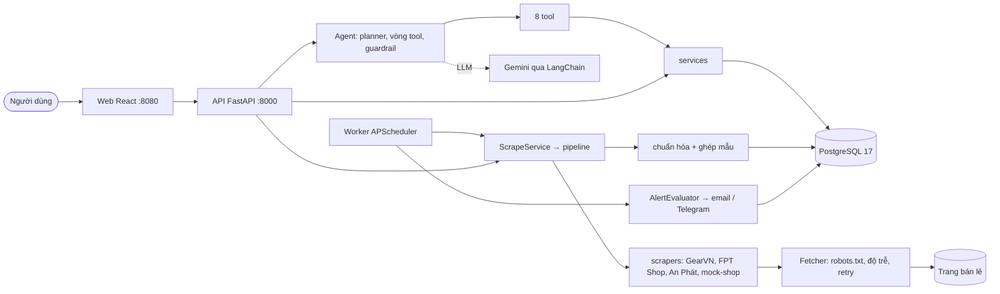

# Product Scraper & Buyer Agent

Đồ án: **Ứng dụng Agentic AI trong Thương mại điện tử.** Một AI agent nhận yêu cầu mua sắm đồ công nghệ bằng tiếng Việt (ví dụ "laptop gaming dưới 30 triệu, RTX 4060 trở lên"), tự lập kế hoạch, lấy dữ liệu đã thu thập từ GearVN, FPT Shop, An Phát, trả bảng so sánh có nguồn, hỗ trợ danh sách mua và cảnh báo giảm giá.

> Trạng thái: M0–M11 hoàn tất, đủ để demo và bảo vệ; còn một số mục backlog nhỏ (xem [§9](#9-hạn-chế-đã-biết-và-hướng-phát-triển)). Tiến độ chi tiết: [docs/PROGRESS.md](docs/PROGRESS.md).

## Mục lục
1. [Tóm tắt](#1-tóm-tắt)
2. [Mục tiêu và kết quả](#2-mục-tiêu-và-kết-quả)
3. [Chức năng](#3-chức-năng)
4. [Kiến trúc](#4-kiến-trúc)
5. [Dữ liệu và nguồn](#5-dữ-liệu-và-nguồn)
6. [Quyết định thiết kế chính](#6-quyết-định-thiết-kế-chính)
7. [Chất lượng đã đo](#7-chất-lượng-đã-đo)
8. [Tuân thủ khi thu thập dữ liệu](#8-tuân-thủ-khi-thu-thập-dữ-liệu)
9. [Hạn chế đã biết và hướng phát triển](#9-hạn-chế-đã-biết-và-hướng-phát-triển)
10. [Chạy thử](#10-chạy-thử)
11. [Cấu trúc thư mục](#11-cấu-trúc-thư-mục)
12. [Làm việc với Claude Code](#12-làm-việc-với-claude-code)

## 1. Tóm tắt
**Bài toán.** Người mua đồ công nghệ ở Việt Nam phải mở nhiều trang bán lẻ, tự đọc thông số và tự so giá giữa các trang.

**Giải pháp.** Hệ thống thu thập sẵn dữ liệu công khai từ ba trang bán lẻ, chuẩn hóa thông số, ghép cùng một mẫu sản phẩm giữa các trang rồi lưu vào PostgreSQL. Agent chỉ trả lời **từ dữ liệu đó** ("thu thập trước, trả lời sau", [ADR-0003](docs/adr/0003-collect-first-pipeline.md)): mọi sản phẩm, giá và link trong câu trả lời phải có trong kết quả của tool, bảng so sánh dựng từ cơ sở dữ liệu chứ không từ số do LLM viết.

**Kết quả.** Hệ thống chạy trọn vòng hỏi → kế hoạch → bảng so sánh → danh sách mua → cảnh báo giảm giá, trên web và trên Docker. Trên bộ 31 câu eval với LLM thật: hiểu đúng ý định ≥ 96%, kết quả đúng ràng buộc ≥ 98%, **0 sản phẩm bịa**. Một mục tiêu chưa đạt: thời gian trả lời (p50 26–31 s so với mục tiêu 15 s), người dùng đã chấp nhận ngoại lệ ([§2](#2-mục-tiêu-và-kết-quả)).

**Quy mô.** 3 trang bán lẻ thật và một mock-shop; 4 nhóm sản phẩm đầy đủ và nhóm khác tìm trực tiếp; 8 tool cho agent; 31 endpoint API; 6 màn hình web; 13 bảng dữ liệu; hơn 8000 test backend và 1000 test frontend.

## 2. Mục tiêu và kết quả
Mục tiêu đo được nằm ở [docs/01-requirements.md](docs/01-requirements.md#1-bối-cảnh-và-mục-tiêu); kết quả đo cuối cùng (2026-10-23, `gemini-3.5-flash-lite`, 31 câu):

| Mã | Mục tiêu | Ngưỡng | Kết quả | Đạt |
| --- | --- | --- | --- | --- |
| G1 | Hiểu đúng yêu cầu (nhóm, khoảng giá, thông số bắt buộc) | ≥ 90% | 96,4% | ✅ |
| G2 | Sản phẩm trả về thỏa mọi ràng buộc | ≥ 95% | 98,6% | ✅ |
| G3 | Không bịa sản phẩm, giá, link | 0 | 0 | ✅ |
| G4 | Thời gian trả lời tầng 1 (p50) | ≤ 15 s | 26–31 s | ⚠️ ngoại lệ được chấp nhận (T11.5) |
| G5 | Request vi phạm robots.txt hoặc độ trễ tối thiểu | 0 | 0 (kiểm bằng test và `Fetcher` duy nhất) | ✅ |

G4 chưa đạt vì mỗi câu cần từ 3 lần gọi Gemini, mỗi lần 4–10 s; tăng giới hạn `LLM_MAX_RPM` không cải thiện. Báo cáo gốc: `reports/eval-2026-10-23*.md` (không đưa vào git).

## 3. Chức năng
- **Hỏi bằng tiếng Việt**: agent lập kế hoạch, hiện tiến trình theo thời gian thực (SSE), trả bảng so sánh dựng từ cơ sở dữ liệu; hỏi lại khi câu quá mơ hồ.
- **Tầng 1** (đầy đủ: lọc theo thông số, so sánh giữa trang, lịch sử giá): laptop, chuột, bàn phím, tai nghe.
- **Tầng 2** (cơ bản: tên, giá, link, nhãn "chưa chuẩn hóa"): nhóm khác, tìm trực tiếp trên GearVN và FPT Shop (cache 6 giờ). Khi chạy offline chỉ tìm trên mock-shop.
- **Danh sách mua** và **cảnh báo giảm giá** (email/Telegram); worker làm mới giá theo lịch và kiểm tra cảnh báo.
- **Trang quản trị** `/admin`: nguồn dữ liệu, lượt thu thập, xử lý captcha giả lập (human-in-the-loop).
- **Mock-shop** nội bộ minh họa phân trang và captcha giả lập, dùng cho test và demo an toàn.

Sáu màn hình web: Hỏi agent, Hội thoại (kết quả), Chi tiết sản phẩm (lịch sử giá), Danh sách mua, Cảnh báo, Quản trị. Ảnh chụp: [docs/ui/](docs/ui/README.md).

## 4. Kiến trúc


Phụ thuộc một chiều: `api` → `agent` → `agent/tools` → `services` → `db/repositories`; thu thập đi `services/scrape_service` → `scrapers/pipeline` → `scrapers/sites` + `normalize` → `db/repositories`. Ranh giới này được kiểm bằng test tự động (`test_layer_boundaries.py`). Sơ đồ chi tiết, luồng "người dùng hỏi" và "thu thập định kỳ": [docs/03-architecture.md](docs/03-architecture.md).

## 5. Dữ liệu và nguồn
| Trang | Dùng cho | Cách lấy | Kết quả chạy thật (PAGES=1, có sự cho phép của người dùng) |
| --- | --- | --- | --- |
| GearVN | Tầng 1 + tầng 2 | Danh sách thẻ sản phẩm + JSON-LD chi tiết | 4 nhóm, 80/80 mục parse đúng |
| FPT Shop | Tầng 1 + tầng 2 | Duyệt qua sitemap, JSON-LD `Product` | cùng An Phát: 8 lượt, 194 offer, 100% parse |
| An Phát Computer | Tầng 1 | Danh mục + trang chi tiết | (như trên) |
| Mock-shop | Test, demo, tầng 2 khi offline | Trang giả lập trong repo | – |

Hoàng Hà Mobile và Laptop88 bị thay bằng FPT Shop và An Phát ([ADR-0008](docs/adr/0008-fptshop-anphat-replace-hoangha-laptop88.md)); Viettel Store và Nguyễn Kim bị bỏ khỏi tầng 2 vì tìm kiếm cần JavaScript ([ADR-0010](docs/adr/0010-tier2-sites-gearvn-fptshop.md)).

**Mô hình dữ liệu** (13 bảng, 5 migration Alembic, [docs/04-data-model.md](docs/04-data-model.md)): `product` (mẫu chuẩn hóa) ← `offer` (một dòng bán ở một trang) ← `price_history`; `scrape_run`; `shopping_list` + `shopping_list_item`; `price_alert`; `conversation`, `message`, `agent_run`; `llm_extraction_cache`, `live_search_cache`; `domain_throttle`. Tiền luôn là số nguyên VND, thời gian lưu UTC.

**Chuẩn hóa và ghép mẫu.** Bộ trích xuất theo luật (không đoán) chuyển thông số thô thành khung thông số có kiểu cho từng nhóm; `matcher` ghép các offer cùng mẫu giữa các trang bằng mã model và độ tương đồng tên có chốt chặn; trường còn thiếu có thể được bổ sung bằng LLM (có cache).

## 6. Quyết định thiết kế chính
Mười ADR trong [docs/adr/](docs/adr/README.md). Những quyết định ảnh hưởng nhất:

| Quyết định | Lý do |
| --- | --- |
| **Thu thập trước, agent trả lời từ DB** ([0003](docs/adr/0003-collect-first-pipeline.md)) | Trả lời nhanh, có nguồn, không gọi trang bán lẻ theo từng câu hỏi; guardrail kiểm được từng sản phẩm, giá, link |
| **Guardrail sau agent** | Chỉ hiển thị thứ có trong kết quả tool; bảng dựng từ DB; nội dung từ web là dữ liệu, không phải lệnh |
| **Phân tầng nhóm sản phẩm** ([0005](docs/adr/0005-tiered-categories.md)) | Làm sâu 4 nhóm thay vì làm nông nhiều nhóm; nhóm khác vẫn tìm được ở mức cơ bản |
| **LangChain + Gemini, đổi được provider** ([0001](docs/adr/0001-gemini-langchain.md)) | Không khóa nhà cung cấp; test dùng LLM giả (`ScriptedChatModel`) nên không tốn tiền và ổn định |
| **PostgreSQL trên Docker, test trên Postgres thật** ([0007](docs/adr/0007-postgresql.md)) | JSONB cho thông số, khóa dòng `SKIP LOCKED` cho cảnh báo, giống môi trường chạy thật |
| **Mock-shop + human-in-the-loop** ([0006](docs/adr/0006-mock-shop-hitl.md)) | Minh họa xử lý captcha mà không bao giờ phải giải captcha thật |
| **Độ trễ domain dùng chung qua PostgreSQL** (T9.8) | `api`, `worker` và script cùng tuân thủ ≥ 5 s/domain; không đặt được khe thì không gửi request (fail-closed) |

## 7. Chất lượng đã đo
| Chỉ số | Giá trị |
| --- | --- |
| Backend | 8375 test pass (+ 4 `xfail` đã biết), coverage 99,16%, ngưỡng cổng 80% |
| Frontend | 1072 test Vitest, 10 test E2E Playwright (LLM giả) |
| Eval agent (31 câu, `gemini-3.5-flash-lite`, 2026-10-23) | intent 96,4%, ràng buộc 98,6%, 0 hallucination, hỏi lại 100%, chọn đúng tool 96,4%; latency p50 26–31 s (chưa đạt 15 s, T11.5) |

Cách đảm bảo: `make check` (ruff, mypy strict, pytest, eslint, tsc, vitest) là cổng bắt buộc; mỗi bug có test tái hiện trước khi sửa, bug chưa có quyết định thiết kế được giữ bằng `xfail(strict=True)`; mỗi milestone qua `code-reviewer` và (trừ một số lượt) `qa-tester`; unit test không bao giờ gọi mạng (parser là hàm thuần, test bằng fixture HTML). Chi tiết: [docs/09-testing-strategy.md](docs/09-testing-strategy.md), [docs/PROGRESS.md](docs/PROGRESS.md), [docs/05-agent-design.md](docs/05-agent-design.md#7-đánh-giá-agent-eval).

## 8. Tuân thủ khi thu thập dữ liệu
Dự án chỉ thu thập dữ liệu sản phẩm công khai: tôn trọng robots.txt, độ trễ ≥ 5 giây mỗi domain (lớn hơn nếu robots.txt có `Crawl-delay`), User-Agent trung thực, không đăng nhập, không đặt hàng hộ, không vượt captcha thật (gặp captcha trên trang thật thì dừng, lượt chạy chuyển `BLOCKED`). Mọi request đều đi qua một `Fetcher` duy nhất. Mặc định chạy offline (`SCRAPER_OFFLINE_ONLY=true`: mock-shop + fixture); chạy với trang thật chỉ khi người dùng tự bật. Điều khoản sử dụng của từng trang đã được đọc và duyệt ở T0.4 (xem [docs/sources/](docs/sources/)). Chi tiết: [docs/02-scope-and-sources.md](docs/02-scope-and-sources.md).

## 9. Hạn chế đã biết và hướng phát triển
**Hạn chế**
- **Độ trễ trả lời** p50 26–31 s do cần nhiều lượt gọi Gemini cho mỗi câu (G4).
- **Một người dùng, chạy cục bộ**: không có đăng nhập, phân quyền hay nhiều người dùng.
- **Ghép mẫu** theo luật và độ tương đồng tên nên có thể ghép sai hoặc bỏ sót với tên sản phẩm lạ; offer đã ghép chưa tự được ghép lại khi luật đổi (T5.4, đang làm).
- **Tìm kiếm không dấu** (ví dụ "chuot khong day") chưa tìm được "Chuột không dây" (BUG-M7-3, cần thêm cột tên đã bỏ dấu).
- **Màu switch bàn phím**: hai tên như "Black Switch Red" và "Black Switch Blue" đang cùng một khóa ghép (BUG-S2-5, cần quyết định thiết kế).
- **Trang cần JavaScript** (Viettel Store, Nguyễn Kim) không thu thập được vì dự án không chạy trình duyệt headless.
- **Giới hạn gói miễn phí Gemini** (khoảng 15 request/phút, đặt `LLM_MAX_RPM=12`).

**Hướng phát triển**: ghép lại offer khi luật đổi (T5.4); đo lại eval tầng 2 với LLM thật (T6.7); sửa 4 điểm nhỏ trên giao diện (T8.12); tìm kiếm không dấu (T7.7); mở rộng nhóm điện thoại (pha X1). Danh sách đầy đủ: [docs/11-roadmap-backlog.md](docs/11-roadmap-backlog.md).

## 10. Chạy thử

### Yêu cầu máy
- Python 3.11+ và [uv](https://docs.astral.sh/uv/); Node.js 20 LTS+ và npm; Git.
- **Docker Desktop** (bắt buộc): PostgreSQL 17 chạy bằng Docker Compose cho dev, test và demo ([ADR-0007](docs/adr/0007-postgresql.md)).
- Windows: dùng Git Bash hoặc WSL2 để chạy `make`; cài GNU make bằng `winget install ezwinports.make` (bản make của MSYS2 làm mất biến môi trường nên `docker compose` không chạy được).
- API key Gemini (Google AI Studio) cho `make eval` và hỏi agent bằng LLM thật. Test không cần key.

### Phát triển
```bash
cp .env.example .env     # điền GOOGLE_API_KEY, ALERT_DEFAULT_EMAIL, SCRAPER_USER_AGENT (email liên hệ), POSTGRES_PASSWORD…
make setup               # bật DB, cài phụ thuộc, migrate, seed dev
make dev                 # API :8000, frontend :5173, mock-shop :8100
```
Nếu cổng 5432 đã bị chiếm, đặt `POSTGRES_PORT` khác (ví dụ 5435) và sửa cổng trong `DATABASE_URL` / `TEST_DATABASE_URL` / `E2E_DATABASE_URL` cho khớp.

### Demo trong Docker (không cần cài Python/Node)
```bash
make demo-up             # db, api (tự migrate), worker, mock-shop, web
make demo-seed           # nạp dữ liệu hư cấu (lần đầu)
make demo-price-drop     # (bước 5 của demo) nâng giá một offer mock-shop + tạo cảnh báo
# giao diện http://localhost:8080 · API http://localhost:8000/api/docs
make db-down             # dừng tất cả, giữ dữ liệu
```
Worker mặc định không chạy lịch (`SCHEDULER_ENABLED=false`); đặt `true` trong `.env` rồi `make demo-up` lại để giá được làm mới theo lịch. Kịch bản trình diễn 7 bước: [docs/10-deployment.md](docs/10-deployment.md#7-kịch-bản-demo-bảo-vệ).

### Lệnh thường dùng
| Lệnh | Việc |
| --- | --- |
| `make check` | Cổng chất lượng: ruff, mypy, pytest, eslint, tsc, vitest |
| `make e2e` | Playwright E2E (LLM giả; cần cổng 5173/8010/8100 trống, tắt demo Docker trước) |
| `make eval` | Đánh giá agent với LLM thật (cần `GOOGLE_API_KEY`), báo cáo ở `reports/` |
| `make scrape SITE=mockshop CAT=laptop` | Một lượt thu thập |
| `make seed FIXTURE=dev\|eval\|e2e` | Nạp dữ liệu hư cấu |
| `make worker` | Bộ lập lịch (cần `SCHEDULER_ENABLED=true`) |
| `make gen-api` | Sinh kiểu TypeScript từ OpenAPI |
| `make help` | Liệt kê mọi lệnh |

## 11. Cấu trúc thư mục
```
CLAUDE.md                bộ nhớ dự án cho Claude Code
.claude/                 settings, hooks, rules, skills, agents
.mcp.json                MCP servers (Playwright, Context7)
.env.example             biến môi trường
docker-compose.yml       db (dev/test) và cả hệ thống (demo)
backend/                 FastAPI, agent, scrapers, normalize, services, db, mock_shop, scripts, tests
frontend/                React + Vite, Playwright e2e
docs/                    01–11 đặc tả, ADR, eval, nguồn, ảnh UI, PROGRESS
reports/                 báo cáo eval (không đưa vào git)
```
Sơ đồ chi tiết: [docs/03-architecture.md](docs/03-architecture.md#6-cấu-trúc-thư-mục-theo-code-sau-m10). Mục lục toàn bộ tài liệu và bảng truy vết yêu cầu → thiết kế → task: [docs/README.md](docs/README.md).

## 12. Làm việc với Claude Code
Dự án được xây theo milestone bằng Claude Code. Quy trình và quy tắc bắt buộc nằm ở [CLAUDE.md](CLAUDE.md); backlog ở [docs/11-roadmap-backlog.md](docs/11-roadmap-backlog.md).

| Thành phần | Vị trí | Vai trò |
| --- | --- | --- |
| Bộ nhớ dự án | `CLAUDE.md` | Tổng quan, lệnh, quy trình, quy tắc; tự nạp `docs/PROGRESS.md` |
| Quy tắc theo thư mục | `.claude/rules/*.md` | Tự nạp khi làm với file backend, frontend, scraping, test |
| Skill quy trình | `.claude/skills/{next,plan-task,check,review,done,eval}` | Gọi bằng `/tên` |
| Skill kiến thức | `.claude/skills/{add-scraper,add-category,agent-tool,ui-screen,write-tests}` | Claude tự dùng khi phù hợp |
| Subagent | `.claude/agents/{code-reviewer,qa-tester}.md` | Review diff; viết test biên cuối milestone |
| Hook / quyền | `.claude/hooks/*.py`, `.claude/settings.json` | Chặn lệnh nguy hiểm, bảo vệ `.env` và ADR, tự format |
| MCP | `.mcp.json` | Playwright (khảo sát trang, chụp UI), Context7 (tài liệu thư viện) |

Claude Code đọc `CONTEXT7_API_KEY` từ **biến môi trường shell**, không từ `.env`. Vòng lặp mỗi milestone: `/next` → Plan mode → `/plan-task` → code + test → `/check` → `/review` → `qa-tester` → `/done`.
