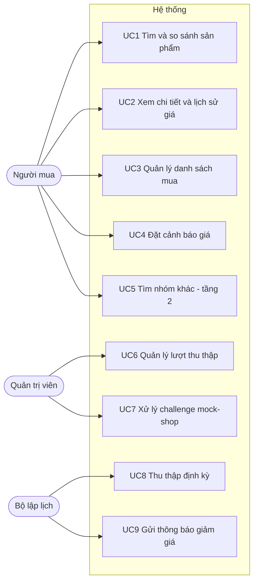

# 01. Phân tích yêu cầu (SRS)

> Phiên bản 1.0 · 2026-10-16 · Trạng thái: Đã chốt phạm vi
> Liên quan: [02 Phạm vi & nguồn](02-scope-and-sources.md) · [11 Backlog](11-roadmap-backlog.md)

## 1. Bối cảnh và mục tiêu

Người mua đồ công nghệ ở Việt Nam thường phải mở nhiều trang bán lẻ, tự đọc thông số và tự so giá. Đề tài xây dựng một **AI agent** nhận yêu cầu bằng tiếng Việt tự nhiên, tự lập kế hoạch, thu thập và chuẩn hóa dữ liệu từ nhiều trang bán lẻ, rồi trả về **bảng so sánh có nguồn** và hỗ trợ **danh sách mua** cùng **cảnh báo giảm giá**.

Mục tiêu đo được:

| Mã | Mục tiêu | Chỉ số | Ngưỡng |
| --- | --- | --- | --- |
| G1 | Hiểu đúng yêu cầu | Tỷ lệ trích đúng ý định (nhóm, khoảng giá, thông số bắt buộc) trên bộ eval | ≥ 90% |
| G2 | Kết quả đúng ràng buộc | Tỷ lệ sản phẩm trả về thỏa mọi ràng buộc người dùng nêu | ≥ 95% |
| G3 | Không bịa | Sản phẩm/giá/link không có trong dữ liệu | 0 |
| G4 | Nhanh | Thời gian trả lời câu hỏi tầng 1 (p50) | ≤ 15 giây |
| G5 | Lịch sự với nguồn | Request vi phạm robots.txt hoặc độ trễ tối thiểu | 0 |

## 2. Phạm vi

### 2.1 Trong phạm vi

- **Tầng 1 (hỗ trợ đầy đủ):** laptop (trọng tâm laptop gaming), chuột, bàn phím, tai nghe. Có chuẩn hóa thông số, lọc theo thông số, so sánh, ghép cùng mẫu giữa các trang, lịch sử giá.
- **Tầng 2 (nhóm khác, hỗ trợ cơ bản):** tìm trực tiếp trên các trang cho phép tìm kiếm; trả tên, giá, link; gắn nhãn "chưa chuẩn hóa thông số"; không lọc theo thông số.
- **Trang nguồn lõi:** GearVN, FPT Shop, An Phát Computer (thay Hoàng Hà Mobile và Laptop88 từ ADR-0008). Trang dùng cho tầng 2: GearVN, Viettel Store, Nguyễn Kim (và mock-shop khi dev/demo ở chế độ offline). Chi tiết và lý do ở [02](02-scope-and-sources.md).
- **Mock-shop:** trang giả lập nội bộ có phân trang và captcha giả để kiểm thử và trình diễn xử lý tình huống phức tạp.
- Danh sách mua, cảnh báo giá qua email/Telegram, lịch thu thập định kỳ.
- Ứng dụng web (React) + API (FastAPI), chạy cục bộ hoặc bằng Docker Compose.

### 2.2 Ngoài phạm vi

- Đăng nhập vào sàn, thêm vào giỏ hàng, đặt hàng hay thanh toán hộ người dùng.
- Vượt captcha thật, dùng proxy xoay vòng, giả mạo User-Agent trình duyệt hay bot của công cụ tìm kiếm.
- Shopee, Tiki, Lazada, Phong Vũ, Thành Nhân, XGear, Sendo (lý do ở [02](02-scope-and-sources.md)).
- Nhiều người dùng, đăng nhập, phân quyền (bản này là ứng dụng một người dùng chạy cục bộ).
- Ứng dụng di động gốc (giao diện web có responsive cho điện thoại).
- **Pha mở rộng (chỉ làm nếu còn thời gian):** điện thoại (FPT Shop, Viettel Store, Nguyễn Kim).

## 3. Tác nhân (actor)

| Tác nhân | Mô tả |
| --- | --- |
| Người mua | Người dùng cuối, nhập yêu cầu, xem so sánh, quản lý danh sách mua và cảnh báo |
| Quản trị viên | Chính người dùng ở vai trò vận hành: xem trạng thái nguồn, chạy thu thập, xử lý challenge của mock-shop |
| Bộ lập lịch | Thành phần hệ thống chạy thu thập và kiểm tra cảnh báo định kỳ |
| Trang bán lẻ | Hệ thống bên ngoài cung cấp trang sản phẩm công khai |
| Dịch vụ LLM | Gemini (mặc định) hoặc OpenAI |
| Kênh thông báo | SMTP email, Telegram Bot API |

## 4. Use case

### UC1. Tìm và so sánh sản phẩm (luồng chính của đề tài)

- **Tiền điều kiện:** đã có dữ liệu thu thập cho nhóm sản phẩm (tầng 1).
- **Luồng chính:**
  1. Người mua nhập: "Tìm laptop gaming dưới 30 triệu, card RTX 4060 trở lên, RAM 16GB".
  2. Agent **lập kế hoạch**: phân tích thành ý định có cấu trúc (nhóm = laptop, giá ≤ 30.000.000, GPU ≥ RTX 4060, RAM ≥ 16) và hiển thị kế hoạch các bước.
  3. Agent **thực thi**: gọi tool tìm trong danh mục đã thu thập, lọc, xếp hạng.
  4. Agent **tổng hợp**: bảng so sánh (tên, giá theo từng trang, thông số chính, link, thời điểm cập nhật giá) và nhận xét ngắn.
  5. Người mua có thể yêu cầu tiếp: "so sánh 2 máy đầu", "thêm máy thứ 2 vào danh sách mua", "báo tôi khi máy này dưới 28 triệu".
- **Luồng thay thế:**
  - A1 Yêu cầu mơ hồ (thiếu nhóm sản phẩm): agent hỏi lại một câu ngắn.
  - A2 Không có kết quả: agent nói rõ ràng buộc nào làm rỗng kết quả và gợi ý nới lỏng.
  - A3 Nhóm không thuộc tầng 1: chuyển sang UC5.
  - A4 Dữ liệu cũ hơn ngưỡng (mặc định 24 giờ): vẫn trả kết quả, gắn cảnh báo "giá cập nhật lúc …".
- **Hậu điều kiện:** cuộc trò chuyện và kết quả được lưu để thao tác tiếp.

### UC2. Xem chi tiết và lịch sử giá
Hiển thị thông số chuẩn hóa, giá ở từng trang, biểu đồ lịch sử giá, link gốc.

### UC3. Quản lý danh sách mua
Tạo danh sách, thêm/xóa sản phẩm (từ giao diện hoặc qua agent), ghi chú, xem tổng tiền theo giá thấp nhất hiện tại. Danh sách lưu trong cơ sở dữ liệu của hệ thống, **không** liên quan đến giỏ hàng của trang bán.

### UC4. Đặt cảnh báo giá
Chọn sản phẩm, ngưỡng giá, kênh (email/Telegram). Hệ thống kiểm tra sau mỗi lượt làm mới giá; gửi một lần khi giá xuống dưới ngưỡng, không gửi lặp cho cùng mức giá.

### UC5. Tìm nhóm khác (tầng 2)
Agent nhận ra nhóm chưa hỗ trợ (ví dụ "loa bluetooth"), gọi tìm kiếm trực tiếp trên các trang cho phép, lấy tối đa N kết quả mỗi trang, trả bảng tên/giá/link với nhãn "chưa chuẩn hóa thông số". Kết quả được cache.

### UC6. Quản lý lượt thu thập
Xem danh sách nguồn (trạng thái robots.txt, độ trễ áp dụng, lần chạy gần nhất), chạy thu thập thủ công cho một (trang, nhóm), xem nhật ký lượt chạy.

### UC7. Xử lý challenge mock-shop (human-in-the-loop)
Khi mock-shop trả trang captcha, lượt thu thập chuyển sang trạng thái `NEEDS_HUMAN`. Giao diện hiện challenge; người dùng nhập mã; hệ thống gửi mã và tiếp tục. **Với trang thật, gặp captcha thì dừng và đánh dấu `BLOCKED`, không bao giờ tự giải.**

### UC8, UC9. Thu thập định kỳ và gửi thông báo
Bộ lập lịch làm mới danh mục theo cron, làm mới riêng các sản phẩm đang được theo dõi thường xuyên hơn, sau đó đánh giá cảnh báo.

## 5. User story và tiêu chí chấp nhận

Định dạng: *Là [vai trò], tôi muốn [mục tiêu] để [lợi ích].* Tiêu chí viết theo Given/When/Then để chuyển thẳng thành test.

| ID | Story | Ưu tiên |
| --- | --- | --- |
| US-01 | Là người mua, tôi muốn gõ yêu cầu bằng tiếng Việt tự nhiên để không phải dùng bộ lọc phức tạp | Must |
| US-02 | Là người mua, tôi muốn thấy kế hoạch agent sẽ làm để tin vào kết quả | Must |
| US-03 | Là người mua, tôi muốn bảng so sánh giá giữa các trang kèm link và thời điểm cập nhật | Must |
| US-04 | Là người mua, tôi muốn sắp xếp và chọn vài sản phẩm để so sánh chi tiết | Must |
| US-05 | Là người mua, tôi muốn xem lịch sử giá của một sản phẩm | Should |
| US-06 | Là người mua, tôi muốn lưu sản phẩm vào danh sách mua | Must |
| US-07 | Là người mua, tôi muốn được báo khi giá giảm dưới mức tôi đặt | Must |
| US-08 | Là người mua, tôi muốn tìm cả những loại sản phẩm khác ở mức cơ bản | Should |
| US-09 | Là quản trị viên, tôi muốn xem nguồn nào đang hoạt động, bị chặn hay lỗi | Must |
| US-10 | Là quản trị viên, tôi muốn xử lý captcha của mock-shop để lượt thu thập tiếp tục | Must |
| US-11 | Là người mua, tôi muốn agent hỏi lại khi yêu cầu chưa rõ thay vì đoán | Should |
| US-12 | Là người mua, tôi muốn giao diện dùng tốt trên điện thoại | Could |

Tiêu chí chấp nhận (mẫu, đầy đủ trong từng task của [11](11-roadmap-backlog.md)):

- **US-01/03:** *Given* danh mục có ≥ 5 laptop RTX 4060 dưới 30 triệu, *When* gửi "laptop gaming dưới 30 triệu RTX 4060", *Then* kết quả chỉ chứa laptop có GPU ≥ RTX 4060 và giá thấp nhất ≤ 30.000.000 ₫, mỗi dòng có ≥ 1 link nguồn và thời điểm cập nhật.
- **US-02:** *Given* một yêu cầu hợp lệ, *When* agent chạy, *Then* sự kiện `plan` được phát trước mọi sự kiện `tool_start` và hiển thị trên giao diện trong ≤ 5 giây.
- **US-07:** *Given* cảnh báo ngưỡng 28.000.000 ₫, *When* lượt làm mới ghi giá 27.490.000 ₫, *Then* gửi đúng 1 thông báo; lượt sau giá không đổi thì không gửi lại.
- **US-10:** *Given* mock-shop trả challenge, *When* người dùng nhập đúng mã, *Then* lượt chạy chuyển từ `NEEDS_HUMAN` sang `RUNNING` và hoàn tất; nhập sai thì giữ `NEEDS_HUMAN` kèm thông báo lỗi.
- **US-11:** *Given* "tìm cái nào rẻ rẻ", *When* agent chạy, *Then* agent trả câu hỏi làm rõ, không gọi tool tìm kiếm.

## 6. Yêu cầu chức năng (FR)

| ID | Yêu cầu | Truy vết |
| --- | --- | --- |
| FR-01 | Hệ thống nhận yêu cầu văn bản tiếng Việt (có/không dấu) và tiếng Anh | US-01 |
| FR-02 | Agent sinh ý định có cấu trúc `QueryIntent` và kế hoạch các bước trước khi thực thi | US-02 |
| FR-03 | Agent chỉ dùng các tool đã đăng ký; tối đa `AGENT_MAX_STEPS` lần gọi tool mỗi yêu cầu | US-01 |
| FR-04 | Kết quả gồm bảng có cấu trúc (JSON) và tóm tắt văn bản; mỗi giá kèm nguồn và `scraped_at` | US-03 |
| FR-05 | Lọc theo giá, hãng, trang, và thông số theo khung của từng nhóm | US-01 |
| FR-06 | Ghép cùng một mẫu giữa các trang theo `model_code`; hiển thị giá thấp nhất và giá từng trang | US-03 |
| FR-07 | Lưu lịch sử giá mỗi lần một offer được thu thập | US-05 |
| FR-08 | CRUD danh sách mua và mục trong danh sách | US-06 |
| FR-09 | CRUD cảnh báo giá; đánh giá sau mỗi lượt làm mới; chống gửi trùng | US-07 |
| FR-10 | Tìm kiếm tầng 2 trực tiếp, có cache, gắn nhãn chưa chuẩn hóa | US-08 |
| FR-11 | Kiểm tra robots.txt trước mọi request; tôn trọng Crawl-delay và độ trễ tối thiểu | G5 |
| FR-12 | Phát hiện captcha/chặn; mock-shop chuyển `NEEDS_HUMAN`, trang thật chuyển `BLOCKED` | US-10 |
| FR-13 | Xử lý phân trang danh sách đến khi hết trang hoặc chạm giới hạn cấu hình | UC8 |
| FR-14 | Trang quản trị hiển thị nguồn, lượt chạy, lỗi | US-09 |
| FR-15 | Agent hỏi lại khi thiếu thông tin cốt lõi (nhóm sản phẩm) | US-11 |
| FR-16 | Phát tiến trình agent theo thời gian thực qua SSE | US-02 |

## 7. Yêu cầu phi chức năng (NFR)

| ID | Nhóm | Yêu cầu |
| --- | --- | --- |
| NFR-01 | Hiệu năng | Truy vấn danh mục ≤ 300 ms (p95, ≤ 20.000 offer). Trả lời tầng 1 ≤ 15 s (p50). Tầng 2 ≤ 45 s (do độ trễ lịch sự). |
| NFR-02 | Lịch sự với nguồn | Độ trễ tối thiểu mỗi domain = max(5 s, Crawl-delay, cấu hình trang). Một request đồng thời mỗi domain. |
| NFR-03 | Tuân thủ | User-Agent trung thực có liên hệ; không đăng nhập; không dùng URL bị robots.txt chặn; không thu thập dữ liệu cá nhân. |
| NFR-04 | Độ tin cậy | Lỗi một trang không làm hỏng cả lượt; retry tối đa 3 lần với backoff; lưu lỗi vào `ScrapeRun`. |
| NFR-05 | Bảo mật | Bí mật chỉ ở `.env`; nội dung trang web coi là dữ liệu, không bao giờ là lệnh cho agent (chống prompt injection). |
| NFR-06 | Khả năng kiểm thử | Parser test offline bằng HTML fixture; agent test bằng LLM giả; không test nào gọi mạng trừ nhóm `live`. Coverage backend ≥ 80%. |
| NFR-07 | Khả năng bảo trì | Thêm một trang mới chỉ cần một class scraper + fixture + đăng ký; không sửa agent. |
| NFR-08 | Khả dụng | Giao diện tiếng Việt, responsive từ 360 px, độ tương phản WCAG AA, điều hướng bằng bàn phím. |
| NFR-09 | Chi phí | Mặc định dùng Gemini Flash; cache trích xuất thông số theo hash nội dung để không gọi LLM lặp lại. |
| NFR-10 | Minh bạch | Mọi giá hiển thị kèm thời điểm thu thập và trang nguồn. |

## 8. Ràng buộc và giả định

- Một sinh viên phát triển chính, dùng Claude Code; thời gian ước lượng 8–10 tuần (ước lượng thô).
- Cấu trúc HTML của các trang có thể đổi bất cứ lúc nào; đây là rủi ro bảo trì đã chấp nhận.
- Điều khoản sử dụng của các trang **chưa được đọc** ở giai đoạn này; task T0.4 yêu cầu đọc và ghi lại trước khi chạy scraper thật.
- Giá thu thập có thể khác giá cuối cùng (khuyến mãi theo tài khoản, mã giảm giá).

## 9. Thuật ngữ

| Thuật ngữ | Nghĩa |
| --- | --- |
| Product | Một mẫu sản phẩm chuẩn hóa (ví dụ một mã laptop cụ thể) |
| Offer | Một lần rao bán Product trên một trang, có giá và link |
| Tầng 1 / Tầng 2 | Mức hỗ trợ theo nhóm sản phẩm, xem mục 2.1 |
| Lượt thu thập (ScrapeRun) | Một lần chạy scraper cho một cặp (trang, nhóm) |
| Challenge | Trang captcha hoặc chặn mà nguồn trả về |
| HITL | Human-in-the-loop: con người xử lý một bước rồi hệ thống tiếp tục |
