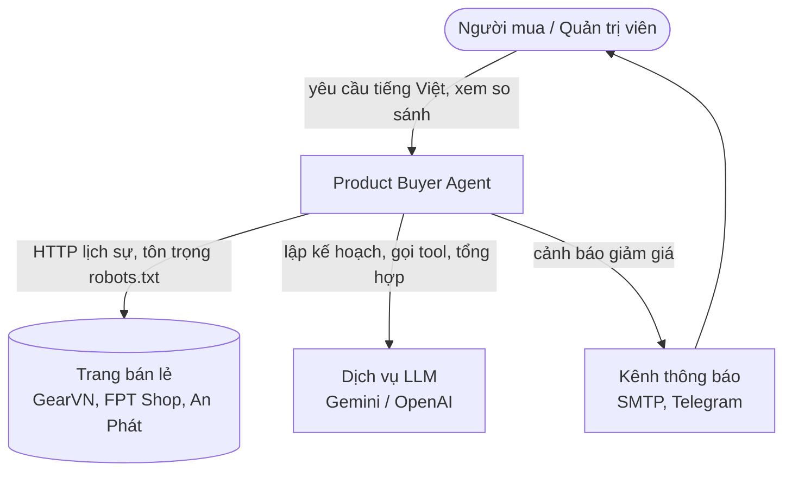
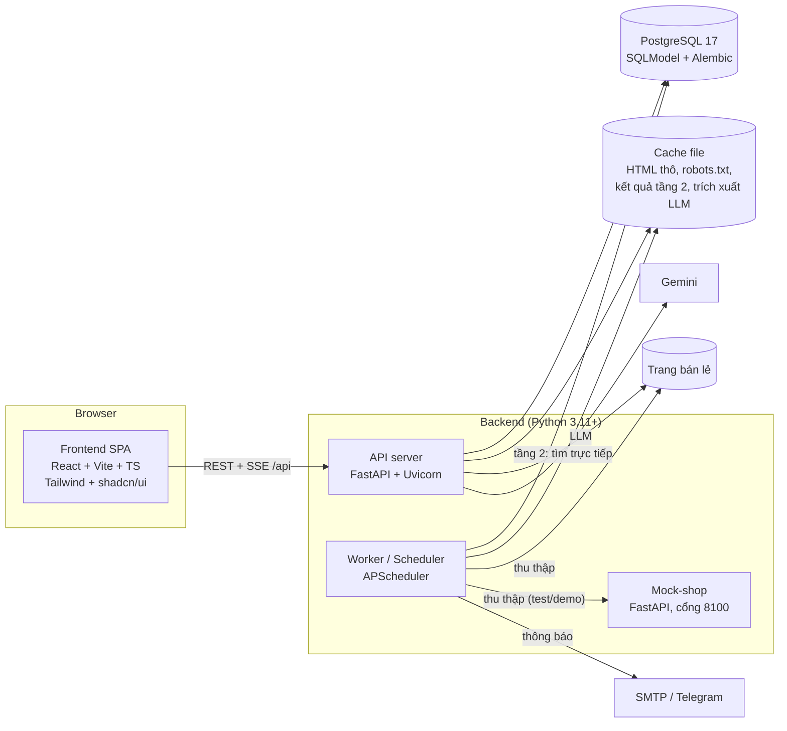
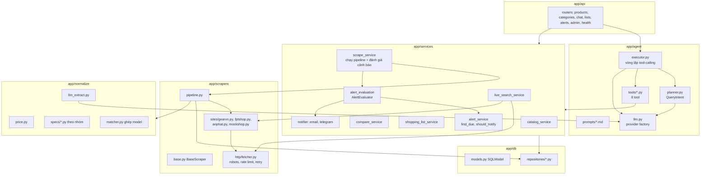
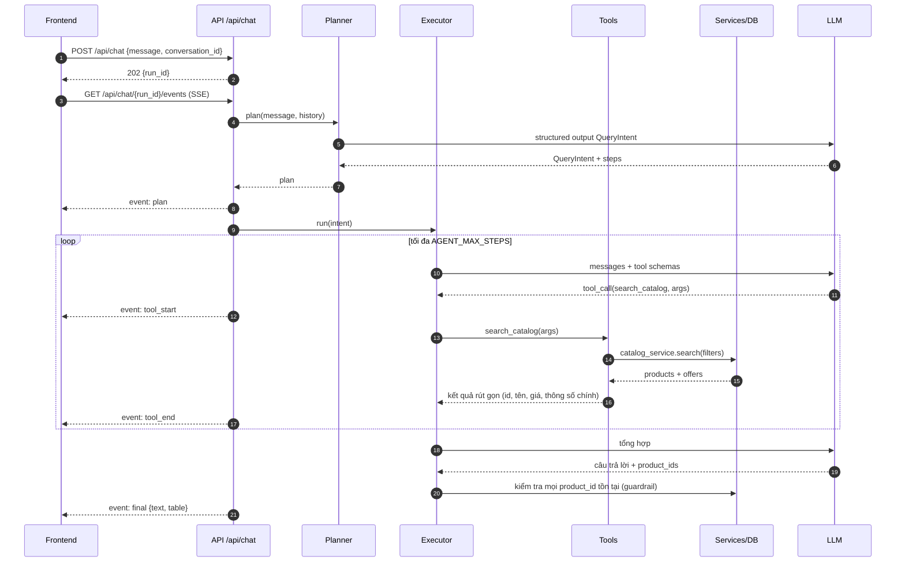
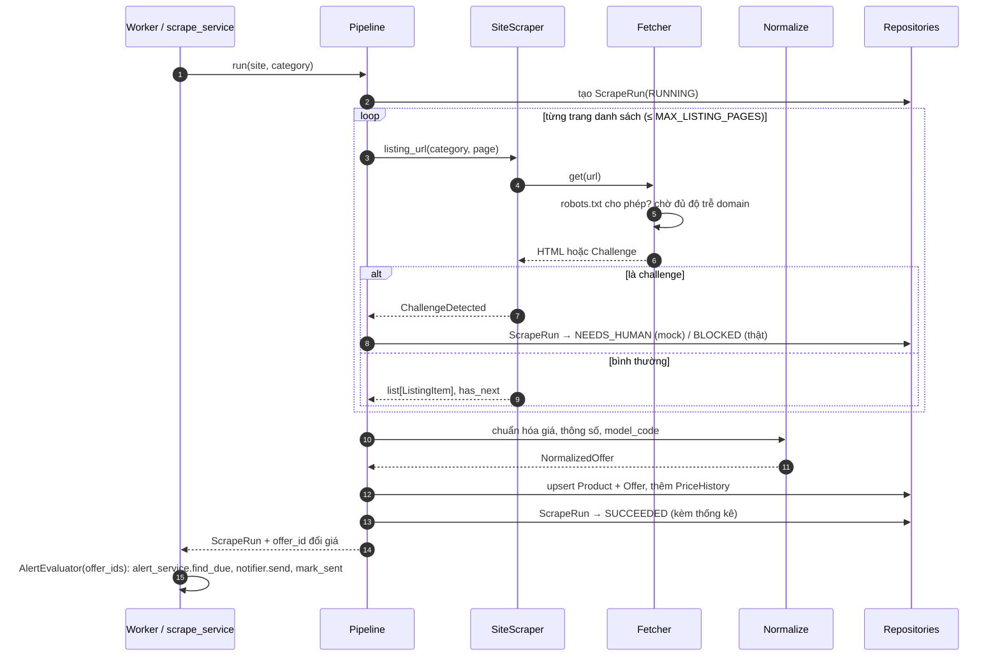

# 03. Thiết kế kiến trúc

> Phiên bản 1.1 · 2026-10-23 (đối chiếu với code sau M10)
> Liên quan: [04 Dữ liệu](04-data-model.md) · [05 Agent](05-agent-design.md) · [06 Thu thập](06-scraping-design.md) · [07 API](07-api-spec.md) · ADR [0001](adr/0001-gemini-langchain.md)–[0010](adr/0010-tier2-sites-gearvn-fptshop.md)

## 1. Nguyên tắc kiến trúc

1. **Thu thập trước, trả lời sau** ([ADR-0003](adr/0003-collect-first-pipeline.md)): dữ liệu tầng 1 được thu thập theo lịch vào cơ sở dữ liệu; agent trả lời từ cơ sở dữ liệu. Không scrape trang thật trong lúc người dùng chờ (trừ tầng 2, có cache).
2. **Agent không đụng trực tiếp vào web hay SQL**: agent chỉ gọi tool có hợp đồng rõ ràng; tool gọi lớp service.
3. **Mỗi trang là một plugin**: thêm trang = thêm một class `BaseScraper` + fixture + đăng ký, không sửa agent.
4. **Tất cả phụ thuộc bên ngoài thay được bằng bản giả** (LLM, HTTP, đồng hồ, kênh thông báo) để test chạy offline.
5. **Monolith mô-đun**: một codebase Python (API + worker cùng image, khác lệnh chạy) và một frontend React. Đủ đơn giản cho đồ án, ranh giới module rõ để tách sau nếu cần.

## 2. Ngữ cảnh hệ thống (C4 mức 1)



## 3. Container (C4 mức 2)



| Container | Trách nhiệm | Lệnh chạy |
| --- | --- | --- |
| Frontend | Giao diện chat, bảng so sánh, danh sách mua, cảnh báo, quản trị | `npm run dev` (5173) |
| API server | REST, SSE tiến trình agent, chạy agent, tầng 2 | `uv run uvicorn app.main:app` (8000) |
| Worker | Lịch thu thập, làm mới giá theo dõi, đánh giá cảnh báo, gửi thông báo | `uv run python -m app.worker` |
| Mock-shop | Trang giả có phân trang + captcha cho test/demo | `uv run uvicorn app.mock_shop.main:app --port 8100` |
| PostgreSQL | Dữ liệu sản phẩm, offer, lịch sử giá, danh sách, cảnh báo, lượt chạy | `make db-up` (service `db` trong `docker-compose.yml`, cổng 5432) |

## 4. Thành phần backend (C4 mức 3)



Quy tắc phụ thuộc: kiểm tự động bằng [`tests/unit/test_layer_boundaries.py`](../backend/tests/unit/test_layer_boundaries.py) (quét import của mọi file trong `app/`, kể cả import trong hàm; file thuộc thư mục chưa khai báo lớp cũng làm test đỏ). Mỗi lớp được import chính nó, `domain`, `config` và:

| Lớp | Được import thêm |
| --- | --- |
| `domain`, `config`, `db`, `normalize`, `mock_shop` | – |
| `scrapers` | `normalize` (`clean_url`, `parse_price`) |
| `scrapers/pipeline` | `normalize`, `db` |
| `services` | `db`, `normalize`, `scrapers` |
| `agent` | `agent/tools`, `services` (bộ nhớ hội thoại), `normalize` (hàm thuần: `text.fold`, hạng GPU, giao diện `LlmSpecsFiller`) |
| `agent/tools` | `services` |
| `api` | `agent`, `services` |
| `main.py` | `api` |
| `worker.py` | `agent` (bộ điền thông số), `services`, `scrapers` (registry, kiểu kết quả) |

Chi tiết:

- `api` không gọi `db` hay `scrapers` trực tiếp. Phiên CSDL của request đến từ `services/database.py` (`session_scope`: commit khi xong, rollback khi lỗi) qua dependency `get_session` ở `api/deps.py` (`scope="function"`, nên commit chạy trước khi gửi response).
- `agent` không đụng CSDL hay web: mọi truy cập đi qua tool (`agent/tools` → `services`) hoặc `services` (lưu hội thoại, lượt chạy).
- `services` → `db/repositories`, `normalize`, `scrapers` (chỉ `live_search_service` dùng scraper/fetcher; chỉ `scrape_service` gọi `pipeline`; `admin_service` chỉ đọc `SiteConfig` từ registry, tóm tắt robots.txt đã tải và hằng số thời gian nghỉ của pipeline, không gọi pipeline hay mạng; `scrape_runtime` dựng Fetcher + `scrape_service` dùng chung cho API).
- `scrapers` không import `db` và `services`, **ngoại lệ duy nhất** là `scrapers/pipeline.py` được import `db/repositories` (nơi nối scraper → normalize → repository). Pipeline không gọi `services` (tránh vòng phụ thuộc).
- Worker (`app/worker.py`) và router quản trị chạy thu thập qua `scrape_service`, không gọi pipeline trực tiếp.

## 5. Luồng chính

### 5.1 Người dùng hỏi (tầng 1)



### 5.2 Thu thập định kỳ



### 5.3 Tầng 2 (nhóm khác)

Planner trả `tier = 2` → executor gọi `live_search_other(query, price_min?, price_max?)` → `live_search_service` (tuần tự, một lượt tìm tại một thời điểm) với từng trang cho phép tầng 2 (GearVN, FPT Shop; ở chế độ offline chỉ mock-shop và trang thật vào `sites_skipped`; [ADR-0010](adr/0010-tier2-sites-gearvn-fptshop.md)): kiểm tra cache của **(trang, từ khóa)** (khóa `live:v1:<trang>:<từ khóa NFC, chữ thường, gọn khoảng trắng>`, TTL `LIVE_SEARCH_CACHE_TTL_HOURS` = 6 giờ) → nếu thiếu, gọi `live_search()` qua Fetcher dùng chung (độ trễ ≥ 5 s/domain), giữ tối đa 24 kết quả mỗi trang vào cache (một trang tìm kiếm FPT Shop; kết quả rỗng chỉ tin 1 giờ, T10.4) → **sau đó** lọc theo khoảng giá (bỏ mục không có giá khi có lọc giá) rồi cắt `limit_per_site`, nên cache không phụ thuộc giá → trả về kèm nhãn `unnormalized`. Lỗi một trang (ngoại tuyến, robots, mạng) chỉ đưa trang đó vào `sites_skipped`, không cache; trang chặn (challenge/403, robots 403/429) ghi mục `live:v1:blocked:<trang>` và nghỉ 24 giờ (cũng nghỉ nếu có `ScrapeRun` `BLOCKED` trong 24 giờ). Từ khóa chứa ký tự điều khiển (NUL, mã < 0x20, surrogate lẻ) bị từ chối bằng `ValidationFailed` (PostgreSQL không lưu được khóa cache như vậy); trang nhận từ khóa đã NFC và gộp khoảng trắng (giữ chữ hoa/thường) nên không vượt giới hạn 200 ký tự của mock-shop. URL trùng sau `clean_url` trong một trang chỉ giữ mục đầu. Không lưu vào bảng `Product`/`Offer`. Worker xóa mục cache cũ hơn max(TTL, 24 giờ nghỉ chặn) sau mỗi lượt làm mới danh mục (`LiveSearchService.purge_expired`).

## 6. Cấu trúc thư mục (theo code sau M10)

```
product-buyer-agent/
├── CLAUDE.md
├── Makefile                      # lệnh chuẩn: setup, dev, check, e2e, eval, scrape, seed, demo-up…
├── docker-compose.yml            # db (dev/test); api, worker, mock-shop, web (demo, `make demo-up`)
├── docker/postgres/init/         # tạo database product_buyer_test
├── .github/workflows/ci.yml
├── backend/
│   ├── pyproject.toml            # uv, ruff, mypy, pytest
│   ├── Dockerfile                # image chung cho api, worker, mock-shop
│   ├── alembic/versions/         # 0001 schema đầu, 0002 thêm site fptshop/anphat
│   ├── app/
│   │   ├── main.py               # FastAPI app factory
│   │   ├── worker.py             # entry worker + scheduler (APScheduler)
│   │   ├── config.py             # pydantic-settings
│   │   ├── api/                  # routers/ (products, categories, chat, lists, alerts, admin, health),
│   │   │                         #   schemas.py, deps.py, errors.py, sse.py, tasks.py (chạy nền)
│   │   ├── agent/                # planner.py, executor.py (ToolLoop), guardrail.py, runner.py, memory.py,
│   │   │                         #   intent.py, spec_filler.py, schemas.py, prompts.py, llm.py, fake_llm.py, testing.py,
│   │   │                         #   tools/ (8 tool), prompts/ (planner, executor, extractor .md)
│   │   ├── services/             # catalog, compare, shopping_list, alert, alert_evaluation, live_search,
│   │   │                         #   scrape_service, scrape_runtime, admin, conversation, health, database, spec_filters, views,
│   │   │                         #   notifier/ (email, telegram)
│   │   ├── scrapers/             # base.py, challenge.py, registry.py, pipeline.py, parsing.py,
│   │   │                         #   http/ (fetcher, robots, rate_limiter, raw_cache, factory, types, errors), sites/ (gearvn,
│   │   │                         #   fptshop, anphat, mockshop)
│   │   ├── normalize/            # price.py, url.py, brand.py, model_code.py, names.py, matcher.py,
│   │   │                         #   text.py, extract.py, llm_extract.py, specs/ (khung thông số theo nhóm, gpu_rank)
│   │   ├── db/                   # engine.py, models.py, repositories/
│   │   ├── domain/               # enums.py, dto.py, catalog.py, chat.py, admin.py, live_search.py,
│   │   │                         #   errors.py (AppError theo 07 §2), clock.py (utc_now)
│   │   └── mock_shop/            # main.py, pages.py, state.py, catalog.py, data.json
│   ├── scripts/                  # seed, scrape, fetch_page, run_eval + eval_core, dump_openapi,
│   │                             #   e2e_server, save_mockshop_fixtures (chạy `python -m scripts.<tên>`)
│   ├── data/                     # cache/, raw/ (gitignore); CSDL nằm trong PostgreSQL
│   └── tests/
│       ├── unit/  integration/  agent/  api/  live/
│       ├── fixtures/<site>/*.html, fixtures/seed/*.json
│       └── conftest.py  factories.py  fakes.py
├── frontend/
│   ├── package.json  vite.config.ts  components.json  openapi.json  Dockerfile  nginx.conf
│   ├── src/
│   │   ├── app/ (router, providers)  pages/  components/ui/ (shadcn)  components/
│   │   ├── features/ (admin, alerts, catalog, chat, lists, results)
│   │   ├── api/ (client.ts, types.gen.ts)  lib/  styles/ (globals.css: token)  mocks/ (MSW)
│   │   (test Vitest đặt cạnh mã nguồn: src/**/*.test.tsx)
│   └── e2e/ (Playwright: ask-agent, compare, add-to-list, create-alert, live-search)
├── reports/                      # báo cáo eval (gitignore)
└── docs/                         # 01–11, adr/, eval/, sources/, ui/, PROGRESS.md
```

## 7. Quyết định công nghệ

| Lớp | Lựa chọn | Lý do ngắn |
| --- | --- | --- |
| Ngôn ngữ backend | Python 3.11+ | Hệ sinh thái scraping + LangChain |
| Quản lý gói | uv | Nhanh, lockfile, chạy script cross-platform |
| Web framework | FastAPI | Async, Pydantic, OpenAPI tự sinh |
| Agent | LangChain (tool calling) + Gemini | [ADR-0001](adr/0001-gemini-langchain.md) |
| HTTP | httpx (async) | Timeout, retry, dễ mock bằng `respx` |
| Parse HTML | selectolax (nhanh), BeautifulSoup dự phòng | |
| Trình duyệt | Playwright (chỉ khi trang cần JS) | Chậm và nặng hơn httpx nên chỉ bật cho trang bắt buộc |
| CSDL | PostgreSQL 17 (Docker Compose) + psycopg 3 + SQLModel + Alembic | [ADR-0007](adr/0007-postgresql.md) (thay ADR-0002) |
| Lịch | APScheduler | Chạy trong process worker, không cần Redis |
| Frontend | React + Vite + TypeScript + Tailwind + shadcn/ui | [ADR-0004](adr/0004-react-frontend.md) |
| Dữ liệu frontend | TanStack Query, kiểu sinh từ OpenAPI (`openapi-typescript`) | Đồng bộ kiểu với backend |
| Biểu đồ | Recharts | Lịch sử giá |
| Test | pytest, respx, Vitest, Testing Library, MSW, Playwright | [09](09-testing-strategy.md) |

> Lưu ý cho Claude Code: API của LangChain thay đổi nhanh. Trước khi viết code agent, tra tài liệu phiên bản hiện hành qua Context7 MCP và ghi phiên bản đã khóa vào `backend/pyproject.toml`.

## 8. Mối quan tâm xuyên suốt

- **Cấu hình:** `app/config.py` (pydantic-settings) là nơi duy nhất đọc biến môi trường.
- **Log:** dùng `logging` chuẩn của Python; worker cấu hình định dạng ở `app/worker.py` (`basicConfig`), API dùng cấu hình mặc định của Uvicorn. Chưa có `app/logging.py` và log JSON; `run_id` của lượt thu thập/agent nằm trong bản ghi `scrape_run` / `agent_run` (không tự gắn vào mọi dòng log). Việc nhỏ chưa có task.
- **Thời gian:** lưu UTC trong DB, hiển thị giờ Việt Nam (Asia/Ho_Chi_Minh) ở frontend.
- **Tiền tệ:** lưu `int` đơn vị đồng (VND), không dùng float.
- **Lỗi:** API trả lỗi dạng `{"error": {"code": "...", "message": "...", "details": {}}}`; mã lỗi và dạng `details` ở [07 §1–2](07-api-spec.md). Lỗi nghiệp vụ là `AppError` (`domain/errors.py`); `api/errors.py` chuyển mọi lỗi (kể cả 404/405/422 và lỗi không lường trước) sang dạng này.
- **Bảo mật:** CORS chỉ cho origin frontend; không có xác thực (ứng dụng cục bộ một người dùng, ghi rõ ngoài phạm vi).
