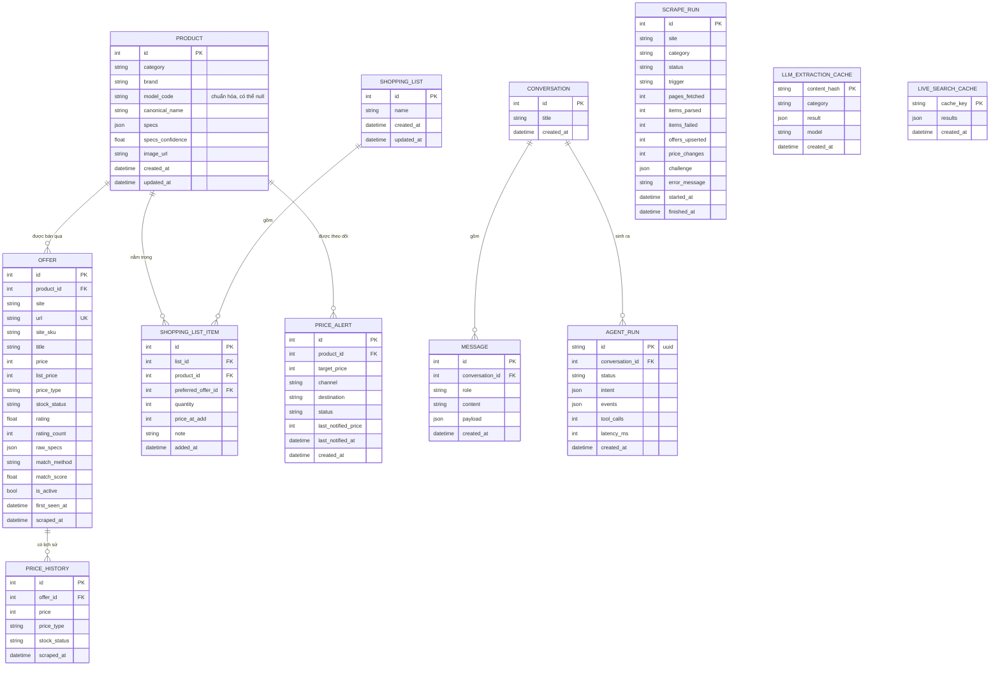

# 04. Thiết kế dữ liệu

> Phiên bản 1.0 · 2026-10-16
> Liên quan: [03 Kiến trúc](03-architecture.md) · [05 Agent](05-agent-design.md) · [06 Thu thập](06-scraping-design.md)

## 1. Nguyên tắc

- **Product ≠ Offer.** `Product` là một mẫu chuẩn hóa (ví dụ ASUS TUF Gaming F16 FX608JHI-TU209W); `Offer` là việc một trang rao bán mẫu đó với giá và link riêng. Đây là cơ sở để so sánh giá giữa các trang.
- **Tiền là số nguyên VND** (`int`), không dùng float.
- **Thời gian lưu UTC** (`datetime` có timezone, cột `TIMESTAMP WITH TIME ZONE`).
- **Thông số theo khung riêng từng nhóm**, lưu cột `JSONB` `specs`, được kiểm tra bằng model Pydantic tương ứng trước khi ghi.
- **CSDL là PostgreSQL 17** ([ADR-0007](adr/0007-postgresql.md)). Mọi cột `json` trong ERD là `JSONB`. Enum lưu `VARCHAR` + `CHECK`, không dùng kiểu `ENUM` gốc.
- **Lịch sử giá chỉ thêm** (append-only).
- **Không lưu dữ liệu cá nhân** từ trang nguồn.

## 2. Sơ đồ quan hệ (ERD)



`SCRAPE_RUN`, `LLM_EXTRACTION_CACHE`, `LIVE_SEARCH_CACHE` không có khóa ngoại.

## 3. Bảng chi tiết và ràng buộc

| Bảng | Ràng buộc / chỉ mục | Ghi chú |
| --- | --- | --- |
| `product` | UNIQUE(`category`, `brand`, `model_code`) khi `model_code` khác null (chỉ mục unique một phần, `postgresql_where`); INDEX(`category`); GIN(`specs`) | `canonical_name` là tên sạch, không chứa từ quảng cáo |
| `offer` | UNIQUE(`url`); INDEX(`product_id`); INDEX(`site`, `is_active`) | `is_active=false` khi lượt chạy đầy đủ không còn thấy offer |
| `price_history` | INDEX(`offer_id`, `scraped_at`) | Thêm dòng khi giá, `price_type` hoặc `stock_status` đổi, **hoặc** dòng cuối cũ hơn 24 giờ |
| `scrape_run` | INDEX(`site`, `category`, `started_at`) | |
| `shopping_list_item` | UNIQUE(`list_id`, `product_id`) | Thêm trùng → tăng `quantity` |
| `price_alert` | INDEX(`product_id`, `status`) | `destination` = email hoặc Telegram chat id |
| `agent_run` | PK uuid | `events` lưu toàn bộ sự kiện SSE để xem lại và debug |

Migration bằng Alembic. Mỗi thay đổi schema = một migration + test chạy `alembic upgrade head` trên DB PostgreSQL rỗng.

Lọc thông số dùng toán tử JSONB của SQLAlchemy (ví dụ `Product.specs["gpu_rank"].as_integer() >= 40`, `Product.specs["is_gaming"].as_boolean()`), không viết SQL thô.

## 4. Enum

| Enum | Giá trị |
| --- | --- |
| `Category` | `laptop`, `mouse`, `keyboard`, `headset`, `phone` (mở rộng), `other` |
| `SiteKey` | `gearvn`, `hoangha`, `laptop88`, `viettelstore`, `nguyenkim`, `mockshop` |
| `PriceType` | `regular` (giá bán không giảm), `sale` (giá khuyến mãi công khai), `member` (giá thành viên), `flash` (flash sale đang diễn ra), `unknown` |
| `StockStatus` | `in_stock`, `out_of_stock`, `preorder`, `unknown` |
| `ScrapeStatus` | `PENDING`, `RUNNING`, `NEEDS_HUMAN`, `BLOCKED`, `SUCCEEDED`, `PARTIAL`, `FAILED` |
| `ScrapeTrigger` | `schedule`, `manual`, `tracked_refresh`, `test` |
| `MatchMethod` | `model_code`, `fuzzy`, `new` |
| `AlertChannel` | `email`, `telegram` |
| `AlertStatus` | `active`, `triggered`, `paused` |
| `AgentRunStatus` | `running`, `succeeded`, `needs_clarification`, `failed` |

**Giá dùng để so sánh** (`effective_price`) của một offer: lấy `price` nếu `price_type` ∈ {`regular`, `sale`, `flash`}; nếu `member` thì vẫn hiển thị nhưng mặc định so sánh bằng `list_price` khi có, kèm nhãn "giá thành viên". Giá bị che (ví dụ flash sale sắp diễn ra hiển thị "2*.**0.000") **không lưu**.

## 5. Khung thông số theo nhóm (Pydantic)

Mọi trường đều tùy chọn khi parse; cột "Bắt buộc" là trường cần có để sản phẩm được dùng trong lọc tầng 1. Thiếu trường bắt buộc → mở trang chi tiết → vẫn thiếu → LLM dự phòng → vẫn thiếu → `specs_confidence < 0.5`, sản phẩm chỉ xuất hiện khi lọc không dùng trường đó.

### 5.1 `LaptopSpecs`

| Trường | Kiểu | Ví dụ | Bắt buộc |
| --- | --- | --- | --- |
| `cpu_model` | str | `i7-13620H`, `Ryzen 7 7435HS`, `Core Ultra 7 155H` | ✓ |
| `cpu_vendor` | enum `intel`/`amd`/`apple`/`qualcomm` | `intel` | |
| `gpu_model` | str | `RTX 4060`, `Integrated` | ✓ |
| `gpu_rank` | int | xem 5.6 | (tính từ `gpu_model`) |
| `gpu_vram_gb` | int | 8 | |
| `ram_gb` | int | 16 | ✓ |
| `storage_gb` | int | 512 | ✓ |
| `storage_type` | enum `ssd`/`hdd` | `ssd` | |
| `screen_in` | float | 15.6 | |
| `resolution` | str | `1920x1080` | |
| `refresh_hz` | int | 144 | |
| `panel` | str | `IPS`, `OLED` | |
| `weight_kg` | float | 2.2 | |
| `os` | str | `Windows 11 Home` | |
| `is_gaming` | bool | true | (suy ra: GPU rời RTX/RX hoặc danh mục gaming) |

### 5.2 `MouseSpecs`

| Trường | Kiểu | Ví dụ | Bắt buộc |
| --- | --- | --- | --- |
| `connection` | list enum `wired`/`wireless_2_4`/`bluetooth` | `[wired, wireless_2_4]` | ✓ |
| `dpi_max` | int | 26000 | |
| `sensor` | str | `HERO 25K` | |
| `buttons` | int | 6 | |
| `weight_g` | int | 63 | |
| `rgb` | bool | true | |
| `shape` | enum `ergo_right`/`ambidextrous` | | |

### 5.3 `KeyboardSpecs`

| Trường | Kiểu | Ví dụ | Bắt buộc |
| --- | --- | --- | --- |
| `connection` | list enum (như chuột) | `[wired]` | ✓ |
| `switch_type` | enum `mechanical`/`membrane`/`optical`/`magnetic` | `mechanical` | ✓ |
| `switch_name` | str | `Red`, `Gateron Brown` | |
| `form_factor` | enum `full`/`tkl`/`75`/`65`/`60`/`other` | `tkl` | |
| `hot_swap` | bool | true | |
| `backlight` | enum `none`/`single`/`rgb` | `rgb` | |

### 5.4 `HeadsetSpecs`

| Trường | Kiểu | Ví dụ | Bắt buộc |
| --- | --- | --- | --- |
| `form` | enum `over_ear`/`on_ear`/`in_ear`/`tws` | `over_ear` | ✓ |
| `connection` | list enum `wired_3_5`/`usb`/`wireless_2_4`/`bluetooth` | `[usb]` | ✓ |
| `has_mic` | bool | true | |
| `anc` | bool | false | |
| `surround_7_1` | bool | true | |
| `driver_mm` | int | 50 | |

### 5.5 `PhoneSpecs` (pha mở rộng)
`chipset`, `ram_gb`, `storage_gb` (bắt buộc), `screen_in`, `battery_mah`, `os`. Mỗi biến thể dung lượng là một `Product` riêng.

### 5.6 Xếp hạng GPU (`gpu_rank`)

Để hiểu "RTX 4060 trở lên", mỗi `gpu_model` được ánh xạ sang một số thứ hạng trong `app/normalize/specs/gpu_rank.py`. Đây là **thứ tự xấp xỉ do dự án tự định nghĩa** để lọc, không phải điểm benchmark; cần rà soát khi thêm GPU mới và có test bảo vệ thứ tự.

Giá trị khởi tạo (càng lớn càng mạnh): `Integrated` 0 · `RTX 2050` 10 · `RTX 3050` 20 · `RTX 3050 Ti` 22 · `RTX 4050` 30 · `RTX 3060` 32 · `RTX 5050` 34 · `RTX 4060` 40 · `RTX 5060` 45 · `RTX 4070` 50 · `RTX 5070` 55 · `RTX 5070 Ti` 60 · `RTX 4080` 70 · `RTX 5080` 75 · `RTX 4090` 80 · `RTX 5090` 85. GPU không có trong bảng → `null` và không thỏa bộ lọc theo hạng.

## 6. DTO miền (`app/domain/dto.py`)

```python
class ListingItem(BaseModel):          # đầu ra parser trang danh sách
    site: SiteKey
    url: HttpUrl                       # http/https hợp lệ; pipeline gọi clean_url (§7) trước khi dựng DTO
    title: str
    price: int | None                  # None nếu không đọc được hoặc bị che
    list_price: int | None
    price_type: PriceType
    stock_status: StockStatus
    image_url: HttpUrl | None
    rating: float | None
    rating_count: int | None
    site_sku: str | None
    raw_specs: dict[str, str]          # cặp nhãn → giá trị thô hiển thị trên thẻ
    category_hint: Category

class ListingPage(BaseModel):
    items: list[ListingItem]
    has_next: bool
    next_url: HttpUrl | None

class ProductDetail(BaseModel):        # đầu ra parser trang chi tiết
    url: HttpUrl
    raw_specs: dict[str, str]
    model_code_hint: str | None        # MPN/SKU từ JSON-LD nếu có
    brand_hint: str | None

class SpecFilter(BaseModel):
    field: str                         # tên trường trong khung specs, ví dụ "gpu_rank", "ram_gb"
    op: Literal["eq", "gte", "lte", "contains", "contains_any", "in"]
    # contains: trường list chứa giá trị; contains_any: trường list chứa ít nhất một giá trị trong value (list);
    # in: trường vô hướng thuộc value (list)
    value: bool | int | float | str | list[str]   # bool cho trường bool (is_gaming); float hữu hạn

class QueryIntent(BaseModel):          # đầu ra planner
    category: Category | None
    tier: Literal[1, 2]
    keywords: list[str]
    price_min: int | None
    price_max: int | None
    brands: list[str]
    sites: list[SiteKey]               # rỗng = mọi trang
    spec_filters: list[SpecFilter]
    sort: Literal["relevance", "price_asc", "price_desc", "rating_desc"]
    limit: int = 10                    # 1..20
    needs_clarification: bool
    clarification_question: str | None
    plan_steps: list[str]              # các bước hiển thị cho người dùng
```

**Ràng buộc kiểm tra khi dựng DTO** (cài đặt ở `app/domain/dto.py`, lỗi → `ValidationError`):

- Số nguyên không nhận bool, chuỗi hay float (`price`, `list_price`, `price_min`, `price_max`, `rating_count`, `limit`): parser phải chuẩn hóa về `int` trước. Tiền ≥ 0, `rating_count` ≥ 0, `rating` 0..5, `limit` 1..20.
- `price_min ≤ price_max` khi cả hai có. `title` và `SpecFilter.field` không rỗng sau khi bỏ khoảng trắng đầu/cuối.
- `SpecFilter`: `in`/`contains_any` cần `value` là list; `gte`/`lte` cần số (không phải bool, không NaN/inf); `eq`/`contains` cần giá trị đơn.
- Giá trị mặc định: `tier=1`, `sort="relevance"`, `limit=10`, `needs_clarification=False`, các list rỗng, `price_type`/`stock_status` là `unknown`, `category_hint=other`.
- `HttpUrl` không phải `str`: lớp lưu trữ (T1.2/T1.4) ghi `str(url)`. DTO chỉ kiểm tra URL hợp lệ, không bỏ tham số theo dõi, userinfo hay fragment; việc đó là của `clean_url` (T2.5).

## 7. Quy tắc chuẩn hóa

| Việc | Quy tắc | Module |
| --- | --- | --- |
| Giá | Bỏ ký tự không phải số trong `27.490.000₫`, `27,490,000 đ` → `27490000`. Chuỗi có `*` hoặc `?` → `None`. Giá < 10.000 hoặc > 500.000.000 → `None` + cảnh báo log | `normalize/price.py` |
| URL | Bỏ `utm_*`, `fbclid`, `gclid`, `srsltid`, fragment; giữ đường dẫn gốc | `normalize/url.py` |
| Hãng | So khớp danh sách hãng đã biết (ASUS, Acer, Lenovo, MSI, HP, Dell, Gigabyte, Apple, Logitech, Razer, Corsair, SteelSeries, HyperX, Akko, DareU, E-Dra, Rapoo…) ở đầu tên | `normalize/brand.py` |
| Mã model | Ưu tiên MPN/SKU từ JSON-LD; nếu không có, regex mẫu mã theo hãng (ví dụ `FX608JHI-TU209W`, `AN515-57-5669`, `83JE00PEVN`); viết hoa, bỏ khoảng trắng | `normalize/model_code.py` |
| Thông số | Bộ luật regex theo nhóm trên `title` + `raw_specs` (ví dụ `RTX\s?(\d{4})(\s?Ti)?`, `(\d+)\s?GB` gần từ "RAM") | `normalize/specs/<category>.py` |
| LLM dự phòng | Chỉ khi thiếu trường bắt buộc sau luật và trang chi tiết; structured output theo khung; cache theo SHA-256 của (`category`, `title`, `raw_specs`) | `normalize/llm_extractor.py` |
| Ghép model | (1) trùng `model_code` cùng `category` + `brand` → `model_code`, score 1.0. (2) Cùng hãng, cùng các trường bắt buộc, độ giống tên ≥ 0.90 (rapidfuzz `token_set_ratio`) → `fuzzy`. (3) Còn lại → `Product` mới, `new` | `normalize/matcher.py` |

Bộ test vàng: `backend/tests/unit/golden/` gồm các cặp (tiêu đề thô, thông số mong đợi) và (offer A, offer B, nên ghép hay không), tối thiểu 40 ca cho laptop và 15 ca cho mỗi nhóm phụ kiện.
