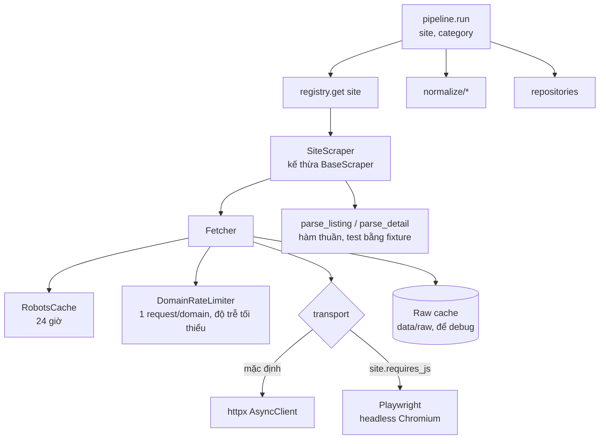

# 06. Thiết kế thu thập dữ liệu (scraping)

> Phiên bản 1.0 · 2026-10-16
> Liên quan: [02 Phạm vi & nguồn](02-scope-and-sources.md) · [04 Dữ liệu](04-data-model.md) · [ADR-0006](adr/0006-mock-shop-hitl.md)

## 1. Các lớp



**Nguyên tắc quan trọng nhất:** `parse_listing(html) -> ListingPage` và `parse_detail(html) -> ProductDetail` là **hàm thuần**, không I/O. Mọi test parser chạy trên file HTML trong `backend/tests/fixtures/<site>/`.

## 2. Giao diện `BaseScraper`

```python
@dataclass(frozen=True)
class SiteConfig:
    key: SiteKey
    base_url: str
    min_delay_s: float                 # cấu hình riêng; độ trễ thật = max(env, robots, cấu hình này)
    requires_js: bool = False
    supports_live_search: bool = False # tầng 2
    categories: Mapping[Category, str] = field(default_factory=dict)  # category -> URL danh mục
    is_mock: bool = False
    enabled: bool = True               # tắt nguồn bị loại (T0.4) hoặc bị chặn lặp lại

class BaseScraper(ABC):
    config: ClassVar[SiteConfig]

    def __init__(self, fetcher: PageFetcher) -> None: ...   # Fetcher (T2.1) thỏa PageFetcher

    # ---- URL ----
    def listing_url(self, category: Category, page: int) -> str: ...
    def search_url(self, query: str) -> str:            # chỉ khi supports_live_search
        raise NotImplementedError

    # ---- parse (hàm thuần) ----
    @abstractmethod
    def parse_listing(self, html: str, category: Category, page_url: str) -> ListingPage: ...
    def parse_detail(self, html: str, url: str) -> ProductDetail:
        raise NotImplementedError
    def parse_search(self, html: str, page_url: str) -> list[ListingItem]:
        return self.parse_listing(html, Category.other, page_url).items

    # ---- phát hiện challenge (mặc định dùng ChallengeDetector chung) ----
    def detect_challenge(self, resp: FetchResponse) -> Challenge | None: ...

    # ---- điều phối (đã cài sẵn, lớp con hiếm khi ghi đè) ----
    async def crawl_category(self, category: Category, max_pages: int, *, start_page: int = 1,
                             expect_items: bool = False) -> AsyncIterator[ListingPage]: ...
    async def fetch_detail(self, url: str) -> ProductDetail: ...
    async def live_search(self, query: str, limit: int) -> list[ListingItem]: ...
```

Đăng ký: `app/scrapers/registry.py` có `SCRAPERS: dict[SiteKey, type[BaseScraper]]`. Thêm trang = thêm một dòng. `get_scraper(site, fetcher)` dựng scraper; trang chưa đăng ký hoặc `enabled=False` → `SiteNotAvailable` (`LookupError`).

Chi tiết đã cài đặt (T2.2), khác hoặc chi tiết hơn bản phác ở trên:

- `BaseScraper.__init__` nhận `PageFetcher` (Protocol trong `scrapers/http/types.py`, chỉ có `async get(url) -> FetchResponse`); lớp `Fetcher` thật (T2.1) thỏa Protocol này. `FetchResponse` là dataclass bất biến với các trường ở §3 "Phản hồi".
- `SiteConfig` tự kiểm tra khi khởi tạo: `min_delay_s` hữu hạn ≥ 0, `base_url` http/https tuyệt đối, URL mọi danh mục cùng máy chủ với `base_url`; `categories` được sao chép và chỉ đọc. Lớp con thiếu `config` → `TypeError` khi khởi tạo.
- `listing_url`: trang 1 là URL danh mục, từ trang 2 thêm/thay `?page=N` (giữ các tham số khác); trang có quy tắc khác thì ghi đè.
- `crawl_category(category, max_pages, *, start_page=1, expect_items=False)`: `max_pages` là số thứ tự trang lớn nhất (tuyệt đối, nên tiếp tục từ `start_page=3` với `max_pages=5` chỉ tải trang 3–5). `start_page` để tiếp tục sau khi giải challenge. Dùng `next_url` của trang nếu cùng máy chủ với `base_url`, ngược lại dựng bằng `listing_url`. `expect_items=True` (pipeline đặt khi lượt thành công trước đó có sản phẩm) biến trang 1 rỗng thành challenge `soft_block`. Khi trang sau trỏ về URL đã tải, trang cuối được trả với `pagination_loop=True` rồi dừng; pipeline ghi `PARTIAL` với thông điệp "Phân trang lặp lại URL đã tải" thay vì thông điệp giới hạn số trang (T2.7).
- `fetch_detail` từ chối URL khác máy chủ của trang (`ValueError`, không gửi request). `live_search` cần `supports_live_search=True`, `query` không rỗng, `limit ≥ 1`.
- Gặp challenge, các điều phối ném `ChallengeDetected` (mang `Challenge`, định nghĩa ở `scrapers/challenge.py`); pipeline bắt và đổi trạng thái (§4).

## 3. `Fetcher`

| Chức năng | Chi tiết |
| --- | --- |
| robots.txt | `RobotsCache.rules(origin).allowed(url)`; bộ phân tích riêng (`scrapers/http/robots.py`, theo RFC 9309: nhóm theo User-agent, quy tắc dài nhất thắng, hòa thì Allow, hỗ trợ `*` và `$`) vì `urllib.robotparser` không hiểu `Disallow: /*?filter=` mà các trang dùng. Tải `/robots.txt` một lần mỗi 24 giờ mỗi domain (cũng qua độ trễ domain); robots.txt lớn hơn 500 KiB → `RobotsUnavailable` (fail-closed: RFC 9309 cho phép bỏ phần vượt nhưng quy tắc nằm ở đó sẽ thành "được phép"); không tải được (lỗi mạng, 5xx thường) → **không cho phép** (`RobotsUnavailable`), không lưu cache nên lần sau thử lại; 404/410 → cho phép (theo chuẩn); 401 → cấm cả trang; **403, 429 hoặc 5xx là trang challenge của CDN (`is_blocking_error_response`) → `RobotsBlocked`** (con của `RobotsUnavailable`, mang `status`, không lưu cache), mà pipeline đổi thành `BLOCKED` và nghỉ 24 giờ (T3.4, §4). Ngoại lệ có chủ ý so với trang thường: robots.txt 429 **không** chờ `Retry-After` rồi thử lại một lần mà chặn ngay (thận trọng; robots.txt là request đầu tiên của lượt nên 429 ở đó nghĩa là máy chủ đã từ chối ta). URL bị chặn → `RobotsDisallowed`, không request. Chuyển hướng kiểm tra robots ở từng bước. Chọn nhóm theo product token của User-Agent (phần trước `/`, bằng nhau, không phân biệt hoa thường — không phải chuỗi con), bỏ BOM UTF-8 ở đầu file, chuẩn hóa percent-encoding của cả quy tắc lẫn URL (`/%7Euser` = `/~user`), `Crawl-delay` > 300 giây bị cắt còn 300 (kèm cảnh báo). |
| Độ trễ | `DomainRateLimiter`: khóa asyncio mỗi domain; chờ đến khi `now - last_request >= delay`. Trang thật: `delay = max(SCRAPER_MIN_DELAY_SECONDS, robots.crawl_delay, site.min_delay_s)` cộng jitter 0–1 s. Mock-shop (`is_mock=True`): `delay = MOCK_SHOP_DELAY_SECONDS`, không jitter. Limiter nhận `clock` và `sleep` qua constructor để test dùng đồng hồ giả (không ngủ thật). |
| Header | `User-Agent: SCRAPER_USER_AGENT`, `Accept-Language: vi-VN,vi;q=0.9`. Không cookie phiên trừ mock-shop sau khi giải challenge (trang thật dùng client có chính sách cookie rỗng; không dùng proxy từ biến môi trường). URL có userinfo (`user:pw@`) bị từ chối vì sẽ thành header `Authorization` (không đăng nhập). Chuyển hướng không tự theo mà kiểm tra từng bước: tối đa 5 lần, chỉ trong cùng `netloc` (đổi http→https được), ra ngoài domain, `Location` hỏng/scheme lạ (`javascript:`, `mailto:`; không retry) → `RedirectError`. Domain so khớp theo `host[:port]` chuẩn hóa (bỏ cổng mặc định, IDN → punycode). |
| Retry | Lỗi mạng, 5xx: retry tối đa `SCRAPER_MAX_RETRIES` với backoff 2^n · 5 s. **Ngoại lệ:** 5xx của trang challenge CDN (`is_blocking_error_response`: header `cf-mitigated: challenge`, từ khóa captcha trong thân, hoặc trang chờ của Cloudflare như "Just a moment"/"Attention Required") được trả ngay như 403, không retry (gửi lại trang challenge chỉ thêm tải). 429: chờ theo `Retry-After` (giây hoặc ngày giờ HTTP; tối thiểu 60 s), tối đa 1 lần, sau đó coi là chặn; `Retry-After` > 600 s (hoặc `inf`) thì không chờ, trả ngay 429; `nan`/âm/thiếu coi như 0 (chờ 60 s). **HTTP 503 kèm `Retry-After`** (giây hoặc ngày giờ HTTP): chờ `max(backoff, Retry-After)`; `Retry-After` > 600 s thì không chờ, `FetchFailed` ngay (T2.7g); các 5xx khác bỏ qua header này. Các 4xx khác → `HttpStatusError`; hết lượt retry → `FetchFailed`. 403: không retry, coi là chặn ngay (xem §4). |
| Giới hạn thân | Đọc theo luồng; thân phản hồi **sau giải nén** lớn hơn 5 MB (`MAX_RESPONSE_BYTES`; kiểm cả `Content-Length` trước và cộng dồn từng đoạn) → `ResponseTooLarge`, không cắt, không retry, không ghi raw cache. robots.txt vượt giới hạn → `RobotsUnavailable` (T2.7b) |
| Timeout | `SCRAPER_TIMEOUT_SECONDS` |
| Offline | `SCRAPER_OFFLINE_ONLY=true` → mọi domain không phải mock-shop bị từ chối với `OfflineModeError` |
| Raw cache | Lưu HTML vào `backend/data/raw/<site>/<yyyymmdd>/<hash>.html` (giữ 7 ngày) để debug và tạo fixture |
| Phản hồi | `FetchResponse(url, final_url, status, headers, text, elapsed_ms, from_cache)` |

## 4. Phát hiện challenge và chặn

`detect_challenge(resp, site)` (hàm thuần trong `scrapers/challenge.py`, `BaseScraper.detect_challenge` gọi nó và lớp con có thể ghi đè) trả về `Challenge(kind, site, url, prompt?, image_url?, token?)` (DTO ở [04 §6](04-data-model.md#6-dto-miền-appdomaindtopy), `kind` là `ChallengeKind`) khi:

- Mã 403 → `http_403`; mã 429 → `http_429` (Fetcher đã chờ `Retry-After` và thử lại một lần, nên 429 tới đây là kết quả cuối). 5xx kèm dấu hiệu challenge của CDN (T2.7c: `cf-mitigated: challenge`, hoặc máy chủ Cloudflare với trang chờ "Just a moment"/"Attention Required"/`chl_page`; script `challenge-platform/.../main.js` đơn thuần không đủ vì Cloudflare chèn nó cả vào trang lỗi thường) → `captcha`; 5xx thường không bị coi là chặn. Mã trạng thái được xét trước từ khóa. **Hợp đồng với Fetcher:** trả `FetchResponse` cho 403/429 và cho 5xx của trang challenge CDN thay vì ném lỗi; mọi trạng thái 4xx/5xx khác (404, 410, 5xx hết lượt retry) và chuyển hướng ra khỏi domain hoặc tới URL robots chặn do Fetcher xử lý (ném lỗi), scraper không kiểm tra lại nên không bao giờ nhận trang lỗi để parse thành "0 sản phẩm".
- Nội dung chứa dấu hiệu captcha → `captcha`: `cf-challenge`, `g-recaptcha`, `hcaptcha`, `turnstile`, `Verify you are human`, `xác minh bạn không phải robot` ở bất kỳ đâu, còn từ chung `captcha` **chỉ khi nằm trong tên thẻ, trong giá trị thuộc tính `id`, `class`, `name`, `action`, `src`, hoặc trong `<title>`** (`meta content`, `alt`, `href` và văn bản thường không tính; `<` chỉ mở thẻ khi theo sau là chữ cái, `/` hoặc `!`) (T4.8: mô tả/bình luận sản phẩm kiểu "không cần nhập captcha" từng làm cả lượt `BLOCKED` + nghỉ 24 giờ). Không phân biệt hoa thường và dạng Unicode NFC/NFD. Hạn chế: trang captcha tĩnh chỉ có chữ (ví dụ `<h1>Vui lòng nhập mã captcha</h1><input name="code">`) không còn bị phát hiện ở bước này; 5xx/robots.txt kiểu đó thành lỗi tải thường (thử lại rồi `FAILED`) thay vì `BLOCKED`. Captcha chèn bằng JavaScript nội tuyến (không có thẻ trong HTML tĩnh) không được phát hiện; khi đó lượt thường thấy 0 sản phẩm và rơi vào `soft_block`. Quét HTML nhưng **bỏ phần thân của `<script>` nội tuyến** (T4.0b: trang Next.js của FPT Shop có `NEXT_PUBLIC_CAPTCHA_KEY` trong script nội tuyến và bị báo nhầm); thẻ `<script>`, thuộc tính và `src` vẫn được quét nên widget reCAPTCHA/hCaptcha thật vẫn bị phát hiện. Thẻ `<script>` không đóng thì không bỏ gì. Có thể vẫn báo nhầm với trang thật có form reCAPTCHA hiển thị; khi khảo sát thấy vậy, ghi đè `detect_challenge` của trang đó. Báo nhầm chỉ làm lượt dừng ở `BLOCKED`. Dấu hiệu trang chờ Cloudflare vẫn quét toàn văn.
- Trang danh sách trả 200 nhưng parse được 0 sản phẩm ở trang 1 trong khi lượt trước có sản phẩm (nghi bị chặn mềm) → `soft_block`. Detector không truy cập DB: `crawl_category(expect_items=...)` nhận cờ này từ pipeline.

Xử lý trong pipeline:

| Nguồn | Hành động |
| --- | --- |
| Mock-shop (chỉ `kind=captcha`) | `ScrapeRun.status = NEEDS_HUMAN`, lưu `challenge` (đề bài + token). Pipeline tạm dừng; API `POST /api/admin/scrape-runs/{id}/challenge` gửi đáp án tới mock-shop, nhận cookie, tiếp tục từ trang đang dừng. |
| robots.txt bị chặn (`RobotsBlocked`, cả mock-shop) | `BLOCKED` với `challenge.kind` là `http_403` (403 và 5xx challenge) hoặc `http_429`, `challenge.url` là robots.txt; không bao giờ `captcha` nên mock-shop không rơi vào `NEEDS_HUMAN`. Trang thật nghỉ 24 giờ như dòng dưới; lỗi robots.txt giữa lượt (khi tải trang chi tiết) cũng dừng cả lượt. 5xx thường của robots.txt vẫn là `FAILED`, không nghỉ. |
| Trang thật | `ScrapeRun.status = BLOCKED`, ghi `challenge`. Pipeline từ chối chạy trang đó khi còn `ScrapeRun` `BLOCKED` của trang trong 24 giờ gần nhất (thời gian tạm nghỉ). **Không tự giải, không đổi IP, không đổi User-Agent.** |

## 5. Mock-shop (`app/mock_shop/`)

Một ứng dụng FastAPI nhỏ chạy cổng 8100, dữ liệu từ `data.json` (khoảng 60 sản phẩm thuộc 4 nhóm tầng 1, tên và giá **hư cấu**, ghi rõ "Mock").

| Endpoint | Hành vi |
| --- | --- |
| `GET /robots.txt` | `User-agent: *`, `Disallow: /admin` (không khai báo Crawl-delay; độ trễ mock-shop do `MOCK_SHOP_DELAY_SECONDS` quyết định) |
| `GET /c/{category}?page=N` | 12 sản phẩm/trang, có nút "Trang sau" khi còn; trang vượt quá → danh sách rỗng |
| `GET /p/{slug}` | Trang chi tiết có bảng thông số và JSON-LD `Product` |
| `GET /search?q=` | Tìm theo tên |
| Captcha giả | Sau `MOCK_SHOP_CAPTCHA_AFTER` request liên tiếp không có cookie `mock_pass`, mọi trang trả HTML có `<div id="captcha">` hiển thị một mã 5 ký tự (text, không phải ảnh) và form `POST /captcha` |
| `POST /captcha` | Đúng mã → set cookie `mock_pass` (hết hạn 10 phút); sai → 400 |
| `GET /__control/reset` | Chỉ cho test: đặt lại bộ đếm |
| Chế độ lỗi (query `?fail=500\|slow\|empty`) | Chỉ cho test retry/timeout/soft block |

Độ trễ mock-shop: `MOCK_SHOP_DELAY_SECONDS=1` khi dev/demo (mặc định trong `.env.example`); `conftest.py` đặt `0` và tiêm đồng hồ giả vào limiter. Quy tắc độ trễ của trang thật không bị ảnh hưởng.

Mock-shop cũng hỗ trợ tìm trực tiếp (tầng 2) để tầng 2 chạy được ở chế độ offline khi dev/test/demo.

Chi tiết đã cài đặt (T2.3, `app/mock_shop/`; `create_app(captcha_after, slow_seconds, clock)` dựng app độc lập, `main.py` có sẵn `app` cho uvicorn):

- Dữ liệu `data.json`: thêm khóa `search_only` (T10.2) gồm 10 sản phẩm hư cấu nhóm tầng 2 (5 loa bluetooth gồm một ca "Liên hệ" và một ca giảm giá, 3 SSD, 2 màn hình) chỉ xuất hiện ở `/search` và `/p/<slug>`, không có `/c/<nhóm>` nên không đổi hợp đồng "60 sản phẩm tầng 1" của `load_catalog()`; `load_search_catalog()` gộp cả hai. Phần tầng 1: 60 sản phẩm (26 laptop = 3 trang 12/12/2, 12 chuột = đúng 1 trang đầy, 11 bàn phím, 11 tai nghe), tên dạng "Laptop ASUS Mock …", có ca biên cố ý: giá "Liên hệ" (không có `offers` trong JSON-LD), hết hàng, giảm giá (`old-price`).
- Trang danh sách/tìm kiếm có cả JSON-LD `ItemList` và thẻ `li.product-card` (`.product-name`, `.price`, `.old-price`, `.stock`, `.rating`, `ul.mini-specs`); liên kết `rel="next"`/`rel="prev"` là đường dẫn tương đối; `page` < 1 hoặc không phải số → 422, nhóm lạ → 404.
- Captcha: chỉ `/c/*`, `/p/*`, `/search` được đếm (không đếm `robots.txt`, `/captcha`, `/__control/*`). Request thứ `MOCK_SHOP_CAPTCHA_AFTER + 1` không có cookie hợp lệ trở đi nhận HTTP 200 với `<div id="captcha" data-token="…">MÃ</div>` và form POST `/captcha` gồm `token`, `answer` (`application/x-www-form-urlencoded`); mã (5 ký tự, không có I/O/0/1) giữ nguyên tới khi giải đúng. Đáp án không phân biệt hoa/thường; đúng → cookie `mock_pass` (`Max-Age=600`), đặt lại bộ đếm; sai hoặc sai `token` → 400, không cookie. `MOCK_SHOP_CAPTCHA_AFTER` phải ≥ 1.
- `?fail=500|slow|empty` áp dụng cho `/c`, `/p`, `/search` (sau kiểm captcha) và được giữ trong liên kết phân trang; `slow` chờ `slow_seconds` (mặc định 5) rồi trả trang bình thường; giá trị khác → 422.

## 6. Chiến lược từng trang

Chi tiết sau khảo sát ghi trong `docs/sources/<site>.md`. Thứ tự ưu tiên khi parse:

1. **JSON-LD** (`<script type="application/ld+json">` với `@type: Product/ItemList`) — ổn định nhất.
2. **JSON nhúng của framework** (ví dụ `__NEXT_DATA__`, biến khởi tạo) nếu nằm trong HTML công khai.
3. **Selector CSS** trên thẻ sản phẩm.

Không gọi các endpoint API nội bộ mà robots.txt chặn (ví dụ `/api/` của GearVN).

Hoàng Hà Mobile và Laptop88 đã bị loại khỏi danh sách nguồn từ 2026-10-19 ([ADR-0008](adr/0008-fptshop-anphat-replace-hoangha-laptop88.md)); thay bằng `fptshop` và `anphat`; hai giá trị cũ đã gỡ khỏi `SiteKey` ở migration 0003 (T4.6).

| Trang | Nhóm (tầng 1) | `min_delay_s` | `requires_js` | Tầng 2 | Ghi chú đã biết |
| --- | --- | --- | --- | --- | --- |
| `gearvn` | laptop, mouse, keyboard, headset | 5 | Không (HTML dựng sẵn ở máy chủ, T3.1) | Có | Danh sách không có JSON-LD sản phẩm (parse thẻ `a.product-card`), chi tiết có JSON-LD `Product` + `additionalProperty`; chip thông số trên thẻ không có nhãn; sản phẩm ngừng kinh doanh hiện "Liên hệ tư vấn" (không giá) |
| `fptshop` | laptop, mouse, keyboard, headset | 5 | Không (trang chi tiết có JSON-LD `Product` trong HTML dựng sẵn, T4.1) | Có (`/tim-kiem?s=<từ khóa>`, ~24 thẻ `a` có `h3` trong HTML dựng sẵn, T10.1) | Danh mục chỉ có ~25 sản phẩm trong HTML (phần còn lại qua nút "Xem thêm"/API) nên duyệt **qua sitemap + trang chi tiết**; phụ kiện nhận diện nhóm bằng tiền tố slug; `mpn` = `sku` = mã nội bộ; giá flash sale theo suất không lưu |
| `anphat` | laptop, mouse, keyboard, headset | 5 (`Crawl-delay: 5`) | Không (thẻ sản phẩm trong HTML tĩnh, T4.3) | **Không** (robots.txt chặn `/tim`) | Phân trang `?page=N` (24 sản phẩm/trang laptop, 30 các nhóm khác; hết trang = 0 thẻ; `has_next` suy từ tổng "N kết quả"); thẻ không có thông số (nạp bằng JS qua `/ajax/` bị chặn) nên pipeline tải trang chi tiết; mọi trang có form đăng ký chứa chữ captcha nên scraper ghi đè `detect_challenge`; giá ẩn `d-none` (Build PC, combo TP.HCM) bỏ qua |
| `viettelstore` | (mở rộng) | 5 | **Có** (tìm kiếm nạp bằng `ajax.aspx`, T10.1) | **Không** (ADR-0010) | Chưa có scraper; tên điện thoại chứa dung lượng |
| `nguyenkim` | (mở rộng) | 5 | **Có** (Next.js, kết quả tìm kiếm nạp phía trình duyệt, T10.1) | **Không** (ADR-0010) | Chưa có scraper |
| `mockshop` | cả 4 | `MOCK_SHOP_DELAY_SECONDS` | Không | Có (dev/test/demo) | Dùng cho test và demo |

## 7. Pipeline (`app/scrapers/pipeline.py`)

```
run(site, category, trigger, max_pages) -> ScrapeRun
  1. Tạo ScrapeRun RUNNING
  2. Với mỗi ListingPage từ crawl_category (dừng khi has_next=false hoặc đủ max_pages):
       với mỗi ListingItem:
         - chuẩn hóa giá, URL, hãng, model_code, specs (luật)
         - thiếu trường bắt buộc → fetch_detail (tính vào giới hạn request) → luật lại
         - vẫn thiếu → llm_extractor (có cache) nếu `LLM_EXTRACTOR_ENABLED=true`
         - matcher → Product (tạo mới hoặc ghép)
         - upsert Offer; thêm PriceHistory nếu đổi
       lỗi parse từng item → items_failed++ (không dừng lượt)
  3. Offer của (site, category) không còn thấy trong lượt ĐẦY ĐỦ (không bị giới hạn trang) → is_active=false
  4. Kết thúc: SUCCEEDED / PARTIAL (items_failed > 20% hoặc chạm max_pages) / FAILED / BLOCKED / NEEDS_HUMAN
  5. Trả về ScrapeRun + danh sách offer_id đổi giá. Pipeline KHÔNG gọi services; việc đánh giá cảnh báo do
     `services/scrape_service.py` (lớp gọi pipeline, dùng chung cho worker và API quản trị) thực hiện:
     scrape_service.run(site, category) → pipeline.run(...) → AlertEvaluator(changed_offer_ids)
     (services/alert_evaluation.py: alert_service.find_due → notifier.send → mark_sent, commit từng cảnh báo)
```

**Làm mới giá offer đang theo dõi (T9.3):** `ScrapePipeline.refresh_offers(site, category, offer_ids)` chỉ tải
`offer.url` (qua Fetcher) của các offer được chọn, rồi ghi `price`/`stock_status` + lịch sử giá từ
`ProductDetail`. `list_price`/`price_type` chỉ đổi khi `ProductDetail.price_type != unknown`, tồn kho chỉ đổi khi
`stock_status != unknown` (GearVN và FPT Shop đọc giá gốc gạch ngang; An Phát chỉ đọc giá bán vì `availability` của
JSON-LD luôn `InStock` khác nút "Đặt hàng" ở thẻ danh sách; mock-shop không có giá gốc ở trang chi tiết). Lượt
dùng `trigger=tracked_refresh`, chung khóa và thời gian nghỉ của (site, category) với lượt đầy đủ (không chạy cùng
lúc), **không bao giờ tắt offer** (kể cả 404/410, chỉ tính `items_failed`), 3 lần tải lỗi liên tiếp thì dừng, và không
được tính làm mốc "lượt trước" khi so số sản phẩm (`latest_succeeded` bỏ qua `tracked_refresh`). `ScrapeService.refresh_tracked(site)`
chọn offer bằng `OfferRepository.list_tracked` (sản phẩm có cảnh báo `active`/`triggered` hoặc nằm trong một danh sách
mua), chạy mỗi nhóm một lượt rồi đánh giá cảnh báo như lượt đầy đủ.

Gặp captcha ở lượt làm mới (chỉ mock-shop có), lượt kết thúc `BLOCKED` thay vì `NEEDS_HUMAN` (không có "trang danh sách để tiếp tục"; `resume` từ chối lượt `tracked_refresh`). Lượt làm mới không mang mốc "lượt trước" nên không bao giờ báo "số sản phẩm giảm". Khi trang chi tiết không cho biết loại giá và giá mới ≥ `list_price` đã lưu, offer `sale` quay về `regular`, `list_price = NULL`. Thẻ danh sách không cho biết tồn kho (`unknown`, như GearVN) thì lượt đầy đủ giữ `stock_status` đã biết thay vì xóa nó.

**Worker (`app/worker.py`, `make worker`):** APScheduler `AsyncIOScheduler` (UTC) với hai job `catalog_refresh`
(`CATALOG_REFRESH_CRON`, thu thập đầy đủ từng nhóm của từng trang đang bật, trang chạy song song, nhóm tuần tự,
`trigger=schedule`) và `tracked_refresh` (`TRACKED_REFRESH_CRON`, `refresh_tracked` từng trang). `max_instances=1`,
`coalesce=True`, `misfire_grace_time=300`. Ngoại tuyến chỉ chạy mock-shop. Nhóm đang có lượt khác
(`ScrapeAlreadyRunning`) bị bỏ qua; trang đang nghỉ (`SiteCooldown`) bỏ qua phần còn lại. Cron sai báo lỗi và thoát mã 2
ngay lúc khởi động. Thứ trong tuần theo crontab chuẩn (0/7 = Chủ nhật, 1 = thứ Hai; `parse_cron` đổi số sang tên ngày vì APScheduler đánh số 0 = thứ Hai; tên ngày như `mon-fri` dùng được, kể cả trộn với số; `sat-sun` hiểu là thứ Bảy đến Chủ nhật). Khi cả ngày-trong-tháng lẫn thứ đều bị giới hạn, APScheduler yêu cầu cả hai khớp (AND), khác crontab thật (OR). `SCHEDULER_ENABLED=false` thì worker thoát mã 0 mà không thu thập gì. Trong `docker-compose.yml` worker có `stop_grace_period: 60s` để job đang gửi thông báo kịp xong khi dừng. Sau mỗi job worker gọi `AlertEvaluator.evaluate(None)` để quét mọi cảnh báo còn hiệu lực (bắt cảnh báo gửi lỗi lần trước, offer mới hoặc đổi tồn kho/loại giá mà `price` không đổi nên không có trong `changed_offer_ids`); lượt chạy từ API quản trị chỉ đánh giá theo `changed_offer_ids`. Khi tắt (SIGTERM/SIGINT) worker hủy job đang chạy (lượt ghi "bị huỷ") rồi mới đóng Fetcher. Mặc định hai cron lệch 30 phút (`0 */12` và `30 */6`) để không giành cùng nhóm.

**Hạn chế đã biết:** bộ giới hạn độ trễ theo domain nằm trong từng tiến trình `Fetcher`; khóa pipeline chỉ theo (site, nhóm). Khi `api` (quản trị bấm thu thập) và `worker` chạy cùng lúc, hai nhóm khác nhau của cùng một domain có thể được tải song song từ hai tiến trình và vượt mức ≥ 5 s/domain. Cách khắc phục (khóa theo domain trong DB) để task sau.

Cảnh báo chất lượng: tỷ lệ parse thành công < 80% hoặc số sản phẩm giảm > 50% so với lượt trước → log `WARNING` và hiển thị trên trang quản trị (dấu hiệu trang đổi giao diện).

Chi tiết đã cài đặt (T2.6; `app/scrapers/pipeline.py`, `app/services/scrape_service.py`, `scripts/scrape.py`):

- **Giao diện:** `ScrapePipeline(session_factory, fetcher, ...)` có `run(site, category, trigger, max_pages=None) -> PipelineResult` và `resume(run_id, answer, max_pages=None)`. `PipelineResult` (run_id, status, bộ đếm, `changed_offer_ids`, `challenge`, `error_message`) là kết quả trả về thay cho đối tượng `ScrapeRun`. Chỉ ném `SiteNotAvailable`, `SiteCooldown`, `ScrapeAlreadyRunning` (trước khi tạo lượt) và, ở `resume`, `RunNotFound`/`ChallengeNotPending`/`ChallengeFailed`; mọi kết cục khác được ghi vào `ScrapeRun` và trả về. `run`/`resume` là phép ghép của hai nửa để API trả `run_id` ngay: `start(...)` kiểm tra điều kiện và tạo lượt `RUNNING` (chưa tải trang nào), `execute(started)` chạy vòng thu thập; `reopen(run_id, answer)` chiếm lượt `NEEDS_HUMAN` và gửi đáp án (ném `ChallengeFailed` đồng bộ), rồi `execute` chạy tiếp. Lượt đã `start` mà không ai `execute` sẽ quá hạn sau 2 giờ như lượt bị bỏ dở. `ScrapeService.run/resume` (và `start/execute/reopen`) bọc thêm kiểm tra `OFFLINE_MODE` (trang thật khi `SCRAPER_OFFLINE_ONLY=true`) và chuyển `changed_offer_ids` cho hook `on_price_changes` sau **mỗi** lần gọi (kể cả `resume`, nên offer đổi giá trước khi lượt bị gián đoạn không mất); `alert_service` nối vào hook ở M9.
- **Giao dịch:** mỗi trang danh sách lưu trong một transaction, từng mục trong một savepoint; lỗi lưu một mục chỉ tăng `items_failed`. Mọi thao tác CSDL chạy qua `asyncio.to_thread`. Bộ đếm trên `ScrapeRun` được cập nhật sau mỗi trang.
- **Bộ đếm:** `items_parsed` = mọi thẻ sản phẩm đã thấy (kể cả thẻ parser bỏ qua, `ListingPage.skipped`); `items_failed` = thẻ không đọc được + mục không lưu được (giá không đọc được hoặc ngoài [10.000; 500.000.000] kể cả giá 0, URL không hợp lệ, liên kết ra ngoài trang hoặc về chính trang danh sách/trang chủ, lỗi CSDL); `offers_upserted` = `items_parsed − items_failed − (mục trùng URL đã gặp trong lượt, bản đầu thắng)`; `price_changes` = số offer đã có lịch sử mà giá khác dòng gần nhất (offer mới không tính).
- **Trạng thái cuối:** `SUCCEEDED`; `PARTIAL` khi `items_failed / items_parsed > 20%`, khi chạm `max_pages` mà còn trang sau (offer không còn thấy **không** bị tắt), hoặc khi lỗi tải ở trang thứ 2 trở đi (`error_message` ghi lỗi); `FAILED` khi lỗi tải ở trang đầu hoặc lỗi không lường trước (`error_message` chỉ ghi tên lớp lỗi, không ghi nội dung); `BLOCKED`/`NEEDS_HUMAN` theo §4. Trang thứ 2 trở đi được trỏ tới bằng "Trang sau" mà trả 200 không có sản phẩm nào (HTML lỗi, chặn mềm) thì dừng ở đó với `PARTIAL` và không tắt offer. Nhóm không thuộc `SiteConfig.categories` và `max_pages < 1` bị từ chối trước khi tạo lượt bằng `InvalidScrapeRequest` (vừa là `ValueError`, vừa là lỗi 422). Cảnh báo chất lượng (tỷ lệ lỗi > 20%, số sản phẩm giảm > 50% so với lượt `SUCCEEDED` trước) ghi vào `error_message` và log `WARNING`. Lượt `SUCCEEDED` chỉ gọi `deactivate_unseen` khi chắc chắn: đã thấy ít nhất một mục, số sản phẩm không giảm quá 50% so với lượt trước, và mọi mục lỗi đều là loại "hết giá" (giá che/0/ngoài miền; offer cũ của mục đó coi như hết bán) — thẻ parser không đọc được hoặc lỗi lưu có thể vẫn còn trên trang nên chặn việc tắt. Sau `resume`, lỗi từ trước khi dừng được coi là không an toàn.
- **Chặn và thời gian nghỉ:** `BLOCKED` cho mọi challenge ở trang thật; mock-shop chỉ `NEEDS_HUMAN` với `kind=captcha` (403/429/`soft_block` của mock-shop vẫn là `BLOCKED`). Trang thật vừa `BLOCKED` thì mọi nhóm của trang đó bị từ chối (`SITE_COOLDOWN`, `details.retry_after`) trong 24 giờ kể từ lúc lượt bị chặn bắt đầu; mock-shop không có thời gian nghỉ.
- **Một lượt mỗi (site, category):** `pg_advisory_xact_lock` quanh việc kiểm tra + tạo lượt; còn lượt `PENDING`/`RUNNING` chưa quá 2 giờ hoặc `NEEDS_HUMAN` chưa quá 1 giờ thì `SCRAPE_ALREADY_RUNNING` (quá hạn coi như tiến trình đã chết).
- **HITL:** `resume` chiếm lượt trước (khóa `pg_advisory_xact_lock`, kiểm tra lại `NEEDS_HUMAN` và chưa quá 1 giờ, `max_pages` ≥ trang cần tiếp tục; chuyển sang `RUNNING`), nên hai `resume` đồng thời không cùng chạy; lỗi hoặc đáp án sai thì trả lượt về `NEEDS_HUMAN` với `challenge` cũ. Task bị huỷ giữa lượt thì lượt được đóng `FAILED` ("Lượt thu thập bị huỷ."). `resume` gửi đáp án qua `Fetcher.post_form` (chỉ mock-shop; trang thật ném `FormNotAllowed`), đáp án sai → `CHALLENGE_FAILED` và lượt vẫn `NEEDS_HUMAN`, đúng → tiếp tục cùng `run_id` từ trang `pages_fetched + 1`. Challenge xảy ra ở trang chi tiết thì trang danh sách đó chưa được lưu và sẽ tải lại khi tiếp tục. Cookie `mock_pass` nằm trong `Fetcher`, nên API dùng một `Fetcher` sống lâu (`services/scrape_runtime.py`, dựng ở lần dùng đầu và đóng khi tắt app); lượt chạy nền do `api/tasks.py` (`TaskRegistry`) giữ tham chiếu và hủy khi tắt app (lượt đang chạy tự đóng `FAILED`); chạy `resume` ở tiến trình khác vẫn được vì cookie lấy lại từ chính lần gửi đáp án.
- **Hủy lượt chờ (T2.8):** `ScrapePipeline.cancel_paused` (qua `DELETE /admin/scrape-runs/{id}/challenge`, nút "Hủy lượt" trong hộp thoại ở `/admin`) đóng lượt `NEEDS_HUMAN` thành `FAILED` với thông điệp "Đã hủy bởi người dùng." dưới cùng khóa `(site, category)` như `resume`, nên hai thao tác đồng thời chỉ một bên thắng. Dùng khi mock-shop đã reset (đáp án không bao giờ đúng nữa, `resume` luôn `CHALLENGE_FAILED`) hoặc khi không muốn chờ 1 giờ để chạy lượt mới. "Lấy lại token" = hủy rồi bấm "Chạy ngay" để có lượt và đề bài mới. Hủy được cả lượt đã quá hạn 1 giờ.
- **Trang chi tiết:** chỉ tải cho mục có `raw_specs` rỗng, tối đa 20 trang mỗi lượt; lỗi tải chi tiết không làm hỏng mục. `raw_specs`, `rating`, `rating_count`, `site_sku` được gộp với giá trị đã có (giá trị mới thắng) vì `OfferRepository.upsert` ghi đè cả `None`/`{}`.
- **Gắn offer vào `Product` (T5.1–T5.2):** `resolve_product` (tham số `resolver` của pipeline) trích thông số bằng luật từ tiêu đề + `raw_specs` đã gộp, đọc mã model, ghép bằng `model_code`/tên hoặc tạo `Product` mới; offer đã có giữ nguyên sản phẩm. `OfferUpsert` lưu `match_method`/`match_score`. Chi tiết luật và chốt chặn ở [04 §7](04-data-model.md#7-quy-tắc-chuẩn-hóa). Bộ LLM dự phòng (T5.3) chưa có: trường bắt buộc còn thiếu sau luật giữ `specs_confidence < 0.5`.
- **Lệnh:** `make scrape SITE=mockshop CAT=laptop [PAGES=2]` (cần `make db-up`, `make migrate` và `make mock-shop`); gặp captcha, lệnh hỏi đáp án ngay trên terminal (tối đa 3 lần), không có terminal thì in `uv run python -m scripts.scrape --site … --category … --resume RUN_ID --answer MÃ`. Mã thoát: 0 = `SUCCEEDED`/`PARTIAL`, 1 = lỗi/`BLOCKED`/`FAILED`, 3 = đang chờ đáp án. Lượt `mockshop` tắt các offer `mockshop` cùng nhóm không còn trong mock-shop (kể cả dữ liệu `make seed`).

## 8. Fixtures

- **Cách chuẩn:** `uv run python scripts/fetch_page.py --site <s> --url <url> --out tests/fixtures/<s>/<tên>.html --allow-online`. Script đi qua `Fetcher` (robots.txt, độ trễ, User-Agent trung thực của dự án). Cờ `--allow-online` cho phép đúng lệnh này truy cập trang thật kể cả khi `SCRAPER_OFFLINE_ONLY=true`; chỉ chạy khi người dùng đồng ý trong task khảo sát.
- **Playwright MCP** (trình duyệt do Claude điều khiển) chỉ dùng để quan sát cách trang hiển thị (cần JavaScript hay không, vị trí phần tử) và chỉ trên trang **không** chặn agent AI trong robots.txt. Không dùng để tải hàng loạt.
- **Trang chặn agent AI** (`ChatGPT-User`, `ClaudeBot`… trong robots.txt; hiện chưa có nguồn nào, Laptop88 đã bị loại ở ADR-0008): không dùng Playwright MCP hay WebFetch. Fixture lấy bằng `fetch_page.py` (bot thu thập của dự án, độ trễ theo trang) hoặc người dùng tự mở trang trong trình duyệt của mình và lưu HTML ("Save Page As… → HTML only") vào thư mục fixture.
- Ngoài ra có thể lưu khi chạy pipeline: `scripts/scrape.py --site <s> --category <c> --save-fixture` (cần `SCRAPER_OFFLINE_ONLY=false`, người dùng chạy có chủ ý).
- Mỗi trang tối thiểu: 1 trang danh sách mỗi nhóm, 1 trang danh sách cuối (không còn trang sau), 2 trang chi tiết, 1 trang tìm kiếm (nếu tầng 2).
- Xóa nội dung không cần (script quảng cáo lớn) để file < 500 KB; không chứa dữ liệu cá nhân.
- Tên: `listing_<category>_p<n>.html`, `detail_<slug>.html`, `search_<query>.html`.
- Fixture của mock-shop (`tests/fixtures/mockshop/`) sinh bằng `uv run python -m scripts.save_mockshop_fixtures` (gọi mock-shop qua ASGI, không mạng); một test so fixture với mock-shop hiện tại nên sửa mock-shop xong phải chạy lại lệnh này.
- Parser nhận thẻ không đọc được thì bỏ qua và đếm vào `ListingPage.skipped`; pipeline cộng vào `items_failed`. Sản phẩm mà nguồn liệt kê nhưng trả 404/410 (FPT Shop qua sitemap) đếm vào `ListingPage.gone`, không phải `skipped`: đó là hàng đã gỡ nên không cấm tắt offer và không tính lỗi.
- Test parser khẳng định: số sản phẩm, sản phẩm đầu tiên đầy đủ trường, `has_next` đúng, mọi giá là số nguyên dương hoặc `None`.

## 9. Lệnh

```
make scrape SITE=mockshop CAT=laptop          # chạy một lượt
make scrape SITE=gearvn CAT=laptop PAGES=1    # cần SCRAPER_OFFLINE_ONLY=false
make mock-shop                                 # chạy mock-shop ở cổng 8100
```
