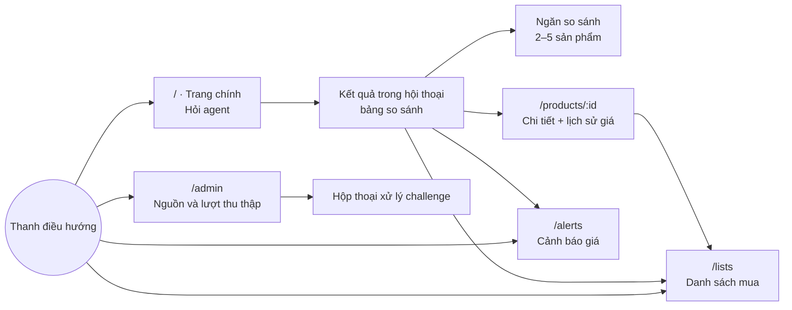

# 08. Thiết kế UI/UX

> Phiên bản 1.0 · 2026-10-16
> Liên quan: [01 Yêu cầu](01-requirements.md) · [07 API](07-api-spec.md) · Ảnh tham khảo: [docs/ui/](ui/README.md)

## 1. Nguyên tắc

1. **Hội thoại là cửa vào, bảng là nơi ra quyết định.** Người dùng hỏi bằng lời; kết quả luôn hiện thành bảng có thể sắp xếp, chọn, so sánh.
2. **Cho thấy agent đang làm gì.** Kế hoạch và từng bước hiện ra theo thời gian thực, giúp người dùng tin và chờ được.
3. **Giá luôn đi kèm nguồn và thời điểm.** Không bao giờ hiện một con số giá trơ trọi.
4. **Không làm thay việc mua.** Nút chính trên sản phẩm là "Mở trang bán", "Thêm vào danh sách", "Báo khi giảm giá".
5. **Tiếng Việt tự nhiên, ngắn.** Số tiền dạng `27.490.000 ₫`, ngày giờ theo giờ Việt Nam.

## 2. Sơ đồ màn hình



| Route | Màn hình | Story |
| --- | --- | --- |
| `/` | Trang chính + hội thoại | US-01, 02, 03, 04, 08, 11 |
| `/c/:conversationId` | Hội thoại cụ thể (mở lại) | US-01 |
| `/products/:id` | Chi tiết sản phẩm | US-05 |
| `/lists`, `/lists/:id` | Danh sách mua | US-06 |
| `/alerts` | Cảnh báo giá | US-07 |
| `/admin` | Nguồn, lượt thu thập, challenge | US-09, 10 |

**Mục nổi trên thanh điều hướng (`aria-current="page"`).** Chỉ nổi khi đường dẫn khớp đúng route: `/` và `/c/:conversationId` nổi "Hỏi agent" (hội thoại thuộc luồng hỏi); `/lists` và `/lists/:id` nổi "Danh sách mua"; `/alerts`, `/admin` chỉ nổi ở đúng đường dẫn đó. `/products/:id` là trang con nên không nổi mục nào (có nút "Quay lại"); trang "Không tìm thấy" cũng không nổi mục nào.

## 3. Wireframe

### 3.1 Trang chính (chưa hỏi)
```
┌──────────────────────────────────────────────────────────────────────┐
│ ◉ Buyer Agent        Hỏi agent   Danh sách mua (2)   Cảnh báo   Quản trị│
├──────────────────────────────────────────────────────────────────────┤
│                                                                      │
│            Bạn muốn mua gì hôm nay?                                   │
│   ┌──────────────────────────────────────────────────────────┐       │
│   │ VD: laptop gaming dưới 30 triệu, RTX 4060, RAM 16GB      │ [Gửi]│
│   └──────────────────────────────────────────────────────────┘       │
│   Gợi ý:  [Laptop gaming dưới 25 triệu]  [Chuột không dây < 1 triệu] │
│           [Bàn phím cơ TKL switch Red]   [Tai nghe có mic dưới 2 triệu]│
│                                                                      │
│   Nguồn: GearVN · FPT Shop · An Phát          Cập nhật: 2 giờ trước  │
└──────────────────────────────────────────────────────────────────────┘
```

### 3.2 Hội thoại với tiến trình agent và bảng kết quả
```
┌──────────────────────────────────────────────────────────────────────┐
│ 🧑 laptop gaming dưới 30 triệu, RTX 4060 trở lên                      │
│                                                                      │
│ 🤖 Kế hoạch                                              ▾ Thu gọn    │
│    ✓ Tìm laptop trong danh mục đã thu thập                            │
│    ✓ Lọc GPU ≥ RTX 4060, giá ≤ 30.000.000 ₫                           │
│    ◌ So sánh giá giữa các trang …                                     │
│                                                                      │
│    Có 7 laptop phù hợp. Rẻ nhất là … (giá cập nhật 09:00 hôm nay)     │
│ ┌──┬───────────────────────┬──────────┬──────┬─────┬───────────┬────┐ │
│ │☐ │ Sản phẩm              │ Giá thấp ▲│ GPU  │ RAM │ Nơi bán   │    │ │
│ ├──┼───────────────────────┼──────────┼──────┼─────┼───────────┼────┤ │
│ │☐ │ [ảnh] Tên sản phẩm …  │27.490.000│ 4060 │ 16  │ 3 trang ▾ │ ⋯ │ │
│ │☐ │ …                     │          │      │     │           │    │ │
│ └──┴───────────────────────┴──────────┴──────┴─────┴───────────┴────┘ │
│  Đã chọn 2  [So sánh]                                                 │
│  Gợi ý tiếp: [So sánh 2 máy rẻ nhất] [Đặt cảnh báo giá]               │
├──────────────────────────────────────────────────────────────────────┤
│ ┌──────────────────────────────────────────────────────┐ [Gửi]       │
│ │ Hỏi tiếp…                                           │              │
└──────────────────────────────────────────────────────────────────────┘
```
- Cột "Nơi bán" mở ra giá từng trang, nhãn loại giá (Thành viên, Flash sale), tình trạng hàng, link "Mở trang ↗".
- Menu `⋯`: Xem chi tiết · Thêm vào danh sách · Báo khi giảm giá.
- Kết quả tầng 2 dùng bảng đơn giản (Tên, Giá, Trang, Link) với nhãn vàng "Tìm trực tiếp – chưa chuẩn hóa thông số".

### 3.3 Ngăn so sánh (drawer bên phải, toàn màn hình trên điện thoại)
```
┌────────────────────────── So sánh (2) ───────────────────── ✕ ┐
│ Thuộc tính        │ Sản phẩm A          │ Sản phẩm B          │
│ Giá thấp nhất     │ 27.490.000 ₫ ✓      │ 28.990.000 ₫        │
│ CPU               │ i7-13620H           │ Ryzen 7 7435HS      │
│ GPU               │ RTX 4060            │ RTX 4060            │
│ RAM               │ 16 GB               │ 16 GB               │
│ Màn hình          │ 15.6" 144 Hz        │ 15.6" 165 Hz ✓      │
│ [Chỉ hiện khác biệt ☑]                                         │
└───────────────────────────────────────────────────────────────┘
```

### 3.4 Chi tiết sản phẩm
Tên + ảnh · bảng giá theo trang (giá, loại giá, tình trạng, cập nhật, nút "Mở trang ↗") · biểu đồ lịch sử giá (đường mỗi trang, chọn 7/30/90 ngày) · bảng thông số chuẩn hóa · độ tin cậy thông số (nếu `specs_confidence < 0.8`: "Một số thông số được trích tự động, hãy kiểm tra trên trang bán") · nút Thêm vào danh sách / Báo khi giảm giá.

### 3.5 Danh sách mua
Danh sách bên trái (điện thoại: chọn ở trên), các mục bên phải: ảnh, tên, số lượng, giá lúc thêm → giá hiện tại (mũi tên xanh nếu giảm), trang rẻ nhất, ghi chú, xóa. Tổng tiền dưới cùng.

### 3.6 Cảnh báo giá
Bảng: sản phẩm, giá hiện tại, ngưỡng, kênh, trạng thái (Đang theo dõi / Đã báo / Tạm dừng), lần báo gần nhất, thao tác. Hộp thoại tạo: ngưỡng (gợi ý −5%, −10%), kênh, nút "Gửi thử".

### 3.7 Quản trị
Thẻ cho mỗi nguồn: trạng thái robots, độ trễ áp dụng, lần chạy gần nhất (badge trạng thái), nút "Chạy ngay" theo nhóm, cảnh báo chất lượng. Bảng lượt chạy với lọc. Lượt `NEEDS_HUMAN` có nút "Xử lý" mở hộp thoại hiện đề bài captcha của mock-shop và ô nhập đáp án. Lượt `BLOCKED` hiện lý do và thời điểm được thử lại. Banner trên cùng nếu đang ở chế độ offline.

### 3.8 Hành vi hội thoại (đã dựng ở T8.2)
- **Gửi tin:** trang chính gửi `POST /chat` rồi chuyển sang `/c/:conversationId?run=<run_id>`; ô nhập báo lỗi của API ngay dưới ô (giữ nguyên nội dung đã gõ). Enter gửi, Shift+Enter xuống dòng, không gửi khi đang gõ dấu bằng bộ gõ IME; tối đa 1000 ký tự, bộ đếm hiện từ 900.
- **Tiến trình:** theo dõi bằng `fetch` + luồng (không `EventSource`, vì cần header `Last-Event-ID` và hủy được); mất kết nối thì nối lại 3 lần (chờ 0,5 / 1 / 2 giây) rồi lấy kết quả bằng `GET /chat/{run_id}`; nếu lượt vẫn chạy thì hiện lỗi mất kết nối kèm "Thử lại". API không gắn bước kế hoạch với từng tool, nên một bước kế hoạch coi là xong khi số tool đã chạy xong vượt qua vị trí của nó.
- **`?run=`:** chỉ có nghĩa ở lần mở trang đầu. Lượt đó phát lại toàn bộ từ SSE (kể cả tin người dùng và câu trả lời), nên lịch sử được cắt ở tin người dùng cuối để không hiện hai lần. Mỗi câu hỏi tiếp theo đổi `?run=` sang lượt mới nhất để tải lại trang vẫn đúng.
- **Ô nhập khi đang chạy:** bị tắt cho đến khi lượt hiện tại kết thúc (`final`, `error` hoặc `clarification`).
- **Hỏi lại (`clarification`):** bong bóng câu hỏi nổi bật, người dùng trả lời ở ô nhập (API chỉ trả câu hỏi, không có nút trả lời nhanh); nút nhanh chỉ dành cho `suggestions` của `final`.
- **Trang chính:** dòng "Nguồn … · Cập nhật: … trước" lấy từ `GET /products?page_size=1` (`data_as_of`; badge vàng khi > 24 giờ); danh mục rỗng thì trỏ tới trang Quản trị; "Hội thoại gần đây" (5 mục từ `GET /conversations`) để mở lại `/c/:id`, ẩn khi chưa có.
- **Markdown của câu trả lời:** HTML thô hiện như văn bản, ảnh không được tải, chỉ liên kết `http(s):` và `mailto:` bấm được (`javascript:`, `data:`, đường dẫn tương đối bị bỏ), liên kết mở tab mới với `rel="noopener noreferrer"`.

### 3.9 Bảng kết quả và ngăn so sánh (đã dựng ở T8.3)
- **Bảng** (≥ 640 px; dưới đó là danh sách thẻ cùng nội dung): cột chọn, sản phẩm (ảnh, tên liên kết tới `/products/:id`, hãng), giá thấp nhất, thông số chính (4 trường đầu của `key_specs`), nơi bán, menu `⋯`. Sắp xếp theo Sản phẩm/Giá bằng cách bấm tiêu đề (tăng → giảm → thứ tự gốc; sản phẩm chưa có giá luôn cuối; `aria-sort`). Ảnh lỗi hoặc URL không phải http(s) thì hiện ô giữ chỗ. Bảng chỉ hiện số liệu có trong kết quả của agent, không tự tính giá.
- **Nơi bán** mở ra giá từng trang: loại giá (Khuyến mãi/Thành viên/Flash sale), tình trạng hàng, giờ cập nhật (badge vàng nếu > 24 giờ), "Rẻ nhất", liên kết "Mở trang" (`target=_blank`, `rel="noopener noreferrer"`, bỏ nếu URL không phải http(s)).
- **Chọn để so sánh:** 2–5 sản phẩm; từ sản phẩm thứ 6 ô chọn bị tắt; nút "So sánh" chỉ bật khi đã chọn ≥ 2. Thứ tự cột trong ngăn theo thứ tự đang hiển thị.
- **Ngăn so sánh** (`Sheet` bên phải, toàn màn hình trên điện thoại; `POST /compare`): hàng giá luôn có và đánh dấu "Rẻ nhất" theo `cheapest_product_id`; "Chỉ hiện khác biệt" bật sẵn (theo `differing_fields`), khi tắt thì trường khác biệt có nhãn chữ "Khác biệt"; hạng GPU (suy ra từ GPU) không hiện; thiếu giá trị hiện `—`. Wireframe có dấu ✓ cho "tốt nhất" ở từng thuộc tính, API chỉ cho biết sản phẩm rẻ nhất nên chỉ đánh dấu giá.
- **Menu `⋯`:** Xem chi tiết · Thêm vào danh sách (chọn danh sách có sẵn hoặc tạo mới, số lượng 1–10.000) · Báo khi giảm giá (ngưỡng nhập tay hoặc gợi ý −5%/−10% làm tròn 1.000 ₫; kênh và nơi nhận tùy chọn, bỏ trống dùng mặc định cấu hình).
- **Tầng 2:** `live_items` hiện thành bảng Tên, Giá, Trang, Liên kết với nhãn vàng "Tìm trực tiếp – chưa chuẩn hóa thông số".
- **Hội thoại mở lại:** tin trợ lý đã lưu chỉ có `payload.product_ids`, nên bảng dựng bằng `GET /products/{id}` từng sản phẩm (giá là giá hiện tại, có thể khác lúc hỏi); sản phẩm không tải được thì bỏ qua.

### 3.10 Chi tiết sản phẩm (đã dựng ở T8.4)
- **Đầu trang:** nút "Quay lại" (về trang trước trong lịch sử; mở thẳng đường dẫn thì về trang chính), ảnh, tên (h1), hãng · mã model, khoảng giá (hoặc một giá nếu thấp nhất = cao nhất), nút Thêm vào danh sách / Báo khi giảm giá (dùng chung hộp thoại với bảng kết quả).
- **Giá theo trang:** rẻ nhất lên đầu; giá hiệu lực, giá niêm yết (khi cao hơn), loại giá, tình trạng hàng, giờ cập nhật (badge vàng nếu > 24 giờ), liên kết "Mở trang".
- **Lịch sử giá:** Recharts, một đường bậc thang mỗi trang (màu `--chart-1…5`), chọn 7/30/90 ngày (mặc định 30; `GET /products/{id}/price-history?days=`); biểu đồ có `role="img"` kèm mô tả và bản tóm tắt chữ (thấp nhất / cao nhất / mới nhất của từng trang) cho trình đọc màn hình. Không có điểm nào → trạng thái rỗng; lỗi tải lịch sử không ảnh hưởng phần còn lại của trang.
- **Thông số:** bảng nhãn tiếng Việt + đơn vị + giá trị liệt kê đọc được (vd. `ssd` → SSD), xếp theo thứ tự cố định; hạng GPU (suy ra) không hiện. Khi `specs_confidence < 0.8` hiện ghi chú "Một số thông số được trích tự động, hãy kiểm tra trên trang bán".
- Mã sản phẩm sai (không phải số nguyên dương ≤ 2^31−1) báo ngay, không gọi API; 404 hiện thông điệp của API.

### 3.11 Danh sách mua (đã dựng ở T8.5)
- **Bố cục:** `/lists` mở danh sách đầu tiên (thay thế lịch sử; chưa có danh sách nào thì hiện trạng thái rỗng); `/lists/:id` hiện chi tiết. Từ 1024 px cột trái liệt kê danh sách kèm số mục và biểu mẫu tạo mới; hẹp hơn thì là ô chọn danh sách ở trên cùng.
- **Danh sách:** tạo (tên 1–200 ký tự), đổi tên (hộp thoại), xóa (luôn hỏi xác nhận vì không hoàn tác được; xóa xong về `/lists`).
- **Mỗi mục:** tên liên kết tới trang chi tiết, số lượng (nút −/+ hoặc gõ số rồi Enter/rời ô; 1–10.000, sai thì trả về giá trị cũ), giá lúc thêm → giá hiện tại với mũi tên ↓ **và chữ** "Giảm …" (↑ "Tăng …", hoặc "Không đổi"), nơi mua (trang đang được tính giá, đánh dấu "ưu tiên" hoặc "rẻ nhất", liên kết "Mở trang"), "Đổi nơi mua" (tải các offer của sản phẩm khi mở; "Tự chọn trang rẻ nhất" bỏ ưu tiên), ghi chú (≤ 500 ký tự, lưu khi rời ô, để trống là xóa), nút xóa mục.
- **Cập nhật lạc quan:** sửa số lượng, ghi chú, nơi mua và xóa mục đổi giao diện ngay (kể cả tổng tiền), rồi tải lại từ máy chủ để lấy giá chính xác; máy chủ từ chối thì hoàn tác và hiện "Không cập nhật được danh sách: …".
- **Tổng tiền:** số lượng × giá hiện tại của từng mục; mục không còn bán không tính và có ghi chú giải thích.

### 3.12 Cảnh báo giá (đã dựng ở T8.6)
- **Bố cục:** từ 640 px là bảng (sản phẩm liên kết tới trang chi tiết, giá hiện tại, ngưỡng, kênh + nơi nhận, trạng thái, lần báo gần nhất, thao tác); hẹp hơn là mỗi cảnh báo một thẻ cùng nội dung. Ô chọn "Lọc theo trạng thái" gọi `GET /alerts?status=`; lọc ra rỗng báo riêng, khác với "chưa đặt cảnh báo nào".
- **Trạng thái:** huy hiệu có chữ (Đang theo dõi / Đã báo / Tạm dừng). Giá hiện tại ≤ ngưỡng thì ghi thêm "Đã tới ngưỡng". Chưa có giá → "Chưa có giá"; chưa từng báo → "Chưa báo lần nào" (đã báo thì hiện thời gian đầy đủ kèm giá lúc báo).
- **Thao tác:** "Tạm dừng" (PATCH `status=paused`) / "Tiếp tục" / "Theo dõi lại" (cảnh báo đã báo, PATCH `status=active`); "Xóa" luôn hỏi xác nhận; lỗi (409, 404, 5xx) hiện ngay tại hàng/thẻ, trạng thái cũ giữ nguyên. Không cập nhật lạc quan: nút tắt trong lúc gửi rồi tải lại danh sách.
- **"Gửi thử":** `POST /alerts/{id}/test` hiện nay luôn trả `sent: false` kèm `reason` (bộ gửi thuộc M9), giao diện hiện đúng lý do đó ("Chưa gửi được thông báo thử: …"), không bao giờ nói đã gửi khi `sent` là false.
- Tạo cảnh báo dùng `CreateAlertDialog` (T8.3) từ bảng kết quả và trang chi tiết; không có nút tạo ở trang này vì cảnh báo luôn gắn với một sản phẩm đang xem.

### 3.13 Quản trị thu thập (đã dựng ở T8.7)
- **Banner:** từ `GET /health`: `offline_mode` → "Đang ở chế độ offline" (chỉ mock-shop thu thập được); `db: error` → cảnh báo CSDL; dòng nhỏ nêu nhà cung cấp LLM + phiên bản. `/health` lỗi thì không hiện banner, phần còn lại vẫn dùng được.
- **Thẻ nguồn** (`GET /admin/sources`): tên, nhãn "Mô phỏng"/"Đã tắt", `robots_status` (cho phép / chặn một phần / chưa kiểm tra), độ trễ áp dụng, "Có tìm kiếm trực tiếp", lượt chạy gần nhất (huy hiệu, mã, nhóm, giờ, bộ đếm, lý do nếu `BLOCKED`/`FAILED`/`PARTIAL`), dòng "Đang nghỉ … thử lại được sau …" khi `cooldown_until` còn ở tương lai. API không có trường "cảnh báo chất lượng" riêng nên giao diện chỉ hiện bộ đếm (số lỗi đọc) và `error_message`.
- **Chạy ngay:** một nút cho mỗi nhóm của nguồn (tắt khi nguồn bị tắt hoặc đang gửi), `POST /admin/scrape-runs` → "Đã bắt đầu lượt #N". Lỗi đồng bộ có câu riêng: `OFFLINE_MODE`, `SCRAPE_ALREADY_RUNNING` (kèm mã lượt), `SITE_COOLDOWN` (kèm giờ thử lại, giờ Việt Nam); lỗi khác dùng thông điệp của máy chủ. Nút không bị tắt trước khi gửi ở chế độ offline: máy chủ là nơi quyết định.
- **Bảng lượt chạy** (`GET /admin/scrape-runs`, 10 lượt/trang, mới nhất trước): lọc trang/nhóm/trạng thái (đổi lọc về trang 1), phân trang trước/sau, dạng thẻ dưới 640 px. `BLOCKED` hiện lý do; thời điểm thử lại chỉ hiện cho lượt mới nhất của nguồn (lấy từ `cooldown_until`), không suy đoán cho lượt cũ.
- **Tự làm mới:** mỗi 3 giây khi trang đang xem có lượt `RUNNING`/`PENDING` (bảng) hoặc lượt gần nhất của một nguồn đang chạy (thẻ nguồn); dừng hẳn khi hết lượt chạy. Biểu tượng quay tắt khi người dùng bật giảm chuyển động.
- **Hộp thoại challenge:** lượt `NEEDS_HUMAN` có nút "Xử lý" (ở thẻ nguồn và ở bảng). Hộp thoại tải `GET …/challenge` mỗi lần mở (không dùng lại bản cũ), hiện loại, đề bài (chỉ là chữ; HTML trong đề bài không được dựng) và ảnh nếu `image_url` là http(s) (không gửi referrer). **Chỉ người nhập đáp án** (1–200 ký tự, không NUL); giao diện không đoán hay giải đáp án. Kết cục: 200 → đóng và báo, lượt chạy tiếp ở nền; 400 `CHALLENGE_FAILED` → giữ hộp thoại và cho thử lại; 409 `CHALLENGE_NOT_PENDING` (khi tải hoặc khi gửi) → đóng, báo "không còn chờ đáp án" và làm mới. Trang thật bị chặn không có luồng này, chỉ dừng ở "Bị chặn".

## 4. Trạng thái giao diện (bắt buộc cho mọi màn hình có dữ liệu)

| Trạng thái | Cách hiển thị |
| --- | --- |
| Đang tải | Skeleton đúng hình dạng nội dung; với agent: danh sách bước có spinner |
| Rỗng | Minh họa nhẹ + câu giải thích + hành động gợi ý (ví dụ "Nới giá lên 32 triệu") |
| Lỗi | Thông điệp tiếng Việt từ `error.message`, nút "Thử lại"; không hiện stack trace |
| Dữ liệu cũ | Badge vàng "Giá cập nhật lúc HH:mm dd/MM" khi > 24 giờ |
| Bị chặn / cần người | Badge đỏ `BLOCKED` / cam `NEEDS_HUMAN` ở trang quản trị |
| Agent hỏi lại | Bong bóng câu hỏi + 2–3 nút trả lời nhanh nếu có |
| Mất kết nối SSE | Tự kết nối lại 3 lần, sau đó gọi `GET /chat/{run_id}` lấy kết quả |

## 5. Design tokens

Định nghĩa bằng biến CSS theo quy ước shadcn/ui (`--background`, `--foreground`, `--primary`…), có chế độ sáng và tối. Đây là bộ mặc định; người dùng thay bằng ý mình và ghi lại tại đây.

| Token | Sáng | Tối | Dùng cho |
| --- | --- | --- | --- |
| `--primary` | `#0F766E` (teal 700) | `#2DD4BF` | Nút chính, liên kết, điểm nhấn |
| `--primary-hover` | `#115E59` (teal 800) | `#5EEAD4` | Nền nút chính khi hover (tương phản với chữ ≥ 7.5:1; không dùng độ trong suốt vì `primary/80` chỉ đạt 3.76:1) |
| `--accent-deal` | `#B45309` (amber 700) | `#FBBF24` | Giá giảm, nhãn khuyến mãi |
| `--success` | `#15803D` | `#4ADE80` | Giá thấp nhất, trạng thái thành công |
| `--destructive` | `#B91C1C` | `#F87171` | Lỗi, BLOCKED |
| `--warning` | `#C2410C` | `#FB923C` | Dữ liệu cũ, NEEDS_HUMAN |
| `--background` | `#FAFAF9` | `#0C0A09` | Nền |
| `--muted` | `#F5F5F4` | `#1C1917` | Nền phụ, hàng xen kẽ |
| `--border` | `#E7E5E4` | `#292524` | Viền |

- Các token còn lại theo quy ước shadcn/ui (`--card`, `--popover`, `--secondary`, `--accent` là nền hover, `--input`, `--ring`, `--chart-1…5`, kèm `*-foreground`) cũng nằm trong `frontend/src/styles/globals.css`. Giá trị cụ thể ở file đó; đổi màu thì sửa đúng file đó.
- **Chế độ sáng/tối:** nút "Giao diện" ở thanh trên (Sáng / Tối / Theo hệ thống, mặc định theo hệ điều hành); lựa chọn lưu ở `localStorage` khóa `buyer-agent-theme` và đặt lớp `dark` trên `<html>` (script trong `index.html` áp trước khi tải để không nháy).
- **Font:** "Be Vietnam Pro" (Google Fonts, hỗ trợ đầy đủ dấu tiếng Việt) cho chữ; `font-variant-numeric: tabular-nums` cho cột giá.
- **Cỡ chữ:** 14 px nội dung bảng, 16 px nội dung chung, 20/24/30 px tiêu đề.
- **Bo góc:** 8 px (thẻ, ô nhập), 6 px (nút), 999 px (badge).
- **Khoảng cách:** thang 4 px (Tailwind mặc định).
- **Biểu tượng:** lucide-react.

## 6. Responsive và tiếp cận

- Điểm gãy: `sm` 640, `md` 768, `lg` 1024, `xl` 1280. Từ 360 px không cuộn ngang trang; bảng kết quả trên điện thoại chuyển thành danh sách thẻ.
- Tương phản tối thiểu WCAG AA (4.5:1 cho chữ thường).
- Điều hướng đầy đủ bằng bàn phím: Enter gửi, Shift+Enter xuống dòng, focus hiển thị rõ.
- Liên kết "Bỏ qua tới nội dung" là mục focus đầu tiên của layout, chuyển focus vào `<main id="main-content">`. Mỗi route khai báo `handle.title`; `document.title` có dạng "<tiêu đề> · Buyer Agent".
- Vùng tiến trình agent dùng `aria-live="polite"`.
- Không chỉ dùng màu để truyền nghĩa: giá giảm có mũi tên ↓ và chữ.

## 7. Cách người dùng tùy chỉnh giao diện với Claude Code

1. Đặt ảnh phác thảo hoặc ảnh tham khảo vào `docs/ui/` (mỗi màn hình một ảnh, tên trùng route, ví dụ `home.png`, `results.png`).
2. Sửa bảng token ở mục 5 nếu muốn đổi màu/font.
3. Giao việc theo từng màn hình bằng skill `ui-screen`, ví dụ: `/ui-screen results` — Claude đọc wireframe ở đây, ảnh trong `docs/ui/`, dựng bằng dữ liệu giả (MSW), chụp màn hình bằng Playwright MCP và so sánh.
