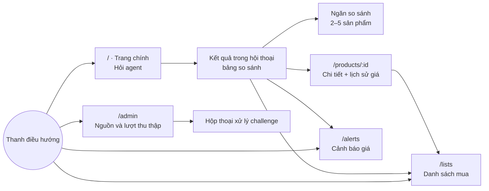

# 08. Thiết kế UI/UX

> Phiên bản 1.0 · 2026-10-16
> Liên quan: [01 Yêu cầu](01-requirements.md) · [07 API](07-api-spec.md) · Ảnh tham khảo: [docs/ui/](ui/README.md)

## 1. Nguyên tắc

1. **Hội thoại là cửa vào, bảng là nơi ra quyết định.** Người dùng hỏi bằng lời; kết quả luôn hiện thành bảng có thể sắp xếp, chọn, so sánh.
2. **Cho thấy agent đang làm gì.** Kế hoạch và từng bước hiện ra theo thời gian thực, giúp người dùng tin và chờ được.
3. **Giá luôn đi kèm nguồn và thời điểm.** Không bao giờ hiện một con số giá trơ trọi.
4. **Không làm thay việc mua.** Nút chính trên sản phẩm là "Mở trang bán", "Thêm vào danh sách", "Báo khi giảm giá".
5. **Tiếng Việt tự nhiên, ngắn.** Số tiền dạng `27.490.000 ₫`, ngày giờ theo giờ Việt Nam.

## 2. Sơ đồ màn hình



| Route | Màn hình | Story |
| --- | --- | --- |
| `/` | Trang chính + hội thoại | US-01, 02, 03, 04, 08, 11 |
| `/c/:conversationId` | Hội thoại cụ thể (mở lại) | US-01 |
| `/products/:id` | Chi tiết sản phẩm | US-05 |
| `/lists`, `/lists/:id` | Danh sách mua | US-06 |
| `/alerts` | Cảnh báo giá | US-07 |
| `/admin` | Nguồn, lượt thu thập, challenge | US-09, 10 |

## 3. Wireframe

### 3.1 Trang chính (chưa hỏi)
```
┌──────────────────────────────────────────────────────────────────────┐
│ ◉ Buyer Agent        Hỏi agent   Danh sách mua (2)   Cảnh báo   Quản trị│
├──────────────────────────────────────────────────────────────────────┤
│                                                                      │
│            Bạn muốn mua gì hôm nay?                                   │
│   ┌──────────────────────────────────────────────────────────┐       │
│   │ VD: laptop gaming dưới 30 triệu, RTX 4060, RAM 16GB      │ [Gửi]│
│   └──────────────────────────────────────────────────────────┘       │
│   Gợi ý:  [Laptop gaming dưới 25 triệu]  [Chuột không dây < 1 triệu] │
│           [Bàn phím cơ TKL switch Red]   [Tai nghe có mic dưới 2 triệu]│
│                                                                      │
│   Nguồn: GearVN · Hoàng Hà Mobile · Laptop88   Cập nhật: 2 giờ trước  │
└──────────────────────────────────────────────────────────────────────┘
```

### 3.2 Hội thoại với tiến trình agent và bảng kết quả
```
┌──────────────────────────────────────────────────────────────────────┐
│ 🧑 laptop gaming dưới 30 triệu, RTX 4060 trở lên                      │
│                                                                      │
│ 🤖 Kế hoạch                                              ▾ Thu gọn    │
│    ✓ Tìm laptop trong danh mục đã thu thập                            │
│    ✓ Lọc GPU ≥ RTX 4060, giá ≤ 30.000.000 ₫                           │
│    ◌ So sánh giá giữa các trang …                                     │
│                                                                      │
│    Có 7 laptop phù hợp. Rẻ nhất là … (giá cập nhật 09:00 hôm nay)     │
│ ┌──┬───────────────────────┬──────────┬──────┬─────┬───────────┬────┐ │
│ │☐ │ Sản phẩm              │ Giá thấp ▲│ GPU  │ RAM │ Nơi bán   │    │ │
│ ├──┼───────────────────────┼──────────┼──────┼─────┼───────────┼────┤ │
│ │☐ │ [ảnh] Tên sản phẩm …  │27.490.000│ 4060 │ 16  │ 3 trang ▾ │ ⋯ │ │
│ │☐ │ …                     │          │      │     │           │    │ │
│ └──┴───────────────────────┴──────────┴──────┴─────┴───────────┴────┘ │
│  Đã chọn 2  [So sánh]                                                 │
│  Gợi ý tiếp: [So sánh 2 máy rẻ nhất] [Đặt cảnh báo giá]               │
├──────────────────────────────────────────────────────────────────────┤
│ ┌──────────────────────────────────────────────────────┐ [Gửi]       │
│ │ Hỏi tiếp…                                           │              │
└──────────────────────────────────────────────────────────────────────┘
```
- Cột "Nơi bán" mở ra giá từng trang, nhãn loại giá (Thành viên, Flash sale), tình trạng hàng, link "Mở trang ↗".
- Menu `⋯`: Xem chi tiết · Thêm vào danh sách · Báo khi giảm giá.
- Kết quả tầng 2 dùng bảng đơn giản (Tên, Giá, Trang, Link) với nhãn vàng "Tìm trực tiếp – chưa chuẩn hóa thông số".

### 3.3 Ngăn so sánh (drawer bên phải, toàn màn hình trên điện thoại)
```
┌────────────────────────── So sánh (2) ───────────────────── ✕ ┐
│ Thuộc tính        │ Sản phẩm A          │ Sản phẩm B          │
│ Giá thấp nhất     │ 27.490.000 ₫ ✓      │ 28.990.000 ₫        │
│ CPU               │ i7-13620H           │ Ryzen 7 7435HS      │
│ GPU               │ RTX 4060            │ RTX 4060            │
│ RAM               │ 16 GB               │ 16 GB               │
│ Màn hình          │ 15.6" 144 Hz        │ 15.6" 165 Hz ✓      │
│ [Chỉ hiện khác biệt ☑]                                         │
└───────────────────────────────────────────────────────────────┘
```

### 3.4 Chi tiết sản phẩm
Tên + ảnh · bảng giá theo trang (giá, loại giá, tình trạng, cập nhật, nút "Mở trang ↗") · biểu đồ lịch sử giá (đường mỗi trang, chọn 7/30/90 ngày) · bảng thông số chuẩn hóa · độ tin cậy thông số (nếu `specs_confidence < 0.8`: "Một số thông số được trích tự động, hãy kiểm tra trên trang bán") · nút Thêm vào danh sách / Báo khi giảm giá.

### 3.5 Danh sách mua
Danh sách bên trái (điện thoại: chọn ở trên), các mục bên phải: ảnh, tên, số lượng, giá lúc thêm → giá hiện tại (mũi tên xanh nếu giảm), trang rẻ nhất, ghi chú, xóa. Tổng tiền dưới cùng.

### 3.6 Cảnh báo giá
Bảng: sản phẩm, giá hiện tại, ngưỡng, kênh, trạng thái (Đang theo dõi / Đã báo / Tạm dừng), lần báo gần nhất, thao tác. Hộp thoại tạo: ngưỡng (gợi ý −5%, −10%), kênh, nút "Gửi thử".

### 3.7 Quản trị
Thẻ cho mỗi nguồn: trạng thái robots, độ trễ áp dụng, lần chạy gần nhất (badge trạng thái), nút "Chạy ngay" theo nhóm, cảnh báo chất lượng. Bảng lượt chạy với lọc. Lượt `NEEDS_HUMAN` có nút "Xử lý" mở hộp thoại hiện đề bài captcha của mock-shop và ô nhập đáp án. Lượt `BLOCKED` hiện lý do và thời điểm được thử lại. Banner trên cùng nếu đang ở chế độ offline.

## 4. Trạng thái giao diện (bắt buộc cho mọi màn hình có dữ liệu)

| Trạng thái | Cách hiển thị |
| --- | --- |
| Đang tải | Skeleton đúng hình dạng nội dung; với agent: danh sách bước có spinner |
| Rỗng | Minh họa nhẹ + câu giải thích + hành động gợi ý (ví dụ "Nới giá lên 32 triệu") |
| Lỗi | Thông điệp tiếng Việt từ `error.message`, nút "Thử lại"; không hiện stack trace |
| Dữ liệu cũ | Badge vàng "Giá cập nhật lúc HH:mm dd/MM" khi > 24 giờ |
| Bị chặn / cần người | Badge đỏ `BLOCKED` / cam `NEEDS_HUMAN` ở trang quản trị |
| Agent hỏi lại | Bong bóng câu hỏi + 2–3 nút trả lời nhanh nếu có |
| Mất kết nối SSE | Tự kết nối lại 3 lần, sau đó gọi `GET /chat/{run_id}` lấy kết quả |

## 5. Design tokens

Định nghĩa bằng biến CSS theo quy ước shadcn/ui (`--background`, `--foreground`, `--primary`…), có chế độ sáng và tối. Đây là bộ mặc định; người dùng thay bằng ý mình và ghi lại tại đây.

| Token | Sáng | Tối | Dùng cho |
| --- | --- | --- | --- |
| `--primary` | `#0F766E` (teal 700) | `#2DD4BF` | Nút chính, liên kết, điểm nhấn |
| `--accent-deal` | `#B45309` (amber 700) | `#FBBF24` | Giá giảm, nhãn khuyến mãi |
| `--success` | `#15803D` | `#4ADE80` | Giá thấp nhất, trạng thái thành công |
| `--destructive` | `#B91C1C` | `#F87171` | Lỗi, BLOCKED |
| `--warning` | `#C2410C` | `#FB923C` | Dữ liệu cũ, NEEDS_HUMAN |
| `--background` | `#FAFAF9` | `#0C0A09` | Nền |
| `--muted` | `#F5F5F4` | `#1C1917` | Nền phụ, hàng xen kẽ |
| `--border` | `#E7E5E4` | `#292524` | Viền |

- **Font:** "Be Vietnam Pro" (Google Fonts, hỗ trợ đầy đủ dấu tiếng Việt) cho chữ; `font-variant-numeric: tabular-nums` cho cột giá.
- **Cỡ chữ:** 14 px nội dung bảng, 16 px nội dung chung, 20/24/30 px tiêu đề.
- **Bo góc:** 8 px (thẻ, ô nhập), 6 px (nút), 999 px (badge).
- **Khoảng cách:** thang 4 px (Tailwind mặc định).
- **Biểu tượng:** lucide-react.

## 6. Responsive và tiếp cận

- Điểm gãy: `sm` 640, `md` 768, `lg` 1024, `xl` 1280. Từ 360 px không cuộn ngang trang; bảng kết quả trên điện thoại chuyển thành danh sách thẻ.
- Tương phản tối thiểu WCAG AA (4.5:1 cho chữ thường).
- Điều hướng đầy đủ bằng bàn phím: Enter gửi, Shift+Enter xuống dòng, focus hiển thị rõ.
- Vùng tiến trình agent dùng `aria-live="polite"`.
- Không chỉ dùng màu để truyền nghĩa: giá giảm có mũi tên ↓ và chữ.

## 7. Cách người dùng tùy chỉnh giao diện với Claude Code

1. Đặt ảnh phác thảo hoặc ảnh tham khảo vào `docs/ui/` (mỗi màn hình một ảnh, tên trùng route, ví dụ `home.png`, `results.png`).
2. Sửa bảng token ở mục 5 nếu muốn đổi màu/font.
3. Giao việc theo từng màn hình bằng skill `ui-screen`, ví dụ: `/ui-screen results` — Claude đọc wireframe ở đây, ảnh trong `docs/ui/`, dựng bằng dữ liệu giả (MSW), chụp màn hình bằng Playwright MCP và so sánh.
