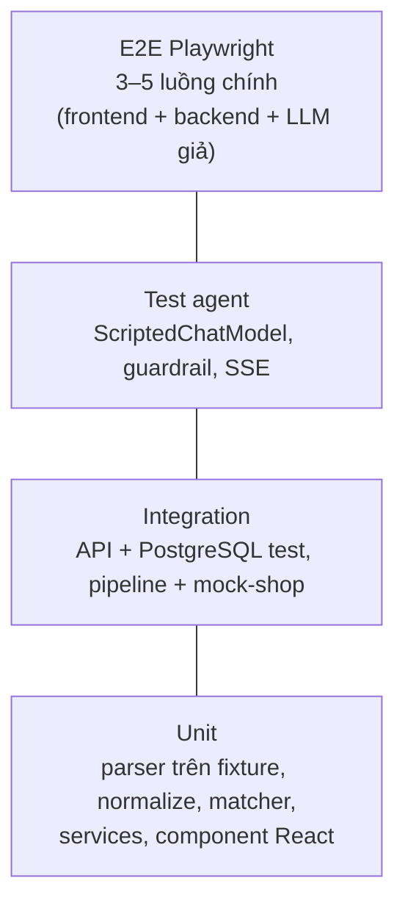

# 09. Chiến lược kiểm thử

> Phiên bản 1.0 · 2026-10-16
> Liên quan: [05 Agent §7](05-agent-design.md#7-đánh-giá-agent-eval) · [06 Thu thập §8](06-scraping-design.md#8-fixtures) · [11 Backlog](11-roadmap-backlog.md)

## 1. Nguyên tắc

1. **Test đi cùng code trong cùng task.** Task chưa có test thì chưa xong ([Definition of Done](11-roadmap-backlog.md#2-definition-of-done)).
2. **Mặc định không gọi mạng.** HTTP giả bằng `respx`, LLM giả bằng `ScriptedChatModel`, trang web giả bằng fixture hoặc mock-shop, đồng hồ giả bằng `time-machine`.
3. **Test nhanh:** toàn bộ `make check` < 2 phút trên máy sinh viên.
4. **Một lỗi = một test tái hiện trước khi sửa** (regression test).
5. **Claude Code chạy `make check` sau mỗi thay đổi đáng kể** và không được đánh dấu task xong khi còn test đỏ.

## 2. Kim tự tháp

| Lớp | Công cụ | Vị trí | Ví dụ |
| --- | --- | --- | --- |
| Unit backend | pytest | `backend/tests/unit/` | `parse_listing` GearVN trả 24 item; `parse_price("2*.**0.000") is None`; `gpu_rank("RTX 4060") == 40` |
| Golden | pytest + YAML | `backend/tests/unit/golden/` | 40+ tiêu đề laptop → specs mong đợi; cặp offer nên/không nên ghép |
| Integration backend | pytest + httpx `AsyncClient` (ASGI) + PostgreSQL test (rollback mỗi test) | `backend/tests/integration/` | `GET /products?spec.gpu_rank__gte=40`; pipeline chạy mock-shop qua ASGI transport, gặp captcha → `NEEDS_HUMAN` → gửi đáp án → `SUCCEEDED` |
| Agent | pytest + `ScriptedChatModel` | `backend/tests/agent/` | Kịch bản tool call; guardrail loại id bịa; vượt `AGENT_MAX_STEPS`; không gọi tool ghi khi không được yêu cầu |
| Eval | `scripts/run_eval.py` + Gemini thật | `docs/eval/queries.yaml` → `reports/` | Xem [05 §7](05-agent-design.md#7-đánh-giá-agent-eval) |
| Live (thủ công) | pytest `-m live` | `backend/tests/live/` | Tải 1 trang danh sách thật mỗi nguồn, khẳng định parse ≥ 1 item. **Bỏ qua mặc định**, chỉ chạy khi `SCRAPER_OFFLINE_ONLY=false` |
| Unit frontend | Vitest + Testing Library + MSW | `frontend/src/**/*.test.tsx` | Bảng sắp xếp theo giá; hiển thị nhãn "giá thành viên"; trạng thái rỗng/lỗi |
| E2E | Playwright | `frontend/e2e/` | Hỏi → thấy kế hoạch → thấy bảng → chọn 2 → so sánh → thêm vào danh sách |

## 3. Dữ liệu test

- **Fixture HTML** cho từng trang (xem [06 §8](06-scraping-design.md#8-fixtures)).
- **Seed DB**: `scripts/seed.py --fixture dev|eval|e2e` nạp sản phẩm hư cấu từ `backend/tests/fixtures/seed/*.json`. Bộ `eval` chứa đủ sản phẩm để mọi câu trong `queries.yaml` có đáp án xác định.
- **Factory**: `tests/factories.py` tạo Product/Offer với giá trị mặc định hợp lệ.

## 4. Cấu hình pytest

- `pytest-asyncio` (mode auto), `respx`, `time-machine`, `pytest-cov`.
- Marker: `live` (mạng thật), `slow`. Mặc định `-m "not live"`.
- CSDL test ([ADR-0007](adr/0007-postgresql.md)): PostgreSQL thật, database `product_buyer_test` đọc từ `TEST_DATABASE_URL` (container `db` tự tạo khi khởi tạo; CI dùng service `postgres:17`). `conftest.py` chạy `alembic upgrade head` một lần mỗi phiên; mỗi test chạy trong một transaction và rollback khi xong (session dùng `join_transaction_mode="create_savepoint"` để code có `commit()` vẫn bị rollback). Không dùng SQLite trong test. Không có DB → pytest dừng sớm với thông báo "chạy `make db-up`".
- `conftest.py`: `SCRAPER_MIN_DELAY_SECONDS=0`, `MOCK_SHOP_DELAY_SECONDS=0`, `DomainRateLimiter` dùng đồng hồ giả và tắt jitter, `LLM_PROVIDER=fake`, `SCRAPER_OFFLINE_ONLY=true`, chặn mọi socket ra ngoài (fixture tự động `disable_network`, trừ `live`), **chỉ cho phép** host:port của `TEST_DATABASE_URL`.

## 5. Ngưỡng chất lượng (cổng CI)

| Kiểm tra | Ngưỡng |
| --- | --- |
| `ruff check` + `ruff format --check` | 0 lỗi |
| `mypy app` (strict) | 0 lỗi |
| `pytest` | 100% pass; coverage `app/` ≥ 80%, `app/normalize` và `app/scrapers/sites` ≥ 90% |
| `eslint` + `tsc --noEmit` | 0 lỗi |
| `vitest` | 100% pass |
| `playwright test` | 100% pass (job riêng, chạy trên PR vào `main`) |

## 6. Lệnh

| Lệnh | Làm gì |
| --- | --- |
| `make db-up` | Bật PostgreSQL (cần trước mọi lệnh test backend) |
| `make check` | Lint + type + unit/integration/agent cả backend và frontend (cổng bắt buộc trước commit) |
| `make test-be` / `make test-fe` | Chỉ một phía |
| `make e2e` | Playwright E2E (tự khởi động backend với `LLM_PROVIDER=fake` và seed `e2e`) |
| `make eval` | Eval với LLM thật |
| `make test-live` | Test với trang thật (thủ công) |

## 7. Vai trò QA trong quy trình với Claude Code

- Subagent `qa-tester` ([.claude/agents/qa-tester.md](../.claude/agents/qa-tester.md)) được gọi ở cuối mỗi milestone để viết thêm test biên (dữ liệu lỗi, rỗng, giá trị cực trị) mà chưa ai nghĩ tới.
- Subagent `code-reviewer` kiểm tra test có thật sự khẳng định hành vi (không chỉ "không lỗi").
