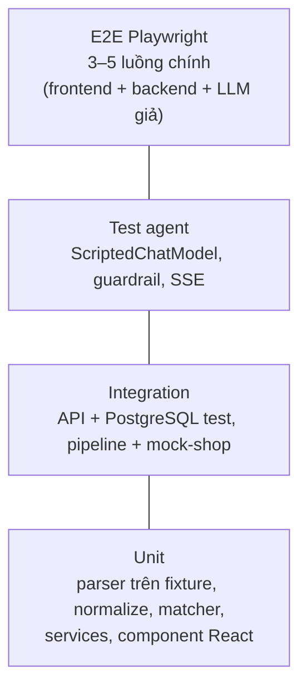

# 09. Chiến lược kiểm thử

> Phiên bản 1.0 · 2026-10-16
> Liên quan: [05 Agent §7](05-agent-design.md#7-đánh-giá-agent-eval) · [06 Thu thập §8](06-scraping-design.md#8-fixtures) · [11 Backlog](11-roadmap-backlog.md)

## 1. Nguyên tắc

1. **Test đi cùng code trong cùng task.** Task chưa có test thì chưa xong ([Definition of Done](11-roadmap-backlog.md#2-definition-of-done)).
2. **Mặc định không gọi mạng.** HTTP giả bằng `respx`, LLM giả bằng `ScriptedChatModel`, trang web giả bằng fixture hoặc mock-shop, đồng hồ giả bằng `time-machine`.
3. **Test nhanh:** toàn bộ `make check` < 2 phút trên máy sinh viên.
4. **Một lỗi = một test tái hiện trước khi sửa** (regression test).
5. **Claude Code chạy `make check` sau mỗi thay đổi đáng kể** và không được đánh dấu task xong khi còn test đỏ.

## 2. Kim tự tháp

| Lớp | Công cụ | Vị trí | Ví dụ |
| --- | --- | --- | --- |
| Unit backend | pytest | `backend/tests/unit/` | `parse_listing` GearVN trả 24 item; `parse_price("2*.**0.000") is None`; `gpu_rank("RTX 4060") == 40` |
| Golden | pytest + YAML | `backend/tests/unit/golden/` | 40+ tiêu đề laptop → specs mong đợi; cặp offer nên/không nên ghép |
| Integration backend | pytest + httpx `AsyncClient` (ASGI) + PostgreSQL test (rollback mỗi test) | `backend/tests/integration/` | `GET /products?spec.gpu_rank__gte=40`; pipeline chạy mock-shop qua ASGI transport, gặp captcha → `NEEDS_HUMAN` → gửi đáp án → `SUCCEEDED` |
| Agent | pytest + `ScriptedChatModel` | `backend/tests/agent/` | Kịch bản tool call; guardrail loại id bịa; vượt `AGENT_MAX_STEPS`; không gọi tool ghi khi không được yêu cầu |
| Eval | `scripts/run_eval.py` + Gemini thật | `docs/eval/queries.yaml` → `reports/` | Xem [05 §7](05-agent-design.md#7-đánh-giá-agent-eval) |
| Live (thủ công) | pytest `-m live` | `backend/tests/live/` | Tải 1 trang danh sách thật mỗi nguồn, khẳng định parse ≥ 1 item. **Bỏ qua mặc định**, chỉ chạy khi `SCRAPER_OFFLINE_ONLY=false` |
| Unit frontend | Vitest + Testing Library + MSW | `frontend/src/**/*.test.tsx` | Bảng sắp xếp theo giá; hiển thị nhãn "giá thành viên"; trạng thái rỗng/lỗi |
| E2E | Playwright | `frontend/e2e/` | Hỏi → thấy kế hoạch → thấy bảng → chọn 2 → so sánh → thêm vào danh sách |

### E2E Playwright (T8.8)

- **Chạy:** `make e2e` (`cd frontend && npm run e2e`). Playwright tự khởi động hai server rồi tắt khi xong: backend `uv run python -m scripts.e2e_server --port 8010` và frontend `npm run dev` (cổng 5173 vì CORS của backend chỉ cho origin này; `VITE_API_BASE_URL` trỏ `localhost:8010`). Không dùng lại server có sẵn (`reuseExistingServer: false`): **tắt `make dev` trước**, vì Vite/API đang chạy sẽ trỏ vào DB dev. `e2e_server` còn chạy mock-shop ở cổng 8100 (cùng tiến trình, không độ trễ, không captcha) để tầng 2 offline có dữ liệu (`loa bluetooth dưới 1 triệu`, spec `live-search.spec.ts`): cổng 5173, 8010 và 8100 phải trống.
- **DB riêng:** `E2E_DATABASE_URL`, bỏ trống thì lấy tên DB của `DATABASE_URL` + `_e2e` (`product_buyer` → `product_buyer_e2e`). Script **từ chối** tên không kết thúc `_e2e` (test: `tests/unit/test_e2e_server.py`) vì `--reset` xóa sạch mọi bảng. Mỗi lần chạy: tạo DB nếu chưa có, `alembic upgrade head`, `seed --fixture e2e --reset --yes`, nên kết quả xác định và chạy lại lần hai vẫn xanh. `LLM_PROVIDER=fake` và `SCRAPER_OFFLINE_ONLY=true` được ép trong script.
- **Spec** (`frontend/e2e/*.spec.ts`, chạy lần lượt vì dùng chung DB; mỗi spec đặt tên danh sách riêng, spec cảnh báo xóa cảnh báo qua API trước mỗi test để Playwright chạy lại không bị báo trùng): hỏi → kế hoạch → bảng (kèm trần giá và câu hỏi lại), chọn 2 → so sánh, thêm vào danh sách (tạo mới và cộng dồn số lượng), đặt cảnh báo (kèm báo trùng và "Gửi thử"). Selector theo vai trò/nhãn, không theo class. Cần Chromium của Playwright (cài thủ công khi cần; CI tự cài).
- `e2e/**` có `tsconfig.e2e.json` riêng (có lib DOM cho `page.evaluate`/`evaluateAll`), tách khỏi `tsconfig.node.json`.

## 3. Dữ liệu test

- **Fixture HTML** cho từng trang (xem [06 §8](06-scraping-design.md#8-fixtures)).
- **Seed DB**: `scripts/seed.py --fixture dev|eval|e2e` nạp sản phẩm hư cấu từ `backend/tests/fixtures/seed/*.json`. Bộ `eval` chứa đủ sản phẩm để mọi câu trong `queries.yaml` có đáp án xác định.
  - Chạy từ `backend/` bằng `uv run python -m scripts.seed --fixture …` (`make seed FIXTURE=…`; dùng `-m` để import được `app`). Script mới trong `scripts/` (scrape, eval) nên chạy cùng cách.
  - File: `laptops.json`, `mice.json`, `keyboards.json`, `headsets.json` (`{"category", "products": [...]}`, mỗi sản phẩm có `offers`; `history` là các điểm đổi giá trong 30 ngày, không khai báo thì giá phẳng) và `extras.json` (danh sách mua + cảnh báo mẫu). Tên có chữ "Mock", URL thuộc miền `.example`; specs được kiểm bằng khung ở `app/normalize/specs` (khóa lạ hoặc thiếu trường bắt buộc là lỗi).
  - Profile: `dev` và `eval` nạp toàn bộ (74 sản phẩm: 35 laptop, 13 mỗi nhóm phụ kiện) kèm danh sách mua, cảnh báo và lượt thu thập mẫu; `e2e` chỉ nạp sản phẩm có `"e2e": true` (16 sản phẩm) và không có dữ liệu phụ vì luồng E2E tự tạo.
  - Chạy lại không nhân đôi dòng (khóa tự nhiên: nhóm + hãng + mã mẫu, và `offer.url`); offer đã có được ghi đè bằng giá trị trong fixture (kể cả giá; lịch sử chỉ thêm dòng khi đổi giá hoặc dòng cuối cũ hơn 24 giờ). `--reset --yes` (`make seed RESET=1`) xóa sạch mọi bảng ứng dụng trước khi nạp để eval/e2e xác định; mặc định tắt, và `--reset` không có `--yes` bị từ chối vì lệnh xóa toàn bộ CSDL trong `DATABASE_URL`.
  - Lịch sử giá đi qua `PriceHistoryRepository.record_snapshot` nên theo đúng luật thêm dòng ở [04 §3](04-data-model.md#3-bảng-chi-tiết-và-ràng-buộc).
  - Module `test_seed_data.py` giữ một transaction seed `eval` suốt module nên không dùng chung module với test seed khác (cùng khóa unique, và `TRUNCATE` cần khóa độc quyền): đừng bật chạy song song (xdist) mà không xem lại.
  - Test: `tests/integration/test_seed_loader.py` (bộ nạp, dữ liệu nhỏ), `test_seed_data.py` (dữ liệu thật phủ `queries.yaml`: dịch `constraints` thành `ProductQuery`), `test_seed_e2e_profile.py`.
- **Factory**: `tests/factories.py` tạo Product/Offer với giá trị mặc định hợp lệ.

## 4. Cấu hình pytest

- `pytest-asyncio` (mode auto), `respx`, `time-machine`, `pytest-cov`.
- Marker: `live` (mạng thật), `slow`. Mặc định `-m "not live"`.
- CSDL test ([ADR-0007](adr/0007-postgresql.md)): PostgreSQL thật, database `product_buyer_test` đọc từ `TEST_DATABASE_URL` (container `db` tự tạo khi khởi tạo; CI dùng service `postgres:17`). `conftest.py` chạy `alembic upgrade head` một lần mỗi phiên; mỗi test chạy trong một transaction và rollback khi xong (session dùng `join_transaction_mode="create_savepoint"` để code có `commit()` vẫn bị rollback). Không dùng SQLite trong test. Không có DB → pytest dừng sớm với thông báo "Run `make db-up`" (tiếng Anh, ASCII vì console Windows in escape cho dấu) ngay ở test đầu tiên dùng fixture `db_engine`/`db_session`; test không dùng DB vẫn chạy bình thường. Chốt chặn: tên database của `TEST_DATABASE_URL` phải kết thúc bằng `_test`, nếu không pytest dừng ngay (tránh chạy test vào DB dev). `TEST_DATABASE_URL` lấy từ biến môi trường (CI), nếu thiếu thì từ `.env` của máy (chỉ đúng khóa này), host `localhost` được đổi thành `127.0.0.1` để tránh treo 3 giây mỗi kết nối mới do thử IPv6. Test migration tạo một database tạm `product_buyer_migrate_*` (cần quyền `CREATE DATABASE`) để chạy `upgrade head` trên DB hoàn toàn rỗng. Model dựng bằng factory ở `tests/factories.py`.
- `conftest.py`: `SCRAPER_MIN_DELAY_SECONDS=0`, `MOCK_SHOP_DELAY_SECONDS=0`, `DomainRateLimiter` dùng đồng hồ giả và tắt jitter, `LLM_PROVIDER=fake`, `SCRAPER_OFFLINE_ONLY=true`, chặn mọi socket ra ngoài (fixture tự động `disable_network`, trừ `live`), **chỉ cho phép** host:port của `TEST_DATABASE_URL`. Chốt chặn gồm `socket.connect`, `sock_connect` của `ProactorEventLoop` (asyncio trên Windows không đi qua `socket.connect`) và phân giải DNS (`getaddrinfo`, `gethostbyname*`) cho mọi tên ngoài `localhost`, IP dạng số và host được phép (host chuỗi nằm trong tập `allowed`, nên test thêm tên vào tập này là mở DNS cho đúng tên đó; DNS ngược `gethostbyaddr`/`getnameinfo`/`getfqdn` chỉ cho loopback và host được phép; UDP `sendto`/`sock_sendto` kiểm theo địa chỉ đích). `httpx.AsyncClient` bọc lỗi chặn trong `ExceptionGroup` (anyio); test dùng `expect_blocked()` ở `test_network_guard_edge.py`.

## 5. Ngưỡng chất lượng (cổng CI)

| Kiểm tra | Ngưỡng |
| --- | --- |
| `ruff check` + `ruff format --check` | 0 lỗi |
| `mypy app` (strict) | 0 lỗi |
| `pytest` | 100% pass; coverage `app/` ≥ 80%, `app/normalize` và `app/scrapers/sites` ≥ 90% |
| `eslint` + `tsc --noEmit` | 0 lỗi |
| `vitest` | 100% pass |
| `playwright test` | 100% pass (job riêng, chạy trên PR vào `main`) |

## 6. Lệnh

| Lệnh | Làm gì |
| --- | --- |
| `make db-up` | Bật PostgreSQL (cần trước mọi lệnh test backend) |
| `make check` | Lint + type + unit/integration/agent cả backend và frontend (cổng bắt buộc trước commit) |
| `make test-be` / `make test-fe` | Chỉ một phía |
| `make e2e` | Playwright E2E (tự khởi động backend với `LLM_PROVIDER=fake` và seed `e2e`; `LLM_PROVIDER=fake` dùng `ShoppingFakeChatModel` xác định, xem [05](05-agent-design.md) §2; test: `backend/tests/agent/test_fake_provider.py`) |
| `make eval` | Eval với LLM thật |
| `make test-live` | Test với trang thật (thủ công) |

## 7. Vai trò QA trong quy trình với Claude Code

- Subagent `qa-tester` ([.claude/agents/qa-tester.md](../.claude/agents/qa-tester.md)) được gọi ở cuối mỗi milestone để viết thêm test biên (dữ liệu lỗi, rỗng, giá trị cực trị) mà chưa ai nghĩ tới.
- Subagent `code-reviewer` kiểm tra test có thật sự khẳng định hành vi (không chỉ "không lỗi").
