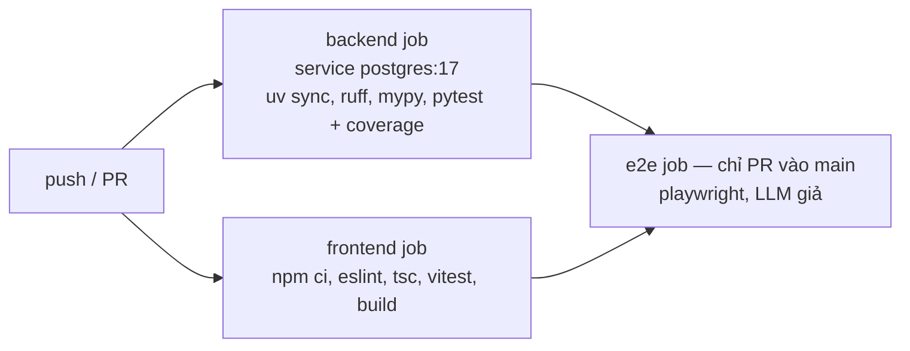

# 10. Triển khai và vận hành

> Phiên bản 1.0 · 2026-10-16
> Liên quan: [03 Kiến trúc](03-architecture.md) · [09 Kiểm thử](09-testing-strategy.md)

## 1. Môi trường

| Môi trường | Mục đích | Cách chạy | Dữ liệu |
| --- | --- | --- | --- |
| `dev` | Phát triển hằng ngày | `make db-up` + `make dev` (backend reload + frontend Vite + mock-shop) | PostgreSQL `product_buyer`, seed `dev` + mock-shop; offline |
| `test` | CI, `make check` | pytest/vitest | PostgreSQL `product_buyer_test` (rollback mỗi test), fixture |
| `demo` | Trình diễn bảo vệ đồ án | `docker compose up` | Dữ liệu thu thập trước (có thể kèm mock-shop) |

## 2. Yêu cầu máy

- Python 3.11+ và **uv**; Node.js 20 LTS trở lên và npm; Git; **Docker Desktop (bắt buộc, chạy PostgreSQL)**.
- Windows: dùng Git Bash hoặc WSL2 cho lệnh `make` (hoặc chạy lệnh tương ứng trong Makefile bằng tay). Cài make bằng `winget install ezwinports.make`; bản make của MSYS2 (`pacman -S make`) làm mất biến môi trường Windows nên `docker compose` không tìm thấy plugin.
- Nếu cổng 5432 đã bị chiếm: đặt `POSTGRES_PORT` khác trong `.env` và sửa cổng trong `DATABASE_URL`/`TEST_DATABASE_URL` cho khớp. `docker-compose.yml` chỉ mở cổng DB trên `127.0.0.1`.

## 3. Chạy cục bộ (sau milestone M0)

```bash
cp .env.example .env             # điền GOOGLE_API_KEY, ALERT_DEFAULT_EMAIL, POSTGRES_PASSWORD...
make db-up                       # docker compose up -d db (PostgreSQL 17, chờ healthcheck)
make setup                       # uv sync + npm ci + alembic upgrade head + seed dev
make dev                         # API :8000, frontend :5173, mock-shop :8100
make worker                      # (tùy chọn) bộ lập lịch
```

## 4. Docker Compose

Service `db` có từ T0.3 (dev, test); các service còn lại thêm ở T9.4 (demo).

| Service | Image | Lệnh | Cổng | Volume |
| --- | --- | --- | --- | --- |
| `db` | `postgres:17` | mặc định; healthcheck `pg_isready` | 5432 (`POSTGRES_PORT`) | volume `pgdata`; `./docker/postgres/init:/docker-entrypoint-initdb.d` (tạo `product_buyer_test`) |
| `api` | `backend/Dockerfile` | `uvicorn app.main:app --host 0.0.0.0 --port 8000` | 8000 | `./backend/data:/app/data` |
| `worker` | cùng image | `python -m app.worker` | – | dùng chung `data` |
| `mock-shop` | cùng image | `uvicorn app.mock_shop.main:app --host 0.0.0.0 --port 8100` | 8100 | – |
| `web` | `frontend/Dockerfile` (build Vite → nginx) | nginx, proxy `/api` → `api:8000` | 8080 | – |

`api` và `worker` phụ thuộc `db` (`depends_on: condition: service_healthy`) và dùng `DATABASE_URL` với host `db` thay cho `localhost` (đặt trong `environment` của compose). `api` chạy `alembic upgrade head` trước khi khởi động. Volume `./backend/data` chỉ còn chứa cache file ([ADR-0007](adr/0007-postgresql.md)).

## 5. CI (GitHub Actions, `.github/workflows/ci.yml`)



- Job e2e chưa có ở T0.3 (chưa có spec Playwright, seed `e2e`); thêm ở T8.8. Hiện CI chỉ có job `backend` và `frontend` (Node 22), chạy bằng `make test-be` / `make test-fe`.
- Không có bí mật nào trong CI (LLM giả, offline).
- Job backend (và e2e) khai báo `services: postgres` (image `postgres:17`, `POSTGRES_DB=product_buyer_test`, healthcheck `pg_isready`), đặt `TEST_DATABASE_URL`/`DATABASE_URL` trỏ `localhost:5432`. Mật khẩu CI là giá trị giả cố định, không phải bí mật.
- Cache uv và npm.
- Artifact: báo cáo coverage, báo cáo Playwright khi lỗi.

## 6. Vận hành

| Việc | Cách làm |
| --- | --- |
| Theo dõi lượt thu thập | Trang `/admin`; log worker |
| Trang đổi giao diện | Cảnh báo chất lượng (tỷ lệ parse < 80%) → lưu fixture mới → sửa parser bằng skill `add-scraper` → test |
| Bị chặn | Trạng thái `BLOCKED` + tạm nghỉ 24 giờ tự động; xem lại độ trễ và khối lượng; nếu lặp lại thì tắt trang đó (`enabled=false` trong `SiteConfig`) |
| Sao lưu | `docker compose exec db pg_dump -U $POSTGRES_USER -Fc $POSTGRES_DB > backup.dump`; khôi phục bằng `pg_restore` |
| Volume `pgdata` có từ trước (thiếu `product_buyer_test`) | Script init chỉ chạy khi volume rỗng: `docker compose exec db createdb -U $POSTGRES_USER product_buyer_test` |
| Xóa sạch DB dev | `make db-down` rồi `docker volume rm` volume `pgdata`, sau đó `make db-up && make setup` |
| Chi phí LLM | Xem số lần gọi trong `agent_run.tool_calls` và log; cache trích xuất giảm số gọi |
| Đổi model LLM | Sửa `GEMINI_MODEL` trong `.env`, chạy `make eval` so sánh trước/sau |

## 7. Kịch bản demo bảo vệ (gợi ý)

1. Mở `/admin`: giới thiệu nguồn, robots.txt, độ trễ, chế độ tuân thủ.
2. Chạy thu thập mock-shop → gặp captcha giả → xử lý trong hộp thoại → lượt chạy hoàn tất (minh họa phân trang + captcha giả lập).
3. Hỏi: "laptop gaming dưới 30 triệu RTX 4060 trở lên" → xem kế hoạch, tiến trình, bảng so sánh 3 trang.
4. "So sánh 2 máy rẻ nhất" → ngăn so sánh. "Thêm máy đầu vào danh sách mua". "Báo tôi khi máy này dưới …".
5. Chạy làm mới giá (seed thay đổi giá) → nhận email/Telegram.
6. Hỏi nhóm khác: "loa bluetooth dưới 1 triệu" → kết quả tầng 2 có nhãn (ở chế độ offline, tầng 2 tìm trên mock-shop; muốn dùng trang thật phải tắt offline có chủ ý).
7. Trình bày báo cáo eval (`reports/eval-*.md`).
