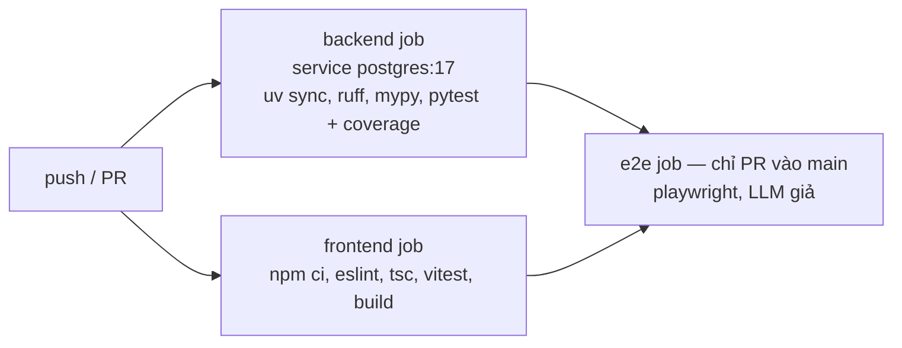

# 10. Triển khai và vận hành

> Phiên bản 1.0 · 2026-10-16
> Liên quan: [03 Kiến trúc](03-architecture.md) · [09 Kiểm thử](09-testing-strategy.md)

## 1. Môi trường

| Môi trường | Mục đích | Cách chạy | Dữ liệu |
| --- | --- | --- | --- |
| `dev` | Phát triển hằng ngày | `make db-up` + `make dev` (backend reload + frontend Vite + mock-shop) | PostgreSQL `product_buyer`, seed `dev` + mock-shop; offline |
| `test` | CI, `make check` | pytest/vitest | PostgreSQL `product_buyer_test` (rollback mỗi test), fixture |
| `demo` | Trình diễn bảo vệ đồ án | `docker compose up` | Dữ liệu thu thập trước (có thể kèm mock-shop) |

## 2. Yêu cầu máy

- Python 3.11+ và **uv**; Node.js 20 LTS trở lên và npm; Git; **Docker Desktop (bắt buộc, chạy PostgreSQL)**.
- Windows: dùng Git Bash hoặc WSL2 cho lệnh `make` (hoặc chạy lệnh tương ứng trong Makefile bằng tay). Cài make bằng `winget install ezwinports.make`; bản make của MSYS2 (`pacman -S make`) làm mất biến môi trường Windows nên `docker compose` không tìm thấy plugin.
- Nếu cổng 5432 đã bị chiếm: đặt `POSTGRES_PORT` khác trong `.env` và sửa cổng trong `DATABASE_URL`/`TEST_DATABASE_URL` cho khớp. `docker-compose.yml` chỉ mở cổng DB trên `127.0.0.1`.

## 3. Chạy cục bộ

```bash
cp .env.example .env             # điền GOOGLE_API_KEY, ALERT_DEFAULT_EMAIL, POSTGRES_PASSWORD...
make db-up                       # docker compose up -d db (PostgreSQL 17, chờ healthcheck)
make setup                       # uv sync + npm ci + alembic upgrade head + seed dev
make dev                         # API :8000, frontend :5173, mock-shop :8100
make worker                      # (tùy chọn) bộ lập lịch; cần SCHEDULER_ENABLED=true trong .env
```

Chạy cả hệ thống trong Docker (demo, không cần cài Python/Node):

```bash
make demo-up      # docker compose up -d --build: db, api (tự migrate), worker, mock-shop, web
make demo-seed    # nạp dữ liệu hư cấu `dev` (lần đầu)
make demo-price-drop  # chuẩn bị bước 5 của demo (§7): nâng giá một offer mock-shop + tạo cảnh báo
# mở http://localhost:8080 (giao diện), http://localhost:8000/api/docs (API)
docker compose logs -f worker     # xem lịch chạy (cần SCHEDULER_ENABLED=true trong .env rồi `docker compose up -d worker`)
make db-down      # dừng tất cả (giữ dữ liệu trong volume pgdata)
```

## 4. Docker Compose

Service `db` có từ T0.3 (dev, test); `api`, `worker`, `mock-shop`, `web` thêm ở T9.4 (demo). `docker compose up -d --build`
(hoặc `make demo-up`) chạy cả năm service; `make db-up` chỉ bật `db`. Mọi cổng chỉ mở cho `127.0.0.1`.

| Service | Image | Lệnh | Cổng | Volume |
| --- | --- | --- | --- | --- |
| `db` | `postgres:17` | mặc định; healthcheck `pg_isready` | 5432 (`POSTGRES_PORT`) | volume `pgdata`; `./docker/postgres/init:/docker-entrypoint-initdb.d` (tạo `product_buyer_test`) |
| `api` | `backend/Dockerfile` (`product-buyer-backend:local`) | `alembic upgrade head` rồi `uvicorn app.main:app --host 0.0.0.0 --port 8000` | 8000 | volume `appdata:/app/data` |
| `worker` | cùng image | `python -m app.worker` | – | dùng chung `data` |
| `mock-shop` | cùng image | `uvicorn app.mock_shop.main:app --host 0.0.0.0 --port 8100` | 8100 | – |
| `web` | `frontend/Dockerfile` (build Vite → nginx, cấu hình `frontend/nginx.conf`) | nginx, proxy `/api` → `api:8000` (tắt buffering cho SSE) | 8080 | – |

`api` phụ thuộc `db` (`depends_on: condition: service_healthy`); `worker` và `web` chờ `api` healthy (schema đã migrate). `api`, `worker`, `mock-shop` dùng chung một image, đọc cấu hình từ `.env` (không đóng `.env` vào image) và bị ghi đè hai khóa trong `environment`: `DATABASE_URL` với host `db` (mật khẩu có ký tự đặc biệt phải mã hóa URL) và `MOCK_SHOP_URL=http://mock-shop:8100` (`mock-shop` là tên service, được `config.py` chấp nhận như địa chỉ cục bộ; không thể trỏ ra trang thật). `SCRAPER_OFFLINE_ONLY` và `SCHEDULER_ENABLED` theo `.env` (mặc định `true`/`false`); `worker` thoát mã 0 khi lịch tắt (không khởi động lại) và chỉ thử lại tối đa 5 lần khi lỗi (`on-failure:5`). Ba container backend chạy bằng người dùng không phải root (`web` là nginx chuẩn, chạy root); `appdata` là volume có tên (không phải bind mount) để user đó ghi được cache thô trên mọi hệ điều hành, và chỉ chứa cache file ([ADR-0007](adr/0007-postgresql.md)). nginx của `web` phân giải lại tên `api` qua DNS Docker nên tạo lại container `api` không làm `web` trả 502.

## 5. CI (GitHub Actions, `.github/workflows/ci.yml`)



- Job `backend` và `frontend` (Node 22) chạy bằng `make test-be` / `make test-fe`; job `frontend` còn kiểm `src/api/types.gen.ts` khớp `openapi.json` (`npm run gen:api` rồi `git diff --exit-code`). Job `e2e` (T8.8) chỉ chạy ở PR vào `main`, sau hai job trên: cài trình duyệt Chromium cho Playwright rồi `make e2e`; DB `product_buyer_test_e2e` do `scripts/e2e_server.py` tự tạo từ `DATABASE_URL`.
- Không có bí mật nào trong CI (LLM giả, offline).
- Job backend (và e2e) khai báo `services: postgres` (image `postgres:17`, `POSTGRES_DB=product_buyer_test`, healthcheck `pg_isready`), đặt `TEST_DATABASE_URL`/`DATABASE_URL` trỏ `localhost:5432`. Mật khẩu CI là giá trị giả cố định, không phải bí mật.
- Cache uv và npm.
- Artifact: báo cáo coverage, báo cáo Playwright khi lỗi.

## 6. Vận hành

| Việc | Cách làm |
| --- | --- |
| Theo dõi lượt thu thập | Trang `/admin`; log worker |
| Trang đổi giao diện | Cảnh báo chất lượng (tỷ lệ parse < 80%) → lưu fixture mới → sửa parser bằng skill `add-scraper` → test |
| Bị chặn | Trạng thái `BLOCKED` + tạm nghỉ 24 giờ tự động; xem lại độ trễ và khối lượng; nếu lặp lại thì tắt trang đó (`enabled=false` trong `SiteConfig`) |
| Sao lưu | `docker compose exec db pg_dump -U $POSTGRES_USER -Fc $POSTGRES_DB > backup.dump`; khôi phục bằng `pg_restore` |
| Volume `pgdata` có từ trước (thiếu `product_buyer_test`) | Script init chỉ chạy khi volume rỗng: `docker compose exec db createdb -U $POSTGRES_USER product_buyer_test` |
| Xóa sạch DB dev | `docker compose down -v` (xóa cả volume `pgdata` và `appdata`) rồi `make db-up && make setup` |
| Chi phí LLM | Xem số lần gọi trong `agent_run.tool_calls` và log; cache trích xuất giảm số gọi |
| Đổi model LLM | Sửa `GEMINI_MODEL` trong `.env`, chạy `make eval` so sánh trước/sau |

## 7. Kịch bản demo bảo vệ

Đã diễn tập ngày 2026-10-23 (T11.3); cột "Kết quả diễn tập" dưới đây là kết quả của lần đó.

Chuẩn bị: `make demo-up` rồi `make demo-seed`; mở http://localhost:8080. Muốn DB sạch (không lẫn dữ liệu dev cũ): `docker compose down -v` (xóa cả volume `pgdata` và `appdata`), rồi chạy lại hai lệnh trên. Cần `GOOGLE_API_KEY` trong `.env`; không đổi `SCRAPER_OFFLINE_ONLY`.

| # | Bước | Cách làm | Kết quả diễn tập |
| --- | --- | --- | --- |
| 1 | Giới thiệu nguồn | `/admin` | Đạt. Banner "Đang ở chế độ offline", 4 nguồn (GearVN, FPT Shop, An Phát, Mock Shop) kèm độ trễ 5 s (Mock Shop 1 s) và lượt chạy gần nhất. |
| 2 | Thu thập + captcha giả | `/admin` → "Chạy ngay: Mock Shop – Laptop" → "Xử lý" → nhập mã | Đạt, nhưng xem ghi chú A. Một lượt 3 trang mất khoảng 1–9 phút (lần đầu chậm do LLM điền thông số thiếu, có cache về sau); sau khi nhập mã `SUCCEEDED` trong vài giây (26 mục, 1 lỗi: sản phẩm hư cấu cố ý không có giá). |
| 3 | Hỏi tầng 1 | "laptop gaming dưới 30 triệu RTX 4060 trở lên" | Đạt, ~30 s. Kế hoạch 3 bước, bảng 7 laptop (25,49–29,49 triệu), mỗi máy 1–3 trang bán. |
| 4 | So sánh, danh sách mua, cảnh báo | Tick 2 máy → "So sánh"; menu "⋯" → "Thêm vào danh sách" → "Báo khi giảm giá" | Đạt. Ngăn so sánh đánh dấu giá rẻ nhất và chỉ hiện khác biệt; thêm vào danh sách và tạo cảnh báo (gợi ý −5%) đều xác nhận. |
| 5 | Làm mới giá → cảnh báo | `make demo-price-drop` (in tên sản phẩm, giá, ngưỡng) → `/admin` → "Chạy ngay: Mock Shop – Laptop" (nhập captcha nếu hỏi) → `/alerts` | Diễn tập 2026-10-23 (trước khi có lệnh): giá đổi được ghi (`price_changes = 1`) và cảnh báo được đánh giá, nhưng **không gửi** vì kênh email chưa cấu hình (log `[alert 3] kênh email chưa được cấu hình, bỏ qua`). Lệnh `make demo-price-drop` (T11.4) thay các bước SQL tay, có test tích hợp. |
| 6 | Tầng 2 | "loa bluetooth dưới 1 triệu" | Đạt sau một lần "Hỏi lại" (Gemini trả 504 `DEADLINE_EXCEEDED` ở lần đầu). Bảng "Tìm trực tiếp – chưa chuẩn hóa thông số" với 2 loa từ Mock Shop; GearVN và FPT Shop bị bỏ qua vì offline. |
| 7 | Báo cáo eval | `reports/eval-2026-10-23.md` | Có. 31 câu, intent ≥ 96%, ràng buộc ≥ 98%, 0 hallucination; latency p50 26–31 s (chưa đạt 15 s; người dùng chấp nhận ngoại lệ ngày 2026-10-25, xem docs/01 G4). |

Ghi chú khi trình diễn:
- **A. Captcha:** mock-shop chỉ đòi captcha sau `MOCK_SHOP_CAPTCHA_AFTER` request trang nội dung chưa có cookie. Trong Docker, `docker-compose.yml` đặt giá trị này là 2 cho service `mock-shop` (T11.4), nên một lượt Laptop (3 trang) luôn gặp captcha ở trang 3; giải xong thì cookie `mock_pass` còn hiệu lực 10 phút nên các lượt ngay sau (ví dụ bước 5) có thể không hỏi lại. Chạy ngoài Docker (`make dev`) vẫn theo `.env` (mặc định 5). Với ngưỡng 2, trang `/search` của tầng 2 (bước 6) cũng được đếm: nếu captcha bật đúng lúc tìm trực tiếp thì mock-shop bị bỏ qua với lý do chặn; khi đó chạy một lượt Mock Shop – Laptop, nhập mã rồi hỏi lại (cookie `mock_pass` dùng được 10 phút).
- **B. Đổi giá:** mock-shop không có điều khiển giá nên `make demo-price-drop` (`scripts/demo_price_drop.py`) giả lập "lần trước shop bán đắt hơn": nâng giá offer laptop mock-shop **còn hàng** rẻ nhất thêm 15% (đổi bằng `make demo-price-drop ARGS="--offer-id N --bump 20 --email ..."`) kèm một dòng `price_history`, rồi tạo cảnh báo email (mặc định `mock@example.com`) với ngưỡng giữa hai mức giá. Lượt Mock Shop – Laptop kế tiếp đọc lại giá thật, pipeline thấy giá giảm và cảnh báo đến hạn. Chạy lại khi cảnh báo còn chờ thì không đổi gì; sau một vòng (giá đã về) thì cảnh báo cũ của cùng nơi nhận cho sản phẩm đó được thay bằng cảnh báo mới, nên diễn tập rồi trình diễn trên cùng CSDL vẫn chạy. Cần ít nhất một lượt Mock Shop – Laptop trước đó (để có offer). Để thấy email thật cần cấu hình `SMTP_HOST` và `ALERT_EMAIL_FROM` ([`.env.example`](../.env.example)); không thì cho xem log `docker compose logs api` hoặc trang `/alerts`.
- **Gemini lỗi tạm thời (429/503/504):** giao diện hiện "Không gọi được mô hình ngôn ngữ lúc này" kèm nút "Hỏi lại"; bấm lại là được. Nên đặt `LLM_MAX_RPM=12` nếu dùng gói miễn phí.
- **Console trình duyệt có 7 lỗi `ERR_NAME_NOT_RESOLVED`:** ảnh sản phẩm hư cấu ở `mock-images.example`, không ảnh hưởng chức năng.
- **Dữ liệu lẫn:** DB dev có dữ liệu thu thập cũ (URL `localhost:8100`), thu thập trong Docker tạo offer mới với URL `mock-shop:8100` nên cùng một mẫu mock xuất hiện thành hai sản phẩm (ví dụ "Laptop MSI Mock Katana 15 X25"). Dùng DB sạch như phần chuẩn bị để tránh.
