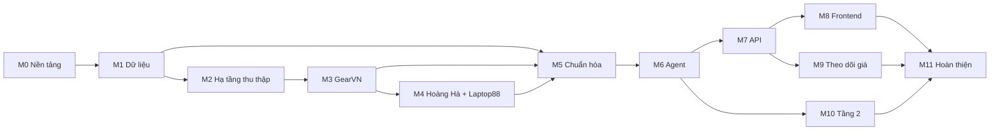

# 11. Lộ trình và backlog

> Phiên bản 1.0 · 2026-10-16 · Nguồn sự thật về **việc cần làm**. Trạng thái hiện tại xem [PROGRESS.md](PROGRESS.md).

## 1. Cách làm việc (Scrum rút gọn cho 1 người + Claude Code)

- **Sprint 1 tuần**, mỗi sprint gắn với 1–2 milestone (bảng mục 3).
- **Một milestone = một nhánh git = một kế hoạch** (một hoặc vài phiên Claude Code, `/clear` giữa hai task nếu cần). Tên nhánh: `milestone/M2-scrape-infra`. Mỗi task ít nhất một commit.
- **Vòng lặp mỗi milestone** (chi tiết trong [CLAUDE.md](../CLAUDE.md)):
  `/next` → Plan mode → `/plan-task <M>` → [code + test → `/done <task>`] × N → `/check` → `/review <M>` → sửa → `qa-tester` → `/done <M>`.
- **Review và QA chỉ chạy một lần, cuối milestone**, trên toàn bộ diff. Cùng lúc cập nhật sơ đồ trong docs nếu kiến trúc thực tế khác thiết kế, rồi `/clear`.
- **Thay đổi quyết định lớn** (thư viện, schema, phạm vi) → ghi ADR mới trong `docs/adr/`.
- **Việc phát sinh** → thêm task mới vào cuối milestone liên quan với ID kế tiếp (ví dụ T2.7), ghi "Phát sinh từ T2.6".

Trạng thái: ⬜ Chưa làm · 🔄 Đang làm · ✅ Xong · ⛔ Bị chặn (ghi lý do trong PROGRESS.md).
Ước lượng: S ≈ ½ ngày · M ≈ 1 ngày · L ≈ 2 ngày (thời gian làm cùng Claude Code, ước lượng thô).

## 2. Definition of Done

**Task** được đánh ✅ (trong lượt milestone) khi:

1. Mọi mục "Xong khi" của task đã đạt và kiểm chứng được (lệnh, test hoặc ảnh chụp).
2. Code mới có test; test liên quan xanh.
3. Tài liệu liên quan đã cập nhật nếu hành vi khác thiết kế (docs, `.env.example`, OpenAPI).
4. Đã commit theo quy ước `feat(T2.6): …` / `fix(T…)` / `test(T…)` / `docs(T…)`.

**Milestone** được đánh ✅ khi **tất cả** đúng:

1. Mọi task trong lượt đã ✅ (task bị chặn/hoãn có lý do trong PROGRESS).
2. `make check` xanh (lint, type, test backend + frontend); coverage không giảm dưới ngưỡng ở [09 §5](09-testing-strategy.md#5-ngưỡng-chất-lượng-cổng-ci).
3. Subagent `code-reviewer` (soát cả milestone) không còn vấn đề mức "Phải sửa".
4. Subagent `qa-tester` đã chạy; bug đã sửa hoặc thành task mới.
5. `docs/PROGRESS.md` đã cập nhật.

## 3. Lộ trình

| Sprint (tuần) | Milestone | Kết quả trình diễn được |
| --- | --- | --- |
| 1 | M0 Nền tảng · M1 Dữ liệu | App rỗng chạy được, CI xanh, DB có dữ liệu seed |
| 2 | M2 Hạ tầng thu thập | Thu thập mock-shop có phân trang + captcha giả + HITL |
| 3 | M3 GearVN | Dữ liệu thật từ GearVN cho 4 nhóm |
| 4 | M4 Hoàng Hà + Laptop88 | 3 nguồn lõi |
| 5 | M5 Chuẩn hóa & ghép | Cùng một mẫu laptop gom giá từ nhiều trang |
| 6 | M6 Agent | Hỏi bằng CLI/test, nhận bảng kết quả đúng; báo cáo eval đầu tiên |
| 7 | M7 API | Toàn bộ chức năng qua REST + SSE |
| 8–9 | M8 Frontend | Ứng dụng web hoàn chỉnh luồng chính |
| 10 | M9 Theo dõi giá · M10 Tầng 2 · M11 Hoàn thiện | Cảnh báo giá, tìm nhóm khác, Docker, báo cáo eval cuối |
| (nếu còn) | X Mở rộng | Điện thoại |

## 4. Backlog chi tiết

### M0 — Nền tảng

| ID | Task | Phụ thuộc | Ước lượng | Trạng thái |
| --- | --- | --- | --- | --- |
| T0.1 | Scaffold backend | – | S | ✅ |
| T0.2 | Scaffold frontend | – | M | ✅ |
| T0.3 | Makefile, git, CI | T0.1, T0.2 | S | ✅ |
| T0.4 | Đọc điều khoản sử dụng các nguồn | – | S | ✅ |
| T0.5 | Hoàn thiện nền frontend (phát sinh từ T0.2) | T0.2 | S | ✅ |
| T0.6 | Chặn mạng thật trong test: asyncio/httpx trên Windows và DNS (phát sinh từ QA M0) | T0.1 | S | ✅ |
| T0.7 | Kiểm tra miền giá trị của cấu hình (phát sinh từ QA M0) | T0.1 | S | ✅ |
| T0.8 | Định dạng lỗi chuẩn `{"error": {...}}` và handler chung (phát sinh từ QA M0) | T0.1 | M | ✅ |
| T0.9 | Vá handler lỗi: `details` không serialize được, thông điệp tiếng Anh (phát sinh từ QA M0 lần hai) | T0.8 | S | ⬜ |

**T0.1 Scaffold backend** — Tài liệu: [03 §6–7](03-architecture.md#6-cấu-trúc-thư-mục-mục-tiêu-sau-m0)
Xong khi:
- `backend/pyproject.toml` quản lý bằng uv, Python ≥ 3.11; phụ thuộc: fastapi, uvicorn, pydantic-settings, sqlmodel, alembic, psycopg[binary] (v3), httpx, selectolax, beautifulsoup4, langchain (+ provider Google), apscheduler, rapidfuzz; dev: pytest, pytest-asyncio, pytest-cov, respx, time-machine, ruff, mypy. **Khóa phiên bản** đã kiểm tra trên Context7.
- Cấu trúc thư mục `app/` đúng 03 §6 (các package rỗng có `__init__.py`).
- `app/config.py` đọc mọi biến trong `.env.example` (gồm `DATABASE_URL`, `TEST_DATABASE_URL` dạng `postgresql+psycopg://`); `app/main.py` app factory; `GET /api/health` trả đúng schema ở [07 §3.1](07-api-spec.md#31-hệ-thống).
- Cấu hình ruff (line 100), mypy strict cho `app/`, pytest (asyncio auto, marker `live`, `slow`, mặc định bỏ `live`), fixture chặn mạng trong `conftest.py`.
- Test: `test_health.py` pass.

**T0.2 Scaffold frontend** — Tài liệu: [08](08-ui-ux.md)
Xong khi:
- Vite + React + TypeScript strict; Tailwind; shadcn/ui khởi tạo với token ở 08 §5 (sáng/tối); font Be Vietnam Pro; lucide-react.
- React Router với các route ở 08 §2 (trang giữ chỗ); layout có thanh điều hướng.
- TanStack Query provider; `src/api/client.ts` đọc `VITE_API_BASE_URL` (gốc máy chủ, client tự thêm `/api`); `vite.config.ts` đặt `envDir: '..'` để dùng `.env` ở thư mục gốc.
- ESLint + Prettier; Vitest + Testing Library + MSW; Playwright cài đặt cấu hình (chưa có test).
- Test: render layout và điều hướng giữa 2 route.

**T0.3 Makefile, git, CI** — Tài liệu: [09 §6](09-testing-strategy.md#6-lệnh), [10 §5](10-deployment.md#5-ci-github-actions-githubworkflowsciyml)
Xong khi:
- `docker-compose.yml` có service `db` (`postgres:17`, volume `pgdata`, healthcheck `pg_isready`, đọc `POSTGRES_*` từ `.env`) và `docker/postgres/init/` tạo database `product_buyer_test` ([ADR-0007](adr/0007-postgresql.md), [10 §4](10-deployment.md#4-docker-compose)).
- Makefile có: `db-up` (chờ healthcheck), `db-down`, `setup` (gọi `db-up` trước), `dev`, `worker`, `mock-shop`, `check`, `test-be`, `test-fe`, `e2e`, `eval`, `test-live`, `scrape`, `seed`, `gen-api`, `migrate`. Biến: `scrape` nhận `SITE`, `CAT`, `PAGES`; `seed` nhận `FIXTURE` (dev/eval/e2e); `eval` nhận `CASES` (danh sách id, tùy chọn). Mỗi target có dòng mô tả; `make help` liệt kê.
- `git init`, nhánh `main`, commit đầu.
- `.github/workflows/ci.yml` chạy job backend (có service `postgres:17`) và frontend như 10 §5.
- `make check` chạy xanh từ máy sạch sau `make setup`.

**T0.4 Đọc điều khoản sử dụng** — Tài liệu: [02 §6](02-scope-and-sources.md#6-rủi-ro)
Xong khi:
- Với GearVN, Hoàng Hà, Laptop88, Viettel Store, Nguyễn Kim: tạo `docs/sources/<site>.md` từ mẫu, điền mục 1 (robots.txt đọc lại) và mục 2 (link điều khoản, trích nguyên văn đoạn liên quan đến thu thập tự động nếu có).
- Kết luận từng trang: Được dùng / Không dùng / Cần hỏi giảng viên. **Người dùng duyệt kết luận** trước khi làm M3.
- Trang "Không dùng" → cập nhật 02 và ghi ADR.

**T0.5 Hoàn thiện nền frontend** — Phát sinh từ review T0.2 (mục "Gợi ý", làm khi tiện, trước T8.1).
Xong khi:
- `QueryClient` chỉ retry khi `ApiError.status` là 0 hoặc ≥ 500 (không retry 4xx); có test.
- Tiếp cận: liên kết "Bỏ qua tới nội dung" + `id` cho `<main>`, `document.title` theo route, thêm `eslint-plugin-jsx-a11y`.
- Playwright: `server.strictPort` ở `vite.config.ts`, `reuseExistingServer: !process.env.CI`, thêm `e2e/` vào tsconfig khi có spec; tách `tsconfig.test.json` để kiểu `vitest/globals` không lọt vào mã chạy thật.
- `ApiError` giữ `details` khi cần lỗi theo trường; xem lại tương phản `Button` variant `default` khi hover (`hover:bg-primary/80`, chỉ đạt 3.76:1 → đã thay bằng token `--primary-hover`).
- `tabular-nums` cho cột giá: Tailwind v4 có sẵn class này, không cần thêm lớp tiện ích; T8.3 chỉ việc dùng.
- (`gen:api` + `openapi-typescript` thuộc T7.5; coverage frontend khi 09 §5 đặt ngưỡng.)

**T0.6 Chặn mạng thật trong test (Windows + DNS)** — Phát sinh từ QA M0 (lỗi 1). Tài liệu: [09 §4](09-testing-strategy.md#4-cấu-hình-pytest). Làm **trước T2.1** (Fetcher dùng `httpx.AsyncClient`).
Xong khi:
- Trên Windows, fixture chặn mạng trong `backend/tests/conftest.py` cũng chặn kết nối asyncio (ProactorEventLoop dùng `ConnectEx`, không đi qua `socket.connect`), ví dụ đổi sang `WindowsSelectorEventLoopPolicy` hoặc vá `loop.sock_connect`/`create_connection`; hoặc chặn ở tầng transport mặc định của `httpx`.
- Chặn cả phân giải DNS (`socket.getaddrinfo`, `loop.getaddrinfo`) cho tên không thuộc danh sách cho phép (`localhost`, máy chủ DB test); có test mới cho DNS (QA M0 chưa viết vì sẽ gọi DNS thật khi chưa sửa).
- Gỡ `_WINDOWS_ASYNC_GAP` (xfail strict, chỉ trên `win32`) khỏi `test_asyncio_connection_to_disallowed_loopback_port_is_blocked` và `test_httpx_async_request_to_disallowed_loopback_port_is_blocked` trong `backend/tests/unit/test_network_guard_edge.py`; hai test xanh thật trên Windows và Linux/CI.
- Test dùng DB thật (libpq không đi qua socket Python) vẫn xanh; `make check` xanh.

**T0.7 Kiểm tra miền giá trị của cấu hình** — Phát sinh từ QA M0 (lỗi 2). Tài liệu: [02 §3](02-scope-and-sources.md), `.env.example`.
Xong khi:
- `app/config.py` ràng buộc miền bằng `Field(ge=..., le=...)` và `allow_inf_nan=False`: `SCRAPER_MIN_DELAY_SECONDS ≥ 0` (hữu hạn), `SCRAPER_TIMEOUT_SECONDS > 0`, `SCRAPER_MAX_RETRIES ≥ 0`, `SCRAPER_MAX_LISTING_PAGES ≥ 1`, `AGENT_MAX_STEPS ≥ 1`, `POSTGRES_PORT` và `SMTP_PORT` trong 1..65535; `SCRAPER_USER_AGENT` sau `strip()` không rỗng (quy tắc User-Agent trung thực).
- Gỡ `xfail(strict=True)` khỏi `test_out_of_range_numeric_setting_is_rejected` (10 ca) và `test_whitespace_only_user_agent_is_rejected` trong `backend/tests/unit/test_config_edge.py`; các test cấu hình cũ vẫn xanh.
- Mặc định trong `Settings` và `.env.example` vẫn khớp nhau và nằm trong miền hợp lệ.

**T0.8 Định dạng lỗi chuẩn và handler chung** — Phát sinh từ QA M0 (lỗi 6). Tài liệu: [07 §1–2](07-api-spec.md#1-quy-ước). Các task T7.* dựa vào task này khi kiểm tra "mã lỗi đúng bảng §2".
Xong khi:
- `app/domain/errors.py` có lỗi miền (mã, HTTP status, thông điệp tiếng Việt, `details`) theo bảng mã ở 07 §2; handler đăng ký trong app factory trả `{"error": {"code", "message", "details"}}` cho: lỗi miền, `HTTPException`/Starlette (404 và 405 của route lạ), `RequestValidationError` → `VALIDATION_ERROR` 422 với `details` theo trường, và `Exception` → `INTERNAL_ERROR` 500 không lộ stack trace hay chuỗi bí mật.
- Nếu cần mã chung cho 404/405 của route lạ thì bổ sung vào 07 §2 (không đoán ngầm trong code).
- OpenAPI mô tả schema lỗi dùng chung để T7.5 sinh kiểu.
- Gỡ `xfail(strict=True)` khỏi `test_unknown_path_uses_documented_error_envelope` (2 ca) trong `backend/tests/unit/test_api_edge.py`; thêm test cho 422 (có `details`), 500 (không lộ chi tiết) và 405.
- Nhánh dự phòng `{detail}` trong `apiFetch` có thể giữ nguyên; `GET /api/health` vẫn đúng 07 §3.1.

**T0.9 Vá handler lỗi** — Phát sinh từ QA M0 lần hai (lỗi 1 và 2). Không chặn M1; làm trước khi service đưa thời gian vào `details` (M2 trở đi: `SITE_COOLDOWN`, `DUPLICATE_ALERT`, M9).
Xong khi:
- `_error_response` trong `backend/app/api/errors.py` mã hóa `details` bằng `jsonable_encoder` (hoặc `AppError` ép giá trị JSON), nên `SiteCooldown(details={"retry_after": datetime})` vẫn trả 409 `SITE_COOLDOWN`, không thành 500; `SecretStr` trong `details` không bị lộ.
- Nhánh `HTTP_<status>` dùng thông điệp tiếng Việt chung (`custom or _GENERIC_HTTP_MESSAGE`) khi `HTTPException` không có thông điệp riêng khác cụm chuẩn: `HTTPException(403)` và `HTTPException(400, detail=None)` không còn ra "Forbidden"/"Bad Request".
- Gỡ `xfail(strict=True)` khỏi `test_app_error_with_datetime_or_set_details_keeps_its_own_status` (2 ca) và `test_http_exception_without_own_message_gets_the_vietnamese_generic_message` (2 ca) trong `backend/tests/unit/test_error_envelope_m0b.py`.
- Nếu `AppError` có `status_code` 204/304 thì handler không gắn thân (hiện chưa lớp nào dùng; chỉ cần test khi thêm lớp).

### M1 — Dữ liệu

| ID | Task | Phụ thuộc | Ước lượng | Trạng thái |
| --- | --- | --- | --- | --- |
| T1.1 | Enum + DTO miền | T0.1 | S | ✅ |
| T1.2 | Model SQLModel + Alembic | T1.1 | M | ✅ |
| T1.3 | Khung specs + `gpu_rank` | T1.1 | S | ✅ |
| T1.4 | Repositories | T1.2 | M | ✅ |
| T1.5 | Seed script + dữ liệu seed hư cấu | T1.4, T1.3 | M | ✅ |
| T1.6 | Chặn giá trị PostgreSQL không lưu được ở `OfferUpsert`/`ProductQuery` (phát sinh từ QA M1) | T1.4 | S | ✅ |
| T1.7 | Seed: file JSON hỏng/sai mã hóa báo `SeedDataError` gọn (phát sinh từ QA M1) | T1.5 | S | ⬜ |
| T1.8 | `normalize_gpu_name`: chữ số ASCII, hậu tố `XTX`, dạng Unicode (phát sinh từ QA M1) | T1.3 | S | ⬜ |

**T1.1** — [04 §4, §6](04-data-model.md#4-enum). Xong khi: mọi enum và DTO có trong `app/domain/`; test validate (`QueryIntent.limit` 1..20, `SpecFilter.op` hợp lệ, URL chuẩn).
**T1.2** — [04 §2–3](04-data-model.md#2-sơ-đồ-quan-hệ-erd). Ghi chú từ review T1.1: URL trong DTO là `HttpUrl`, ghi cột bằng `str(url)`; giá nên là `BIGINT` hoặc có `CHECK` cận trên vì DTO chưa chặn giá quá lớn. Xong khi: 12 bảng như ERD, ràng buộc và chỉ mục đúng §3; migration đầu tiên; test `alembic upgrade head` trên DB PostgreSQL rỗng; cột JSON là `JSONB` (GIN trên `product.specs`), enum là `VARCHAR` + `CHECK`, thời gian `TIMESTAMP WITH TIME ZONE`, unique một phần cho `product` ([ADR-0007](adr/0007-postgresql.md)); `conftest.py` có fixture session PostgreSQL rollback mỗi test ([09 §4](09-testing-strategy.md#4-cấu-hình-pytest)).
**T1.3** — [04 §5](04-data-model.md#5-khung-thông-số-theo-nhóm-pydantic). Xong khi: 4 model specs (+ `PhoneSpecs`), danh sách trường bắt buộc mỗi nhóm, `gpu_rank()` với bảng khởi tạo; test thứ tự hạng và chuẩn hóa tên GPU (`"GeForce RTX4060 8GB"` → `RTX 4060`).
**T1.4** — Xong khi: repository cho Product, Offer (upsert theo `url`), PriceHistory (luật thêm dòng §3), ScrapeRun, ShoppingList, PriceAlert, Conversation/Message, AgentRun, các cache; truy vấn lọc theo specs JSON (toán tử JSONB của SQLAlchemy, không SQL thô); upsert offer bằng `INSERT … ON CONFLICT (url)`; test trên PostgreSQL test, gồm ca luật thêm lịch sử giá.
**T1.5** — [09 §3](09-testing-strategy.md#3-dữ-liệu-test). Xong khi: `scripts/seed.py --fixture dev|eval|e2e`; dữ liệu hư cấu (tên có chữ "Mock"), ≥ 30 laptop, ≥ 10 mỗi nhóm phụ kiện, phủ đủ các câu trong `docs/eval/queries.yaml`; một số sản phẩm có offer ở 2–3 trang và có lịch sử giá 30 ngày.

**T1.6** — Phát sinh từ QA M1 (lỗi 1, 2); làm trước T2.6 (lỗi tại đây làm hỏng cả transaction của lượt thu thập thay vì tính vào `items_failed`). Xong khi:
- `OfferUpsert` ném `ValidationError` (không để PostgreSQL ném `DataError`/`OperationalError`) cho: `url` > 2.704 byte (khớp giới hạn btree của UNIQUE, thống nhất với 2.000 ký tự của `clean_url` ở T2.5), ký tự NUL trong `title`/`raw_specs`, giá hoặc `list_price` vượt cận trên `BIGINT` (cận trên đặt ở kiểu `Vnd`).
- `ProductQuery` (`price_min`, `price_max`, `offset`) và `SpecFilter.value` có cận trên: `search` không ném `DataError` ("bigint out of range", tức HTTP 500) với số nguyên khổng lồ.
- Gỡ `xfail(strict=True)` khỏi `test_offer_upsert_rejects_values_postgres_cannot_store_with_validation_error` (4 ca, `test_repo_offers_m1.py`) và `test_search_with_integers_beyond_bigint_is_rejected_or_answered_not_crashed` (4 ca, `test_repo_products_m1.py`).
**T1.7** — Phát sinh từ QA M1 (lỗi 6). Xong khi: `load_extras`/`load_catalog` đọc bằng `utf-8-sig` (BOM do Notepad lưu), bắt `JSONDecodeError`/`UnicodeDecodeError` và ném `SeedDataError` nêu tên file; `main()` trả mã 1 với thông báo gọn, không in traceback. Gỡ `xfail` của 3 test trong `test_seed_m1.py` (`test_broken_extras_file_is_reported_as_seed_data_error_or_loaded`, `test_category_file_with_wrong_encoding_is_reported_as_seed_data_error`, `test_main_returns_exit_code_1_for_malformed_extras_file`).
**T1.8** — Phát sinh từ QA M1 (lỗi 7, 8). Xong khi: `normalize_gpu_name` chỉ trả tên chuẩn có chữ số ASCII (`[0-9]` hoặc NFKC trước khi so khớp; `"RTX ４０６０"` → `RTX 4060`); `"RX 7900 XTX"` giữ hậu tố `XTX` (hoặc từ chối tường minh, ghi vào docs/04 §5.6); kết quả không đổi giữa NFC/NFKC/NFKD của cùng đầu vào (`™` không thành `TM` dính liền). Gỡ `xfail` trong `test_gpu_rank_m1.py` (các test `…_only_ascii_canonical_names`, `…_does_not_drop_letters_of_a_suffix`, `…_does_not_change_the_result[NFKC|NFKD]`). Cân nhắc cùng lúc thêm RTX 3070, 3070 Ti, 3080 vào bảng hạng (laptop cũ còn bán; hiện `gpu_rank = null` nên bị loại khỏi "RTX 4060 trở lên"), nếu thêm thì cập nhật §5.6 và test thứ tự.

### M2 — Hạ tầng thu thập

| ID | Task | Phụ thuộc | Ước lượng | Trạng thái |
| --- | --- | --- | --- | --- |
| T2.1 | Fetcher (robots, độ trễ, retry, offline, raw cache) + `scripts/fetch_page.py` | T0.1, T0.6, T2.2 | M | ⬜ |
| T2.2 | BaseScraper, SiteConfig, registry, ChallengeDetector | T1.1 | S | ✅ |
| T2.3 | Mock-shop | T0.1 | M | ⬜ |
| T2.4 | MockShopScraper | T2.2, T2.3 | S | ⬜ |
| T2.5 | Chuẩn hóa cơ bản: giá, URL, hãng | T1.1 | S | ⬜ |
| T2.6 | Pipeline + `scrape_service` + vòng đời ScrapeRun + HITL + `make scrape` | T1.4, T2.1, T2.4, T2.5 | L | ⬜ |

**T2.1** — [06 §3](06-scraping-design.md#3-fetcher). Xong khi: test với `respx`: URL bị robots chặn không gửi request; độ trễ thực tế ≥ cấu hình (đồng hồ giả); 2 domain chạy song song không chờ nhau; retry 5xx với backoff; 403 không retry; 429 tôn trọng `Retry-After`; offline mode chặn domain thật; robots.txt không tải được → không cho phép; mock-shop dùng `MOCK_SHOP_DELAY_SECONDS`, không jitter; theo hợp đồng `PageFetcher` ([06 §4](06-scraping-design.md#4-phát-hiện-challenge-và-chặn)): trả response cho 403/429, ném lỗi cho mọi 4xx/5xx khác và cho chuyển hướng ra ngoài domain hoặc tới URL robots chặn. `scripts/fetch_page.py --site --url --out [--allow-online]` lưu một trang qua Fetcher ([06 §8](06-scraping-design.md#8-fixtures)). **Việc dồn từ QA M0 lần hai (lỗi 3–5, Fetcher là nơi chúng có tác động thật):** (a) vá thêm `socket.socket.sendto` và `BaseProactorEventLoop.sock_sendto` trong `backend/tests/conftest.py` cùng `gethostbyaddr`/`getnameinfo`/`getfqdn`, rồi gỡ `xfail` của `test_udp_sendto_to_a_disallowed_address_is_blocked`, `test_asyncio_udp_sock_sendto_to_a_disallowed_address_is_blocked` và `test_hostname_lookup_through_gethostbyaddr_or_getfqdn_is_blocked` trong `test_network_guard_m0b.py`; (b) `SCRAPER_USER_AGENT` từ chối ký tự điều khiển (NUL, BEL, DEL, CR/LF) và chuỗi chỉ gồm ký tự độ rộng 0 (U+200B) ngay lúc khởi động, rồi gỡ `xfail` của `test_user_agent_with_control_or_invisible_only_content_is_rejected_at_startup` trong `test_config_m0b.py` (h11 hiện chỉ báo `LocalProtocolError` ở request đầu tiên).
**T2.2** — [06 §2, §4](06-scraping-design.md#2-giao-diện-basescraper). Xong khi: lớp trừu tượng và registry; `ChallengeDetector` có test cho từng dấu hiệu (403, 429, từ khóa captcha, soft block).
**T2.3** — [06 §5](06-scraping-design.md#5-mock-shop-appmock_shop). Xong khi: mọi endpoint trong bảng; dữ liệu 60 sản phẩm hư cấu; test phân trang, captcha sau N request, đáp án đúng/sai, chế độ lỗi.
**T2.4** — Xong khi: scraper mock-shop parse danh sách (JSON-LD + HTML), chi tiết, tìm kiếm; fixture lưu từ mock-shop; test parser.
**T2.5** — [04 §7](04-data-model.md#7-quy-tắc-chuẩn-hóa). Xong khi: `parse_price` (gồm giá bị che → None), `clean_url`, `detect_brand`; ≥ 20 ca test tham số hóa. Từ review T1.2: `clean_url` nên từ chối URL quá dài (> 2000 ký tự) vì `offer.url` có UNIQUE (btree lỗi với khóa > ~2,7 KB). Từ review T1.1: `clean_url` bỏ cả userinfo (`user:pw@`) và fragment, vì `HttpUrl` ở DTO chấp nhận chúng; `parse_price` trả `int` (DTO không nhận chuỗi/float).
**T2.6** — [06 §7](06-scraping-design.md#7-pipeline-appscraperspipelinepy), [03 §5.2](03-architecture.md#52-thu-thập-định-kỳ). Xong khi: test integration chạy pipeline với mock-shop (ASGI transport): lượt đầy đủ → `SUCCEEDED` với số liệu đúng; gặp captcha → `NEEDS_HUMAN` → `resume(answer)` → `SUCCEEDED`; lỗi một item → `items_failed` tăng, lượt không dừng; giá đổi → thêm `PriceHistory` và trả `offer_id`; trang thật bị chặn → `BLOCKED` và tạm nghỉ 24 giờ; `make scrape SITE=mockshop CAT=laptop` chạy được. Từ review T1.4: `OfferRepository.upsert` ghi đè cả `None`/`{}` nên pipeline phải gộp `raw_specs`/`rating` (từ trang chi tiết) trước khi gọi; repo đồng bộ nên bọc `asyncio.to_thread`; pipeline sở hữu transaction (repo không commit). Từ QA M1: bọc savepoint cho từng mục để lỗi lưu một mục chỉ tính vào `items_failed`; kiểm giá 0 (repo chấp nhận, sẽ đứng đầu `price_asc`; `parse_price` của T2.5 phải trả `None` khi < 10.000); mỗi (site, category) chỉ một lượt vì `record_snapshot` không khóa.

### M3 — GearVN

| ID | Task | Phụ thuộc | Ước lượng | Trạng thái |
| --- | --- | --- | --- | --- |
| T3.1 | Khảo sát GearVN + fixtures | T0.4, T2.1 | M | ⬜ |
| T3.2 | GearVNScraper | T3.1 | M | ⬜ |
| T3.3 | Chạy thật có kiểm soát | T3.2, T2.6 | S | ⬜ |

**T3.1** — Dùng skill `add-scraper` (Pha A). Xong khi: `docs/sources/gearvn.md` điền đủ mục 3–7; URL danh mục 4 nhóm; quyết định `requires_js`; fixtures theo [06 §8](06-scraping-design.md#8-fixtures).
**T3.2** — Xong khi: parse danh sách 4 nhóm, chi tiết, tìm kiếm; test trên fixture; coverage module ≥ 90%.
**T3.3** — **Người dùng tự bật** `SCRAPER_OFFLINE_ONLY=false`. Xong khi: `make scrape SITE=gearvn CAT=<nhóm> PAGES=1` cho 4 nhóm đều `SUCCEEDED`; tỷ lệ parse ≥ 90%; ghi kết quả vào `docs/sources/gearvn.md`.

### M4 — Hoàng Hà + Laptop88

| ID | Task | Phụ thuộc | Ước lượng | Trạng thái |
| --- | --- | --- | --- | --- |
| T4.1 | Khảo sát Hoàng Hà + fixtures | T0.4, T2.1 | S | ⬜ |
| T4.2 | HoangHaScraper (ánh xạ `price_type`) | T4.1, T2.2 | M | ⬜ |
| T4.3 | Khảo sát Laptop88 + fixtures (không dùng Playwright MCP/WebFetch, xem [06 §8](06-scraping-design.md#8-fixtures)) | T0.4, T2.1 | S | ⬜ |
| T4.4 | Laptop88Scraper | T4.3, T2.2 | M | ⬜ |
| T4.5 | Chạy thật có kiểm soát 2 nguồn | T4.2, T4.4, T2.6 | S | ⬜ |

**T4.2** — Xong khi: phân biệt giá niêm yết, giá hiện tại, giá thành viên, flash sale (giá bị che → không lưu); test cho từng loại. Xác minh Hoàng Hà có bán chuột/bàn phím/tai nghe hay không và ghi vào 02 §1.
**T4.4** — Xong khi: `min_delay_s=10`, `supports_live_search=False`; không tạo URL có `specMap`/`filter`; đọc thông số rút gọn trên thẻ; test 4 nhóm.

### M5 — Chuẩn hóa & ghép mẫu

| ID | Task | Phụ thuộc | Ước lượng | Trạng thái |
| --- | --- | --- | --- | --- |
| T5.1 | Bộ trích xuất thông số theo luật (4 nhóm) + golden test | T1.3, T3.2, T4.2, T4.4 | L | ⬜ |
| T5.2 | Trích `model_code` + matcher + golden pairs | T5.1 | M | ⬜ |
| T5.3 | LLM dự phòng + cache | T5.1, T6.1 | M | ⬜ |

**T5.1** — Xong khi: golden ≥ 40 laptop, ≥ 15 mỗi phụ kiện, lấy từ tiêu đề thật trong fixture; độ chính xác trường bắt buộc ≥ 95% trên golden.
**T5.2** — Xong khi: ≥ 30 cặp golden (nên ghép / không nên ghép); 0 ghép sai trên golden; test idempotent (chạy lại pipeline không tạo product trùng).
**T5.3** — Phụ thuộc T6.1 nằm ở M6 nhưng T6.1 chỉ cần T0.1, nên khi lập lượt M5 cần làm T6.1 trước hoặc hoãn T5.3 sang lượt M6. Bật/tắt bằng `LLM_EXTRACTOR_ENABLED`. Xong khi: chỉ gọi khi thiếu trường bắt buộc; kết quả validate bằng khung specs; cache theo hash; test với model giả; ghi số lần gọi vào log.

### M6 — Agent

| ID | Task | Phụ thuộc | Ước lượng | Trạng thái |
| --- | --- | --- | --- | --- |
| T6.1 | LLM factory + `ScriptedChatModel` | T0.1 | S | ⬜ |
| T6.2 | Services: catalog, compare, shopping_list, alert (CRUD) | T1.4 | M | ⬜ |
| T6.3 | Planner + prompt | T6.1, T1.1 | M | ⬜ |
| T6.4 | 8 tool | T6.2 | M | ⬜ |
| T6.5 | Executor + sự kiện + guardrail + bộ nhớ hội thoại | T6.3, T6.4 | L | ⬜ |
| T6.6 | Eval harness + báo cáo cơ sở | T6.5, T1.5 | M | ⬜ |

**T6.1** — [05 §2](05-agent-design.md#2-mô-hình-và-cấu-hình). Xong khi: `get_chat_model(role)` cho gemini/openai/fake; tra Context7 cho API LangChain hiện hành và ghi phiên bản; `ScriptedChatModel` phát chuỗi tool call định sẵn.
**T6.2** — Xong khi: `catalog_service.search(QueryIntent-like filters)` lọc đúng theo specs JSON và giá hiệu lực (§4 `effective_price` ở 04); `stale` khi dữ liệu > 24 giờ; test với seed. Từ review T1.4: service kiểm `quantity ≥ 1` và đổi lỗi ràng buộc thành lỗi miền; `ProductRepository.search` đã có lọc giá/trang/specs, service chỉ ánh xạ `relevance`/từ khóa và `stale`. **Việc dồn từ QA M1 (cần quyết định thiết kế, xfail ở `*_m1.py`):** (a) chuẩn hóa `strip`+`lower` cho `destination` email khi tạo/tìm cảnh báo (`find_live` đang coi `Mock@Example.com` và `mock@example.com ` là hai người nhận, gửi trùng; test `test_find_live_treats_email_variants_of_one_mailbox_as_the_same_destination`); (b) kiểm `preferred_offer_id` thuộc đúng `product_id` (`test_add_item_rejects_preferred_offer_of_another_product`); (c) chuẩn hóa tên danh sách về NFC (`test_get_by_name_matches_vietnamese_name_in_either_unicode_form`); (d) quyết định xử lý offer hết hàng trong `search` (hiện vẫn tính vào `min_price`/`offers_count`); (e) bọc đầu vào repository: `limit < 0`, `quantity` > int32, `now` naive; `update_item` chưa xóa được `note`.
**T6.3** — [05 §4](05-agent-design.md#4-prompt). Ghi chú từ review T1.1: cân nhắc `extra="forbid"` và `validate_assignment=True` cho `QueryIntent`/`SpecFilter` (tên trường LLM gõ sai hiện bị bỏ qua im lặng); chỉ bật sau khi tra Context7 xem schema `additionalProperties: false` có chạy với Gemini structured output, kèm retry khi validate lỗi. Xong khi: prompt trong `prompts/planner.md`; test với model giả cho phần chuyển đổi hậu xử lý (ví dụ chuẩn hóa tiền, map GPU → rank); test snapshot prompt.
**T6.4** — [05 §3](05-agent-design.md#3-hợp-đồng-tool). Xong khi: 8 tool đúng hợp đồng; kết quả ≤ 4.000 ký tự; test từng tool với seed; `live_search_other` tạm trả `{"items": [], "sites_skipped": [...], "reason": "chưa bật tầng 2"}` cho đến M10.
**T6.5** — [05 §1, §5, §6](05-agent-design.md#5-guardrail-code-chạy-sau-executor). Xong khi: test kịch bản: câu hỏi chuẩn → `plan` → `tool_*` → `final`; id bịa bị loại; vượt bước; tool lỗi; tham chiếu "máy thứ 2"; không gọi tool ghi khi không được yêu cầu; hỏi lại khi mơ hồ.
**T6.6** — [05 §7](05-agent-design.md#7-đánh-giá-agent-eval). Xong khi: `make eval` chạy toàn bộ `queries.yaml` (đã bổ sung đủ ≥ 30 câu), xuất `reports/eval-<ngày>.md`; ghi kết quả cơ sở vào PROGRESS.md; nếu dưới ngưỡng → tạo task sửa prompt.

### M7 — API

| ID | Task | Phụ thuộc | Ước lượng | Trạng thái |
| --- | --- | --- | --- | --- |
| T7.1 | Products, categories, compare, price-history | T6.2 | M | ⬜ |
| T7.2 | Chat + SSE + conversations | T6.5 | M | ⬜ |
| T7.3 | Lists + alerts | T6.2 | S | ⬜ |
| T7.4 | Admin + challenge HITL | T2.6 | M | ⬜ |
| T7.5 | Sinh kiểu TypeScript từ OpenAPI | T7.1–T7.4, T0.2 | S | ⬜ |

Xong khi (chung): đúng [07](07-api-spec.md); mã lỗi đúng bảng §2; test integration cho mọi endpoint (thành công + ít nhất một lỗi); SSE test bằng client đọc luồng, gồm phát lại khi kết nối sau khi run xong.

### M8 — Frontend

| ID | Task | Phụ thuộc | Ước lượng | Trạng thái |
| --- | --- | --- | --- | --- |
| T8.1 | Token, layout, điều hướng, API client | T7.5 | M | ⬜ |
| T8.2 | Trang chính + chat + tiến trình agent (SSE) | T8.1 | L | ⬜ |
| T8.3 | Bảng kết quả + ngăn so sánh | T8.2 | L | ⬜ |
| T8.4 | Chi tiết sản phẩm + biểu đồ giá | T8.1 | M | ⬜ |
| T8.5 | Danh sách mua | T8.1 | M | ⬜ |
| T8.6 | Cảnh báo giá | T8.1 | M | ⬜ |
| T8.7 | Quản trị + hộp thoại challenge | T8.1 | M | ⬜ |
| T8.8 | E2E luồng chính | T8.2–T8.7 | M | ⬜ |
| T8.9 | Sửa `apiFetch`: hủy bằng lý do bất kỳ, thông điệp lỗi rỗng (phát sinh từ QA M0) | T0.5 | S | ⬜ |
| T8.10 | Sửa `NavBar`: `aria-current` trên trang không tìm thấy (phát sinh từ QA M0) | T8.1 | S | ⬜ |

Xong khi (chung): dùng skill `ui-screen`; đúng wireframe và trạng thái ở [08 §3–4](08-ui-ux.md#3-wireframe); test Vitest cho logic và trạng thái (tải/rỗng/lỗi); ảnh chụp màn hình sáng + tối, desktop + 375 px lưu vào `docs/ui/screens/`; người dùng duyệt ảnh.
**T8.8** — Xong khi: 4 luồng E2E: hỏi → bảng; so sánh; thêm vào danh sách; tạo cảnh báo; chạy với `LLM_PROVIDER=fake` + seed `e2e`. Lưu ý từ T0.5: `e2e/**/*.ts` đang nằm trong `tsconfig.node.json` (không có DOM lib); nếu spec dùng `window`/`document` trong `page.evaluate`, tách `tsconfig.e2e.json` có lib DOM.
**T8.9** — Phát sinh từ QA M0 (lỗi 3 và 4); làm trước T8.2 vì chat SSE và `useQuery` dùng chung `apiFetch`. Xong khi:
- `apiFetch` coi mọi lần hủy là hủy: khi `init.signal?.aborted` thì ném lại lỗi gốc, không đổi thành `ApiError(0, 'NETWORK_ERROR')` (nếu không `shouldRetry` sẽ thử lại một lần hủy, kể cả `controller.abort(new Error('…'))`).
- Khi `error.message` từ máy chủ là chuỗi rỗng thì dùng `strings.errors.unknown` để UI không hiện hộp lỗi trống.
- Gỡ hai `it.fails` trong `frontend/src/api/client.edge.test.ts` (test "abort kèm lý do tùy ý…" và "thông điệp lỗi từ máy chủ rỗng…") và để chúng xanh thật; `client.test.ts` cũ vẫn xanh.
**T8.10** — Phát sinh từ QA M0 (lỗi 5); làm cùng hoặc sau T8.1 vì T8.1 quyết định cách nav nổi ở `/c/:id` và `/products/:id` (docs/08 chưa nói rõ). Xong khi:
- `/alerts/x` và `/admin/anything` hiện trang không tìm thấy mà không mục nav nào có `aria-current="page"`: thêm `end: true` cho mục không có route con (`/alerts`, `/admin`), `/lists` giữ khớp tiền tố vì có `/lists/:id`.
- Quyết định cho `/c/:id` và `/products/:id` (nổi "Hỏi agent" hay không) được ghi vào docs/08 §2, và test `/products/42` trong `router.edge.test.tsx` khẳng định đúng quyết định đó.
- Gỡ `it.fails.each` trong `describe('NavBar · aria-current')` của `frontend/src/app/router.edge.test.tsx`.

### M9 — Theo dõi giá & vận hành

| ID | Task | Phụ thuộc | Ước lượng | Trạng thái |
| --- | --- | --- | --- | --- |
| T9.1 | Đánh giá cảnh báo + chống gửi trùng | T6.2, T2.6 | M | ⬜ |
| T9.2 | Notifier email + Telegram | T9.1 | S | ⬜ |
| T9.3 | Worker + lịch APScheduler | T2.6, T9.1 | M | ⬜ |
| T9.4 | Dockerfile + docker compose | T8.8 | M | ⬜ |

**T9.1** — Xong khi: test đúng tiêu chí US-07 ([01 §5](01-requirements.md#5-user-story-và-tiêu-chí-chấp-nhận)); cảnh báo `triggered` gửi lại chỉ khi giá xuống thấp hơn `last_notified_price` thêm ≥ 1%.
**T9.3** — Xong khi: job làm mới danh mục theo `CATALOG_REFRESH_CRON`, job làm mới offer đang được theo dõi theo `TRACKED_REFRESH_CRON` (chỉ trang chi tiết của offer có cảnh báo/danh sách), mỗi job chạy qua `scrape_service` (gọi pipeline rồi đánh giá cảnh báo, [03 §4](03-architecture.md#4-thành-phần-backend-c4-mức-3)); không chạy 2 lượt cùng (site, category); test với scheduler giả.

### M10 — Tầng 2 (nhóm khác)

| ID | Task | Phụ thuộc | Ước lượng | Trạng thái |
| --- | --- | --- | --- | --- |
| T10.1 | Khảo sát + parser tìm kiếm Viettel Store, Nguyễn Kim (GearVN đã có ở T3.2) | T0.4, T2.2 | M | ⬜ |
| T10.2 | `live_search_service` + cache 6 giờ | T10.1, T2.1 | M | ⬜ |
| T10.3 | Nối agent (planner tier 2, tool) + bảng tầng 2 ở frontend | T10.2, T6.5, T8.3 | M | ⬜ |

Xong khi: chỉ dùng trang có `supports_live_search=True`; tuần tự, đúng độ trễ; mỗi trang ≤ `limit_per_site` kết quả; nhãn "chưa chuẩn hóa"; test kịch bản "loa bluetooth dưới 1 triệu" với fixture.

### M11 — Hoàn thiện

| ID | Task | Phụ thuộc | Ước lượng | Trạng thái |
| --- | --- | --- | --- | --- |
| T11.1 | Eval cuối với LLM thật, chỉnh prompt đến khi đạt ngưỡng | M6–M10 | M | ⬜ |
| T11.2 | Cập nhật tài liệu theo code thực tế + README + sơ đồ | T11.1 | M | ⬜ |
| T11.3 | Diễn tập kịch bản demo ([10 §7](10-deployment.md#7-kịch-bản-demo-bảo-vệ-gợi-ý)) | T9.4 | S | ⬜ |

### X — Mở rộng (chỉ khi M0–M11 xong)

| ID | Task | Ước lượng | Trạng thái |
| --- | --- | --- | --- |
| X1 | Nhóm điện thoại: nâng Viettel Store và Nguyễn Kim thành trang lõi cho nhóm này ([02 §1](02-scope-and-sources.md#1-ma-trận-trang--nhóm-sản-phẩm)); `PhoneSpecs`, scraper Hoàng Hà/Viettel Store/Nguyễn Kim cho điện thoại, biến thể dung lượng | L | ⬜ |
| X2 | Đổi trang lõi nếu một nguồn bị loại ở T0.4 (gợi ý: FPT Shop, HACOM) | L | ⬜ |
| X3 | Xuất danh sách mua ra CSV / chia sẻ link | S | ⬜ |
